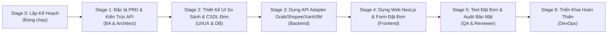

# 01-PLAN: KẾ HOẠCH TỔNG THỂ DỰ ÁN NỀN TẢNG GIAO HÀNG ĐA KÊNH

> **Dự án**: Nền Tảng Tích Hợp & Kết Nối Giao Hàng Đa Đơn Vị (ShopeeFood, Grab, Xanh SM, Ahamove, Be)  
> **Tên Mã Dự Án**: `FAST-SHIP-HUB` (Nền tảng Aggregator Vận Chuyển Toàn Diện)  
> **Người Lập Kế Hoạch**: `orchestrator` (Tổng Thầu)

---

## 1. TỔNG QUAN Ý TƯỞNG & BÀI TOÁN KINH DOANH
- **Ý tưởng**: Xây dựng nền tảng web trung gian (Delivery Aggregator) giúp chủ cửa hàng, doanh nghiệp bán lẻ và cá nhân chỉ cần vào 1 trang web duy nhất để:
  1. Nhập thông tin người gửi & người nhận.
  2. Hệ thống tự động so sánh giá cước & thời gian giao dự kiến giữa **Grab, ShopeeFood, Xanh SM (ô tô/xe máy điện), Ahamove, Be**.
  3. Chọn đơn vị tối ưu nhất (Rẻ nhất hoặc Nhanh nhất) và bấm "Đặt Giao Hàng".
  4. Hệ thống tự động đẩy đơn qua API của đối tác tương ứng, gọi tài xế đến lấy hàng.
  5. Theo dõi hành trình giao nhận (Tracking) thời gian thực trên 1 bản đồ tập trung.
  6. Quản lý đối soát tiền COD và ví thanh toán cước phí tập trung.

---

## 2. BỘ 8 CÂU HỎI LÀM RÕ TẠI STAGE 0 (ĐÃ THIẾT LẬP SẴN GIÁ TRỊ TỐI ƯU KHUYẾN NGHỊ)

Để bạn không phải suy nghĩ phức tạp, Tổng Thầu đã chọn sẵn các phương án tối ưu chuẩn công nghiệp. Nếu bạn đồng ý, hệ thống tự động chạy theo cấu hình này:

1. **Khách hàng mục tiêu chính**:
   - *Lựa chọn tối ưu*: Chủ shop online, nhà hàng/quán ăn nhỏ lẻ và cá nhân gửi hàng nội thành.
2. **Các hãng giao hàng tích hợp ở bản MVP đầu tiên**:
   - *Lựa chọn tối ưu*: **GrabExpress**, **ShopeeFood (Shopee Xpress Instant)**, **Xanh SM Delivery** (và cổng giả lập Sandbox để test).
3. **Cơ chế so sánh cước (Price Comparison)**:
   - *Lựa chọn tối ưu*: Tự động tính khoảng cách km bằng tọa độ bản đồ, gọi biểu phí của từng bên và hiển thị bảng so sánh xếp hạng: *Rẻ nhất*, *Nhanh nhất*, *Xanh/Thân thiện môi trường*.
4. **Mô hình thanh toán cước**:
   - *Lựa chọn tối ưu*: Ví cước trả trước (Top-up Wallet) nạp tiền qua QR Napas/Chuyển khoản hoặc thanh toán từng đơn.
5. **Theo dõi đơn hàng (Tracking)**:
   - *Lựa chọn tối ưu*: Trang tra cứu mã vận đơn công khai (không cần login) + Dashboard cho chủ shop xem định vị tài xế.
6. **Công nghệ phát triển cốt lõi**:
   - *Lựa chọn tối ưu*: Next.js 15 App Router, TypeScript, Tailwind CSS, PostgreSQL / Supabase, Prisma ORM.
7. **Xác thực người dùng**:
   - *Lựa chọn tối ưu*: Đăng nhập bằng Email/SĐT + Mật khẩu an toàn kèm xác thực phân quyền Role (Shop Owner vs Admin).
8. **Quyền quyết định công nghệ**:
   - *Lựa chọn tối ưu*: `AGENT DECIDE` — Đội ngũ AI tự động chọn giải pháp chuẩn bảo mật, nhanh, tiết kiệm nhất.

---

## 3. LỘ TRÌNH 6 BƯỚC TRIỂN KHAI DỰ ÁN

