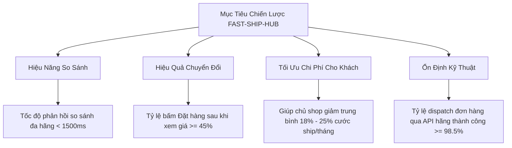
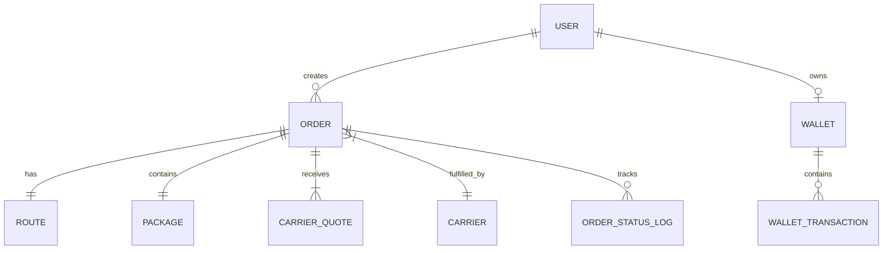
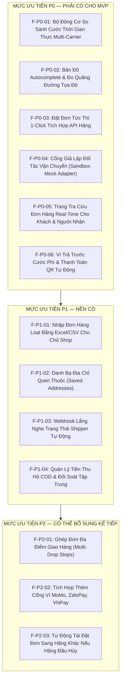

# TÀI LIỆU ĐẶC TẢ YÊU CẦU SẢN PHẨM (PRODUCT REQUIREMENTS DOCUMENT - PRD)

> **Tên sản phẩm**: Nền Tảng Tích Hợp & So Sánh Giao Hàng Đa Hãng (`FAST-SHIP-HUB`)  
> **Mã tài liệu**: `DOC-PRD-001` | **Phiên bản**: `1.0.0` | **Trạng thái**: `APPROVED_FOR_ARCHITECTURE`  
> **Tác giả**: `business-analyst` (Chuyên gia Phân tích Nghiệp vụ)  
> **Người tiếp nhận**: `system-architect` & Multi-Agent Engineering Team  

---

## 1. TỔNG QUAN & BỐI CẢNH DỰ ÁN (EXECUTIVE SUMMARY & BACKGROUND)

### 1.1. Bối cảnh thị trường
Thị trường giao hàng tức thì chặng cuối (On-Demand Last-Mile Delivery) tại Việt Nam đang bùng nổ mạnh mẽ với sự tham gia của nhiều ông lớn công nghệ: **GrabExpress**, **ShopeeFood / Shopee Xpress Instant**, **Xanh SM Delivery** (thuộc GSM / Vingroup với 100% xe máy/ô tô điện VinFast), **Ahamove** và **Be (beDelivery)**.

### 1.2. Vấn đề của người dùng (Problem Statement)
1. **Phân mảnh dịch vụ & Hao tổn thời gian**: Các chủ shop online, nhà hàng F&B và cá nhân thường xuyên phải chuyển đổi qua lại giữa 4 đến 5 ứng dụng trên điện thoại để tra cứu giá, tìm tài xế lúc cao điểm hoặc thời tiết xấu (mưa bão, kẹt xe).
2. **Chi phí cước biến động khôn lường**: Mỗi hãng áp dụng thuật toán Dynamic Pricing (tăng giá giờ cao điểm) theo khu vực và thời điểm khác nhau. Một lộ trình 5km có thể chênh lệch từ 15.000đ đến 35.000đ giữa các ứng dụng. Người gửi không có công cụ so sánh trực tiếp trong tích tắc.
3. **Quản lý & Theo dõi đơn hàng phân tán**: Khi một shop gửi 50 đơn/ngày qua 3 hãng khác nhau, việc theo dõi tài xế, kiểm tra xem đơn nào đã giao, đơn nào bị hủy hay khách từ chối nhận trở thành "cơn ác mộng" vận hành.
4. **Đối soát COD rườm rà**: Tiền thu hộ (Cash on Delivery) bị giữ ở nhiều ví đối tác khác nhau với lịch đối soát lệch nhau, gây đọng vốn lưu động của người bán.

### 1.3. Giải pháp sản phẩm: FAST-SHIP-HUB
**FAST-SHIP-HUB** là nền tảng Web Aggregator thông minh, đóng vai trò như một **"Skyscanner / Google Flights cho ngành Giao nhận tức thì"**:
- **Nhập dữ liệu 1 lần**: Người gửi chỉ cần nhập địa chỉ lấy hàng, địa chỉ giao hàng và kích thước kiện hàng.
- **Báo giá đa hãng thời gian thực (< 1.5s)**: Gọi đồng thời API của Grab, ShopeeFood, Xanh SM, Ahamove, Be và Cổng Sandbox để hiển thị bảng so sánh trực quan.
- **Đề xuất thông minh (Smart Tags)**:
  - 🟢 **Rẻ nhất (Best Price)**: Đơn vị có mức cước cuối cùng thấp nhất sau khi tính phụ phí.
  - ⚡ **Nhanh nhất (Fastest Delivery)**: Đơn vị có ETA (thời gian tài xế đến lấy + thời gian giao) ngắn nhất.
  - 🌿 **Xanh nhất (Eco-Friendly / Zero Emission)**: Sử dụng đội xe thuần điện (Xanh SM / VinFast EV) giúp bảo vệ môi trường và giảm phát thải CO2.
  - 🌟 **Tối ưu nhất (Recommended)**: Cân bằng tốt nhất giữa giá cả và tốc độ phục vụ.
- **Đặt đơn 1-Click tích hợp**: Bấm chọn hãng và điều phối tài xế ngay trên giao diện web duy nhất mà không cần cài thêm ứng dụng di động của từng hãng.
- **Trang tra cứu hành trình tập trung (Unified Live Map Tracking)**: 1 đường dẫn duy nhất chia sẻ cho người nhận xem tài xế di chuyển thời gian thực.

---

## 2. MỤC TIÊU SẢN PHẨM & CHỈ SỐ THÀNH CÔNG (GOALS & KPIS)

| Chỉ số (Metric) | Định nghĩa | Mục tiêu MVP (Target) |
| :--- | :--- | :--- |
| **Quotation Latency** | Thời gian từ lúc nhập xong địa chỉ đến khi hiển thị đầy đủ bảng giá 5 hãng | **≤ 1.5 giây** |
| **Booking Success Rate** | Tỷ lệ đơn hàng đẩy sang hệ thống đối tác thành công ngay lần đầu | **≥ 98.5%** |
| **Merchant Cost Saving** | Tỷ lệ chi phí tiết kiệm được nhờ thuật toán gợi ý hãng rẻ nhất | **15% – 25%** |
| **Tracking Uptime** | Độ khả dụng của trang tra cứu đơn hàng công khai | **99.9%** |
| **Order Dispatch SLA** | Thời gian từ lúc khách bấm "Đặt đơn" tới khi nhận lại Booking ID của hãng | **≤ 3.0 giây** |

---

## 3. CHÂN DUNG NGƯỜI DÙNG MỤC TIÊU (TARGET USER PERSONAS)

### Persona 1: Nguyễn Thùy Linh — Chủ shop thời trang online (Merchant / SME)
- **Độ tuổi**: 28 tuổi | **Địa bàn**: TP. Hà Nội / TP. Hồ Chí Minh.
- **Quy mô**: 30 – 80 đơn giao nội thành/ngày, bán qua Facebook, TikTok Shop, Zalo.
- **Hành vi**: Thường xuyên gửi hàng gấp cho khách thử đồ. Mỗi lần gửi lại mất 5 phút mở Grab rồi mở Xanh SM xem bên nào rẻ hơn 5k–10k.
- **Kỳ vọng**: 1 giao diện web trên máy tính hoặc điện thoại mở sẵn, nạp ví 2.000.000đ, paste địa chỉ khách vào là tự chọn bên rẻ nhất rồi ấn ship. Tiền COD gom về 1 chỗ để dễ quản lý dòng tiền.

### Persona 2: Trần Quốc Tuấn — Khách hàng cá nhân vãng lai (Casual Sender)
- **Độ tuổi**: 34 tuổi | **Nghề nghiệp**: Nhân viên văn phòng.
- **Hành vi**: Cần gửi gấp chìa khóa nhà bỏ quên hoặc tập tài liệu hợp đồng cho đối tác.
- **Kỳ vọng**: Vào web ngay không cần qua quy trình đăng ký tài khoản rườm rà 5 bước. Nhập số điện thoại, nhập địa chỉ, thấy Xanh SM đang có xe máy điện gần đó rẻ hơn Grab 12.000đ -> Bấm thanh toán bằng mã QR chuyển khoản ngân hàng -> Có link gửi đối tác theo dõi vị trí shipper.

### Persona 3: Hoàng Đức Minh — Quản trị viên vận hành sàn (Platform Admin & Ops)
- **Trách nhiệm**: Đảm bảo cổng kết nối API các hãng hoạt động trơn tru; quản trị biểu phí hoa hồng dịch vụ (Markup/Commission rate); xem báo cáo doanh thu; can thiệp khi có tranh chấp tài xế hủy đơn.
- **Kỳ vọng**: Dashboard thời gian thực giám sát tình trạng kết nối từng hãng (Grab, ShopeeFood, Xanh SM, Ahamove, Be), bộ cấu hình bật/tắt từng đối tác (Circuit Breaker) khi đối tác gặp sự cố.

---

## 4. CÁC THỰC THỂ CỐT LÕI CỦA HỆ THỐNG (CORE DOMAIN ENTITIES)

1. **User (Người dùng)**:
   - Các thuộc tính: `id`, `email`, `phone`, `full_name`, `role` (`GUEST`, `MERCHANT`, `ADMIN`), `status` (`ACTIVE`, `SUSPENDED`).
2. **Address / Route (Điểm đi & Điểm đến)**:
   - Thông tin điểm lấy hàng (Pickup) & Điểm giao hàng (Dropoff): Họ tên, số điện thoại, địa chỉ chi tiết, địa chỉ chuẩn hóa (Formatted address), Tọa độ địa lý (`latitude`, `longitude`), Ghi chú địa chỉ (Ví dụ: Số phòng, số tầng).
   - Khoảng cách di chuyển tính theo đường bộ (`distance_in_km`), Thời gian di chuyển ước tính (`duration_in_minutes`).
3. **Package (Kiện hàng vận chuyển)**:
   - Tên hàng hóa, loại hàng (`DOCUMENT`, `FOOD`, `FASHION`, `FRAGILE`, `ELECTRONICS`), Trọng lượng (`weight_in_grams`), Kích thước (`length`, `width`, `height`), Giá trị khai giá hàng hóa (`declared_value_vnd`), Tiền thu hộ COD (`cod_amount_vnd`), Yêu cầu đặc biệt (`is_fragile`, `deliver_to_door`, `return_proof`).
4. **Carrier & Service Tier (Hãng vận chuyển & Hạng dịch vụ)**:
   - Danh sách Hãng: `GRAB`, `SHOPEE_FOOD`, `XANH_SM`, `AHAMOVE`, `BE`, `SANDBOX_MOCK`.
   - Hạng dịch vụ: `BIKE_INSTANT` (Giao xe máy tức thì 30-60 phút), `BIKE_SAME_DAY` (Giao trong ngày), `CAR_DELIVERY` (Giao bằng xe ô tô), `TRUCK_500KG` (Xe tải chuyển nhà/hàng cồng kềnh).
5. **Carrier Quote (Báo giá cước của từng hãng)**:
   - `base_fee`: Cước cơ bản theo km.
   - `surcharge`: Phụ phí thời tiết mưa, phụ phí giờ cao điểm, phụ phí đêm khuya.
   - `platform_fee`: Phí dịch vụ sàn FAST-SHIP-HUB.
   - `discount_amount`: Giảm giá khuyến mãi.
   - `final_total_fee`: Tổng số tiền người gửi phải thanh toán.
   - `estimated_pickup_minutes`: Thời gian tài xế đến lấy (phút).
   - `estimated_delivery_minutes`: Thời gian giao tới nơi (phút).
   - `tags`: Nhãn nhận diện (`CHEAPEST`, `FASTEST`, `GREENEST`, `BEST_VALUE`).
6. **Order / Shipment (Đơn đặt giao hàng)**:
   - `order_code`: Mã đơn hệ sinh thái FSH-XXXXX (Duy nhất).
   - `carrier_order_id`: Mã vận đơn đối tác cấp (Grab Tracking ID, Xanh SM Order ID).
   - `current_status`: Trạng thái dòng đời đơn hàng.
   - `driver_info`: Tên tài xế, Số điện thoại, Biển số xe, Loại phương tiện (Xăng/Điện), Tọa độ GPS gần nhất.
   - `tracking_token`: Token ngẫu nhiên bảo mật để mở trang theo dõi mà không cần đăng nhập.
7. **Wallet & Transaction (Ví thanh toán & Giao dịch)**:
   - Số dư khả dụng (`balance`), Số dư tạm giữ cho đơn đang chạy (`hold_balance`), Lịch sử nạp tiền (`TOPUP`), Thanh toán cước (`SHIPPING_PAYMENT`), Thu hộ COD nhận về (`COD_CREDIT`), Hoàn tiền hủy đơn (`REFUND`).

---

## 5. DANH MỤC TÍNH NĂNG THEO ĐỘ ƯU TIÊN (FEATURE CATALOG & MOSCOW MATRIX)

### 5.1. Chi tiết tính năng P0 (Must-Have MVP)

#### [F-P0-01] Bộ Động Cơ So Sánh Cước Thời Gian Thực (Multi-Carrier Quoting Engine)
- **Mô tả**: Khi người dùng nhập xong thông tin 2 điểm và gói hàng, hệ thống kích hoạt tính cước song song (Parallel Quoting Request) tới tất cả các Adapter đối tác: GrabExpress, ShopeeFood, Xanh SM, Ahamove, Be và Sandbox Mock.
- **Đầu ra**: Danh sách thẻ so sánh hiển thị rõ: Logo hãng, tên gói dịch vụ, giá cước cuối cùng (đã gồm VAT và phụ phí), thời gian giao ước tính, gắn các nhãn nổi bật:
  - 🏆 **Rẻ nhất**: Nổi bật viền xanh lá, hiển thị số tiền tiết kiệm được so với hãng đắt nhất.
  - ⚡ **Nhanh nhất**: Nổi bật viền cam, hiển thị số phút giao ngắn nhất.
  - 🌿 **Xanh nhất**: Dành riêng cho Xanh SM xe điện (giảm thải khói bụi, thân thiện môi trường).
- **Cơ chế chịu lỗi (Fault Tolerance)**: Nếu 1 hãng bị timeout (> 2000ms) hoặc lỗi mạng, hệ thống vẫn hiển thị kết quả của các hãng còn lại kèm thông báo thân thiện "Không lấy được cước từ [Tên hãng], vui lòng thử lại sau".

#### [F-P0-02] Bản Đồ Autocomplete & Định Vị Tọa Độ (Geocoding & Map Engine)
- **Mô tả**: Tích hợp ô gõ gợi ý địa chỉ tự động theo chuẩn hành chính Việt Nam (Tỉnh/Thành phố, Quận/Huyện, Phường/Xã, Tên đường, Số nhà).
- **Tính toán đường bộ**: Tự động xác định kinh độ, vĩ độ (`lat`, `lng`) và tính toán khoảng cách đường thực tế (`distance_km`) cùng thời gian lưu thông trung bình để phục vụ tính giá cước.
- **Bản đồ tương tác trực quan**: Hiển thị ghim điểm lấy (xanh dương) và điểm giao (đỏ) kèm đường nối lộ trình trên bản đồ.

#### [F-P0-03] Đặt Đơn Tức Thì 1-Click Tích Hợp API Hãng (Unified 1-Click Booking)
- **Mô tả**: Người dùng chọn thẻ báo giá ưng ý, kiểm tra lại thông tin người nhận, tiền COD và bấm **"Xác Nhận Đặt Giao Hàng"**.
- **Cơ chế xử lý**:
  - Kiểm tra số dư ví (nếu là Chủ shop có tài khoản) hoặc yêu cầu quét mã QR thanh toán nhanh (nếu là Khách vãng lai).
  - Khóa số dư / xác nhận thanh toán -> Gọi API tạo đơn sang hãng được chọn.
  - Nhận phản hồi mã đơn đối tác (`tracking_id`) và lưu vào CSDL trong thời gian ≤ 3 giây.
  - Chuyển trạng thái đơn sang `BOOKED` và kích hoạt màn hình theo dõi trực tiếp.

#### [F-P0-04] Cổng Giả Lập Đối Tác Vận Chuyển (Carrier Sandbox Mock Adapter)
- **Mô tả**: Cổng giả lập hoàn chỉnh mô phỏng đúng 100% chuẩn cấu trúc API của các hãng lớn:
  - Cho phép chọn chế độ kiểm thử trong môi trường Development/Staging mà không phát sinh chi phí thật.
  - Giả lập đầy đủ các sự kiện vòng đời: Nhận đơn (`BOOKED`) -> Shipper đang đến lấy (`PICKING`) -> Đã lấy hàng & Đang giao (`DELIVERING`) -> Giao thành công (`DELIVERED`) hoặc Thất bại/Hủy đơn (`CANCELLED`).
  - Hỗ trợ mô phỏng tọa độ di chuyển của Shipper từng giây trên bản đồ.

#### [F-P0-05] Trang Tra Cứu Đơn Hàng Tập Trung Thời Gian Thực (Unified Live Tracking)
- **Mô tả**: Mỗi đơn hàng tạo ra một mã tra cứu công khai kèm đường link an toàn định dạng: `https://fastshiphub.vn/track/[TRACKING_TOKEN]`.
- **Nội dung trang**:
  - Trạng thái trực quan dạng thanh tiến trình (Stepper): Đã đặt -> Đang lấy hàng -> Đang giao -> Hoàn tất.
  - Bản đồ thời gian thực hiển thị vị trí của Shipper, điểm lấy và điểm giao.
  - Thông tin tài xế: Ảnh, Họ tên, Số điện thoại (bấm gọi trực tiếp), Biển số xe, Đơn vị vận chuyển (Logo Grab/Xanh SM/ShopeeFood/Ahamove/Be).
  - Không yêu cầu người nhận phải đăng nhập tài khoản để xem.

#### [F-P0-06] Ví Trả Trước & Thanh Toán Nhanh QR Napas (Wallet & Instant QR Checkout)
- **Đối với Chủ Shop (Merchant)**: Quản lý ví điện tử nội bộ. Nạp tiền trước vào tài khoản để đặt đơn không cần bấm thanh toán từng lần. Tự động trừ tiền khi đơn thành công, hoàn tiền tức thì khi đơn bị hủy.
- **Đối với Khách Vãng Lai (Guest)**: Hiển thị mã QR VietQR (chuẩn Napas 24/7) chứa đúng số tiền cước và mã giao dịch. Tự động kiểm tra trạng thái chuyển khoản thành công để phát lệnh điều xe ngay lập tức.

---

## 6. YÊU CẦU PHI CHỨC NĂNG (NON-FUNCTIONAL REQUIREMENTS - NFRS)

### 6.1. Hiệu năng & Khả năng mở rộng (Performance & Scalability)
- **Thời gian phản hồi API so sánh cước**: P95 ≤ 1500ms, P99 ≤ 2000ms khi truy vấn đồng thời 5 đối tác vận chuyển.
- **Cơ chế Caching**: Cache kết quả đo khoảng cách/tọa độ (Routing Cache) trong 15 phút với cùng cặp tọa độ để tiết kiệm chi phí gọi Map API và tăng tốc độ.
- **Chịu tải**: Hệ thống sẵn sàng đáp ứng 500 yêu cầu so sánh giá cước/phút trong giờ cao điểm (11h00 - 13h00 và 17h00 - 19h00).

### 6.2. An toàn & Bảo mật thông tin (Security & Compliance)
- **Bảo vệ khóa bí mật (Secret Management)**: Tuyệt đối không để lộ Client ID, Secret Key, Token của Grab, Shopee, Xanh SM ở mã nguồn Frontend. Toàn bộ Adapter API thực hiện tại Server-side.
- **Bảo vệ quyền riêng tư người dùng (PII Protection)**:
  - Mã hóa số điện thoại trên giao diện theo dõi công khai (Ví dụ: `098****123`).
  - Đường link tracking sử dụng UUIDv4 hoặc Token ngẫu nhiên 32 ký tự mã hóa chống cào quét (Anti-Scraping / ID Enumeration).
- **Toàn vẹn tài chính**: Áp dụng cơ chế Database Transaction (ACID) khi trừ tiền ví và nạp ví; chống gian lận lặp đơn (Idempotency Key cho từng giao dịch đặt đơn).

### 6.3. Khả năng tương thích & Trải nghiệm (Usability & Compatibility)
- Thiết kế giao diện theo triết lý Mobile-First, đáp ứng hoàn hảo trên mọi kích thước màn hình (Điện thoại iPhone/Android từ 360px đến Màn hình máy tính 4K).
- Hỗ trợ đầy đủ ngôn ngữ Tiếng Việt có dấu chuẩn quy tắc văn phong thương mại điện tử, thân thiện, dễ hiểu.

---

## 7. RỦI RO DỰ ÁN & CHIẾN LƯỢC GIẢM THIỂU (RISKS & MITIGATION)

| Rủi ro (Risk) | Mức độ | Hậu quả | Giải pháp kỹ thuật & vận hành |
| :--- | :---: | :--- | :--- |
| **API hãng bị chậm hoặc nghẽn mạng** | Cao | Khách hàng phải chờ lâu, giao diện bị treo | Thiết lập Timeout nghiêm ngặt ở mức 1.8s cho mỗi Adapter. Dùng `Promise.allSettled()` để trả về các hãng đã xong trước mà không đợi hãng bị nghẽn |
| **Hãng từ chối nhận đơn do hết tài xế** | Trung bình | Đơn hàng bị treo ở trạng thái tìm xe | Nhận webhook từ hãng báo không có xe -> Tự động bắn thông báo cho khách và hiển thị nút "Chuyển sang hãng khác rẻ thứ nhì" ngay lập tức |
| **Khách hủy đơn sau khi tài xế đã nhận** | Cao | Thất thoát cước phí hoặc phí phạt tài xế | Áp dụng chính sách hủy: Cho phép hủy miễn phí trong vòng 2 phút đầu từ khi đặt; sau 2 phút nếu tài xế đang di chuyển sẽ áp dụng phí huỷ theo quy định hãng |
| **Lệch biểu phí giữa báo giá và thực tế** | Thấp | Sàn phải bù lỗ chênh lệch | Quote báo giá chỉ có hiệu lực tối đa trong vòng 5 phút (TTL 300 giây). Quá thời gian này bắt buộc làm mới lại cước |
