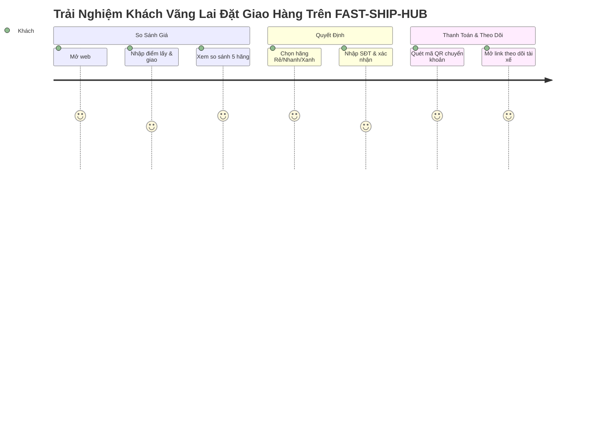
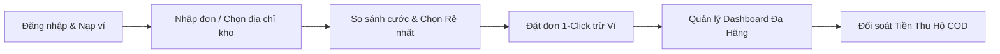
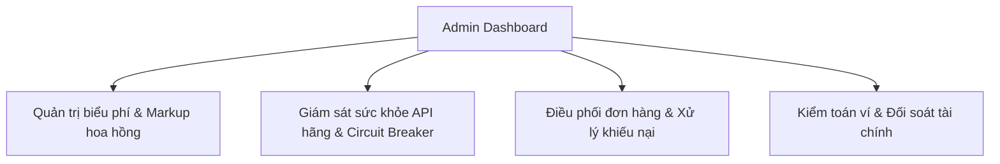

# TÀI LIỆU CÂU CHUYỆN NGƯỜI DÙNG (USER STORIES)

> **Tên sản phẩm**: Nền Tảng Tích Hợp & So Sánh Giao Hàng Đa Hãng (`FAST-SHIP-HUB`)  
> **Mã tài liệu**: `DOC-US-001` | **Phiên bản**: `1.0.0` | **Trạng thái**: `APPROVED_FOR_ARCHITECTURE`  
> **Tác giả**: `business-analyst` (Chuyên gia Phân tích Nghiệp vụ)  
> **Đối tượng sử dụng**: `system-architect`, `frontend-engineer`, `backend-engineer`, `qa-engineer`

---

## 1. KHUNG TIÊU CHUẨN XÂY DỰNG USER STORIES
Mọi User Story trong tài liệu này đều tuân theo chuẩn Agile quốc tế:
- **Cấu trúc**: `Là [Role], tôi muốn [Action], để [Business Value]`.
- **Độ ưu tiên (Priority)**: P0 (Bắt buộc cho MVP), P1 (Quan trọng sau MVP), P2 (Nâng cao).
- **Quy tắc nghiệm thu tóm tắt**: Tiêu chí Pass/Fail rõ ràng, có thể kiểm thử tự động.

---

## 2. PHÂN HỆ KHÁCH VÀNG LAI (GUEST USER STORIES - GST)

### [US-GST-01] Nhập địa chỉ lấy & giao hàng có gợi ý thông minh
- **User Story**: Là một **Khách vãng lai**, tôi muốn **gõ địa chỉ lấy và địa chỉ giao hàng với tính năng tự động gợi ý (Autocomplete) và hiển thị ghim trên bản đồ**, để **tôi chọn đúng địa chỉ nhanh chóng mà không cần nhập thủ công quá nhiều ký tự**.
- **Độ ưu tiên**: **P0 (Must-Have)** | **Độ phức tạp**: Trung bình (3 SP).
- **Tiêu chí nghiệm thu cốt lõi**:
  - Khi gõ từ 3 ký tự trở lên vào ô địa chỉ, hệ thống hiển thị danh sách gợi ý địa điểm trong bán kính khu vực liên quan.
  - Sau khi chọn địa chỉ, ghim tương ứng tự động xuất hiện trên bản đồ vệ tinh/giao thông, tính toán ngay khoảng cách km đường bộ.
  - Cho phép người dùng bổ sung số nhà, số phòng, tên tòa nhà hoặc ghi chú chi tiết cho tài xế.

### [US-GST-02] So sánh cước vận chuyển đa hãng thời gian thực
- **User Story**: Là một **Khách vãng lai**, tôi muốn **nhìn thấy bảng so sánh giá cước và thời gian giao dự kiến của Grab, ShopeeFood, Xanh SM, Ahamove, Be trên cùng một màn hình**, để **tôi có thể chọn được dịch vụ phù hợp nhất với túi tiền và nhu cầu thời gian của mình**.
- **Độ ưu tiên**: **P0 (Must-Have)** | **Độ phức tạp**: Cao (5 SP).
- **Tiêu chí nghiệm thu cốt lõi**:
  - Sau khi nhập xong 2 điểm, hệ thống tự động tải song song biểu phí của các hãng và trả kết quả dưới 1.5 giây.
  - Mỗi thẻ hãng hiển thị: Logo thương hiệu, Hạng dịch vụ (Xe máy/Xe tải/Xe điện), Tổng tiền cước cuối cùng (VNĐ), Thời gian tài xế có mặt (phút) và thời gian giao tới nơi.
  - Nếu một hãng bị lỗi hoặc quá thời gian chờ, hệ thống vẫn hiển thị các hãng còn lại bình thường và thông báo nhẹ trạng thái hãng lỗi.

### [US-GST-03] Lọc & Nhận diện hãng Rẻ nhất, Nhanh nhất, Xanh nhất
- **User Story**: Là một **Khách vãng lai**, tôi muốn **hệ thống tự động gắn nhãn huy hiệu (Badge) 'Rẻ nhất', 'Nhanh nhất', 'Xanh nhất' và cho phép tôi sắp xếp theo các tiêu chí này**, để **tôi ra quyết định đặt xe chỉ trong 3 giây mà không cần tự tính toán so sánh số liệu**.
- **Độ ưu tiên**: **P0 (Must-Have)** | **Độ phức tạp**: Thấp (2 SP).
- **Tiêu chí nghiệm thu cốt lõi**:
  - Thẻ có giá cước thấp nhất tự động gắn huy hiệu màu xanh lá 🏆 **Rẻ nhất** kèm số tiền tiết kiệm được so với hãng đắt nhất.
  - Thẻ có tổng thời gian giao sớm nhất gắn huy hiệu màu cam ⚡ **Nhanh nhất**.
  - Dịch vụ xe điện (Xanh SM) gắn huy hiệu màu xanh lục 🌿 **Xanh nhất (Không phát thải)**.
  - Người dùng bấm bộ lọc "Rẻ nhất" -> Thẻ rẻ nhất tự động nhảy lên đầu danh sách.

### [US-GST-04] Đặt đơn tức thì không cần đăng ký tài khoản rườm rà
- **User Story**: Là một **Khách vãng lai**, tôi muốn **chỉ cần nhập số điện thoại và tên người nhận rồi bấm đặt đơn ngay**, để **tôi gửi hàng khẩn cấp mà không bị cản trở bởi quy trình đăng ký mật khẩu phức tạp**.
- **Độ ưu tiên**: **P0 (Must-Have)** | **Độ phức tạp**: Trung bình (3 SP).
- **Tiêu chí nghiệm thu cốt lõi**:
  - Không bắt buộc tạo mật khẩu hay xác minh email nhiều bước.
  - Hệ thống lưu phiên làm việc (Session) tạm thời liên kết với Số điện thoại của khách để bảo mật.

### [US-GST-05] Thanh toán cước nhanh bằng mã VietQR Napas 24/7
- **User Story**: Là một **Khách vãng lai**, tôi muốn **quét mã QR ngân hàng hiển thị sẵn số tiền và nội dung chuyển khoản để thanh toán cước trong 10 giây**, để **hệ thống tự động kích hoạt điều xe ngay khi tiền vào tài khoản**.
- **Độ ưu tiên**: **P0 (Must-Have)** | **Độ phức tạp**: Cao (5 SP).
- **Tiêu chí nghiệm thu cốt lõi**:
  - Hiển thị mã chuẩn VietQR với số tiền chính xác từng đồng và mã đơn hàng duy nhất.
  - Hệ thống tự động lắng nghe xác nhận tiền về (Polling hoặc Webhook ngân hàng) trong vòng 3 – 5 giây.
  - Khi thanh toán thành công, màn hình tự động chuyển sang trạng thái "Đang kết nối tài xế".

### [US-GST-06] Theo dõi hành trình tài xế trực tiếp qua link công khai
- **User Story**: Là một **Khách vãng lai hoặc Người nhận hàng**, tôi muốn **nhấp vào link theo dõi để xem vị trí của tài xế trên bản đồ và thông tin liên hệ của tài xế**, để **tôi chủ động đón hàng đúng lúc mà không phải gọi điện hỏi shipper liên tục**.
- **Độ ưu tiên**: **P0 (Must-Have)** | **Độ phức tạp**: Cao (5 SP).
- **Tiêu chí nghiệm thu cốt lõi**:
  - Đường link định dạng bảo mật `fastshiphub.vn/track/:token`, không yêu cầu đăng nhập.
  - Hiển thị bản đồ với vị trí tài xế cập nhật liên tục, đường nối từ điểm lấy đến điểm giao.
  - Hiển thị tên tài xế, số điện thoại (có nút bấm gọi nhanh), biển số xe, đơn vị vận chuyển.
  - Hiển thị tiến trình đơn hàng rõ ràng: Tìm xe -> Đang đến lấy -> Đã lấy hàng -> Đang giao -> Hoàn tất.

---

## 3. PHÂN HỆ CHỦ SHOP ONLINE & DOANH NGHIỆP (MERCHANT STORIES - SHP)

### [US-SHP-01] Đăng ký, đăng nhập tài khoản Merchant và bảo mật hồ sơ
- **User Story**: Là một **Chủ shop online**, tôi muốn **đăng ký tài khoản bằng Email/Số điện thoại và đăng nhập an toàn**, để **tôi lưu trữ lịch sử đơn hàng, quản lý số dư ví và hưởng các chính sách ưu đãi cước phí**.
- **Độ ưu tiên**: **P0 (Must-Have)** | **Độ phức tạp**: Trung bình (3 SP).
- **Tiêu chí nghiệm thu cốt lõi**:
  - Hỗ trợ đăng ký bằng Số điện thoại + Mật khẩu an toàn.
  - Phân quyền rõ ràng giữa Merchant và Admin.
  - Khôi phục mật khẩu nhanh chóng qua OTP/Email.

### [US-SHP-02] Quản lý danh bạ địa chỉ kho / cửa hàng quen thuộc
- **User Story**: Là một **Chủ shop online**, tôi muốn **lưu sẵn nhiều địa chỉ lấy hàng (Kho tổng, Chi nhánh 1, Cửa hàng 2)**, để **khi tạo đơn tôi chỉ cần chọn 1 click là điểm lấy hàng tự động điền đầy đủ mà không phải gõ lại**.
- **Độ ưu tiên**: **P1 (Should-Have)** | **Độ phức tạp**: Thấp (2 SP).
- **Tiêu chí nghiệm thu cốt lõi**:
  - Thêm, sửa, xóa các điểm lấy hàng quen thuộc; đặt 1 địa chỉ làm mặc định.
  - Form tạo đơn tự động tải địa chỉ kho mặc định khi mở màn hình.

### [US-SHP-03] Nạp tiền vào Ví trả trước cước vận chuyển (Top-up Wallet)
- **User Story**: Là một **Chủ shop online**, tôi muốn **nạp trước một số tiền (ví dụ 1.000.000đ hoặc 5.000.000đ) vào tài khoản ví qua chuyển khoản ngân hàng**, để **tôi có thể đặt liên tục hàng chục đơn trong ngày mà không phải quét mã QR thanh toán từng đơn**.
- **Độ ưu tiên**: **P0 (Must-Have)** | **Độ phức tạp**: Cao (5 SP).
- **Tiêu chí nghiệm thu cốt lõi**:
  - Tạo lệnh nạp ví với số tiền tùy chọn hoặc các gói định sẵn (200k, 500k, 1 triệu, 5 triệu).
  - Khớp lệnh nạp tự động qua Webhook ngân hàng trong vòng 10 giây; cập nhật số dư ví tức thì.
  - Bảng sao kê lịch sử giao dịch ví minh bạch (Số tiền, Loại giao dịch, Mã đơn đối ứng, Số dư sau giao dịch).

### [US-SHP-04] Đặt đơn 1-Click trừ tiền ví tự động
- **User Story**: Là một **Chủ shop online**, tôi muốn **khi chọn được hãng ưng ý, bấm 'Xác Nhận Đặt Giao' là hệ thống tự động trừ tiền từ số dư ví và tạo đơn ngay**, để **tôi tiết kiệm tối đa thao tác vận hành bán hàng**.
- **Độ ưu tiên**: **P0 (Must-Have)** | **Độ phức tạp**: Trung bình (3 SP).
- **Tiêu chí nghiệm thu cốt lõi**:
  - Nếu số dư ví đủ: Hệ thống trừ tiền cước (tạm giữ) và kích hoạt tạo đơn qua API hãng trong < 2 giây.
  - Nếu số dư không đủ: Báo lỗi thân thiện "Số dư ví không đủ, vui lòng nạp thêm hoặc chọn thanh toán QR đơn lẻ".
  - Đảm bảo tính nhất quán (ACID Transaction): Không bao giờ xảy ra lỗi trừ tiền ví mà không tạo được đơn.

### [US-SHP-05] Cấu hình tiền thu hộ COD và tài khoản ngân hàng nhận tiền
- **User Story**: Là một **Chủ shop online**, tôi muốn **nhập số tiền COD cần thu hộ từ khách và khai báo số tài khoản ngân hàng của tôi**, để **tài xế ứng trước tiền hàng hoặc hệ thống tự động chuyển trả tiền COD sau khi đơn giao thành công**.
- **Độ ưu tiên**: **P0 (Must-Have)** | **Độ phức tạp**: Trung bình (3 SP).
- **Tiêu chí nghiệm thu cốt lõi**:
  - Nhập tiền COD từ 0đ đến 10.000.000đ (tùy giới hạn của từng hãng vận chuyển).
  - Hiển thị rõ biểu phí thu hộ COD của từng hãng (nếu có).
  - Lưu cấu hình tài khoản ngân hàng thụ hưởng (Ngân hàng, Số tài khoản, Tên chủ tài khoản) để nhận tiền đối soát.

### [US-SHP-06] Quản lý bảng điều khiển đơn hàng tập trung đa hãng
- **User Story**: Là một **Chủ shop online**, tôi muốn **xem danh sách tất cả các đơn hàng đã đặt (dù đi qua Grab, ShopeeFood hay Xanh SM) trên cùng một bảng quản trị**, để **tôi theo dõi trạng thái, lọc đơn đang giao, đơn hoàn tất hoặc xử lý khiếu nại kịp thời**.
- **Độ ưu tiên**: **P0 (Must-Have)** | **Độ phức tạp**: Cao (5 SP).
- **Tiêu chí nghiệm thu cốt lõi**:
  - Danh sách đơn hàng có bộ lọc đa chiều: Theo trạng thái (Đang tìm tài xế, Đang lấy, Đang giao, Thành công, Đã hủy), theo hãng vận chuyển, theo khoảng thời gian.
  - Tìm kiếm nhanh bằng Mã đơn nội bộ, Mã vận đơn của hãng hoặc Số điện thoại người nhận.
  - Nút bấm xuất file báo cáo Excel/CSV.

### [US-SHP-07] Báo cáo thống kê chi phí vận chuyển và số tiền tiết kiệm được
- **User Story**: Là một **Chủ shop online**, tôi muốn **xem biểu đồ thống kê tổng chi phí cước ship trong tháng và số tiền đã tiết kiệm được nhờ thuật toán gợi ý hãng rẻ nhất**, để **tôi đo lường hiệu quả kinh doanh và tiếp tục gắn bó với nền tảng**.
- **Độ ưu tiên**: **P1 (Should-Have)** | **Độ phức tạp**: Trung bình (3 SP).
- **Tiêu chí nghiệm thu cốt lõi**:
  - Widget trực quan: Tổng số đơn, Tổng cước ship đã trả, Số tiền tiết kiệm tích lũy so với giá cao nhất.
  - Biểu đồ phân bổ tỷ lệ đơn hàng theo từng hãng (Grab chiếm bao nhiêu %, Xanh SM bao nhiêu %).

---

## 4. PHÂN HỆ QUẢN TRỊ VIÊN HỆ THỐNG (ADMIN STORIES - ADM)

### [US-ADM-01] Quản lý biểu phí & tỷ lệ hoa hồng chiết khấu sàn
- **User Story**: Là một **Quản trị viên hệ thống**, tôi muốn **cấu hình phí dịch vụ sàn (cố định VND hoặc % giá cước) và mức chiết khấu cho từng hãng**, để **đảm bảo mô hình kinh doanh có lợi nhuận và linh hoạt điều chỉnh theo thị trường**.
- **Độ ưu tiên**: **P0 (Must-Have)** | **Độ phức tạp**: Trung bình (3 SP).
- **Tiêu chí nghiệm thu cốt lõi**:
  - Cho phép đặt mức phí sàn mặc định (ví dụ: +1.000đ/đơn hoặc 3% trên giá trị cước).
  - Cập nhật biểu phí được áp dụng ngay lập tức cho các lượt tính giá tiếp theo mà không cần khởi động lại máy chủ.

### [US-ADM-02] Giám sát sức khỏe API đối tác & Công tắc khẩn cấp (Circuit Breaker)
- **User Story**: Là một **Quản trị viên hệ thống**, tôi muốn **theo dõi trạng thái kết nối (Health check), thời gian phản hồi (Latency) của từng hãng và có nút gạt Tắt/Bật hãng ngay lập tức**, để **khi một hãng bị sập hệ thống hoặc bão giá, tôi có thể tạm ngắt hãng đó để bảo vệ trải nghiệm người dùng**.
- **Độ ưu tiên**: **P0 (Must-Have)** | **Độ phức tạp**: Cao (5 SP).
- **Tiêu chí nghiệm thu cốt lõi**:
  - Đèn báo trạng thái: Xanh (Bình thường), Vàng (Chậm > 2s), Đỏ (Lỗi/Timeout liên tục).
  - Nút công tắc ngắt khẩn cấp (Toggle Active/Inactive) cho từng hãng: Khi tắt, hãng sẽ không được gọi API báo giá nữa.
  - Hệ thống tự động kích hoạt Circuit Breaker nếu tỷ lệ lỗi của 1 hãng vượt quá 50% trong 5 phút liên tục.

### [US-ADM-03] Giám sát toàn bộ đơn hàng và can thiệp điều phối thủ công
- **User Story**: Là một **Quản trị viên hệ thống**, tôi muốn **xem danh sách toàn bộ đơn hàng trên sàn, xem chi tiết lỗi khi hãng từ chối nhận đơn và có thể bấm hủy hoặc chuyển hãng thủ công**, để **hỗ trợ giải quyết khiếu nại cho khách hàng và tài xế nhanh chóng**.
- **Độ ưu tiên**: **P0 (Must-Have)** | **Độ phức tạp**: Cao (5 SP).
- **Tiêu chí nghiệm thu cốt lõi**:
  - Xem chi tiết lịch sử API logs (Payload gửi đi, Response trả về của hãng đối tác).
  - Có quyền can thiệp cập nhật trạng thái đơn hàng khi xảy ra lỗi đồng bộ.
  - Ghi vết (Audit Log) đầy đủ nhân viên nào đã thực hiện hành động can thiệp.

### [US-ADM-04] Quản lý sổ cái ví người dùng và đối soát tài chính
- **User Story**: Là một **Quản trị viên hệ thống**, tôi muốn **kiểm tra sổ cái giao dịch tài chính (Financial Ledger), đối chiếu giữa tổng tiền nạp ví, tiền cước trả hãng và doanh thu sàn thu được**, để **đảm bảo số liệu kế toán chính xác 100%, không bị thất thoát tiền tệ**.
- **Độ ưu tiên**: **P0 (Must-Have)** | **Độ phức tạp**: Cao (5 SP).
- **Tiêu chí nghiệm thu cốt lõi**:
  - Báo cáo cân đối số dư: `Tổng nạp - Tổng cước đã chi - Doanh thu sàn = Tổng số dư hiện tại của người dùng`.
  - Cảnh báo ngay lập tức nếu có bất kỳ sai lệch số dư bất thường nào (Double spending alert).
