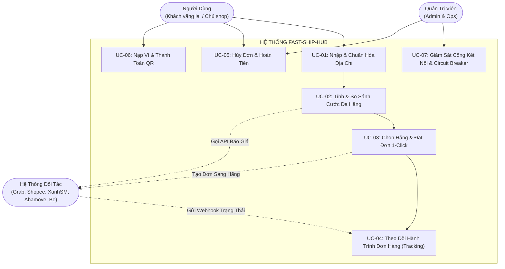
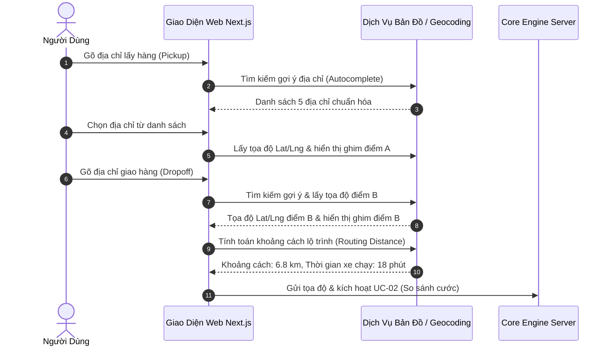
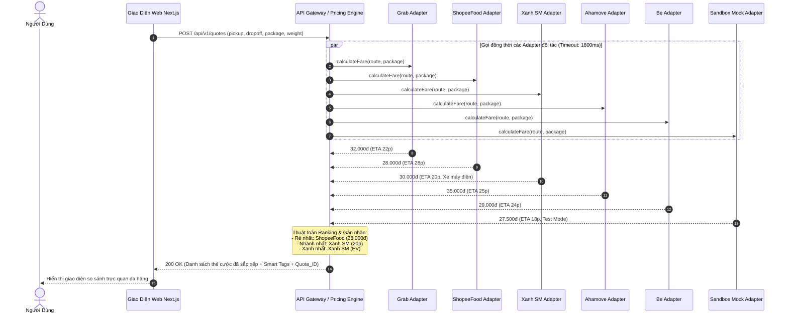
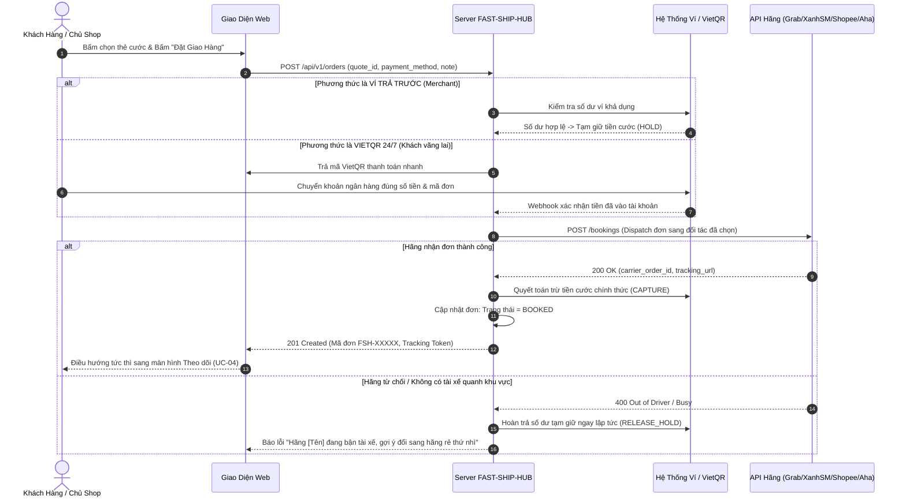

# TÀI LIỆU ĐẶC TẢ CA SỬ DỤNG (USE CASE SPECIFICATIONS)

> **Tên sản phẩm**: Nền Tảng Tích Hợp & So Sánh Giao Hàng Đa Hãng (`FAST-SHIP-HUB`)  
> **Mã tài liệu**: `DOC-UC-001` | **Phiên bản**: `1.0.0` | **Trạng thái**: `APPROVED_FOR_ARCHITECTURE`  
> **Tác giả**: `business-analyst` (Chuyên gia Phân tích Nghiệp vụ)  
> **Người tiếp nhận**: `system-architect`, `backend-engineer`, `frontend-engineer`, `qa-engineer`

---

## 1. SƠ ĐỒ TỔNG THỂ CÁC CA SỬ DỤNG (USE CASE OVERVIEW DIAGRAM)

---

## 2. CHI TIẾT CÁC CA SỬ DỤNG CỐT LÕI (CORE USE CASES)

### 2.1. [UC-01] Nhập & Chuẩn Hóa Tuyến Đường Vận Chuyển (Input & Validate Delivery Route)

| Thuộc tính | Chi tiết |
| :--- | :--- |
| **Mã Use Case** | `UC-01` |
| **Tên Use Case** | Nhập thông tin tuyến đường và kiện hàng |
| **Tác nhân chính (Primary Actor)** | Khách vãng lai (Guest), Chủ shop (Merchant) |
| **Điều kiện tiên quyết (Pre-conditions)** | Người dùng truy cập vào trang chủ hoặc màn hình Tạo đơn của FAST-SHIP-HUB. |
| **Điều kiện sau khi hoàn tất (Post-conditions)**| Hệ thống lưu trữ tọa độ chuẩn hóa (`pickup_lat`, `pickup_lng`, `dropoff_lat`, `dropoff_lng`), khoảng cách km đường bộ và sẵn sàng kích hoạt tính cước. |

#### Luồng sự kiện chính (Main Flow):
1. Người dùng nhập tên đường/địa danh tại ô "Địa chỉ lấy hàng".
2. Hệ thống gọi Geocoding API trả về danh sách gợi ý theo thời gian thực.
3. Người dùng chọn địa chỉ chính xác, hệ thống ghim điểm lấy hàng lên bản đồ.
4. Người dùng nhập thông tin liên hệ người gửi: Họ tên, Số điện thoại.
5. Người dùng tiếp tục nhập "Địa chỉ giao hàng" và thông tin người nhận.
6. Hệ thống tính toán đường đi thực tế, vẽ đường Polyline màu xanh trên bản đồ và hiển thị cự ly (ví dụ: `6.8 km`).
7. Người dùng chọn loại hàng hóa (Tài liệu, Đồ ăn, Quần áo, Hàng dễ vỡ) và nhập trọng lượng kiện hàng (mặc định: 1 kg).
8. Hệ thống tự động chuyển tiếp sang `UC-02` để gọi báo giá từ các hãng.

#### Các luồng phụ / Ngoại lệ (Alternative & Exception Flows):
- **A1: Điểm lấy hàng và điểm giao hàng trùng nhau (Khoảng cách < 50m)**:
  - Hệ thống hiển thị cảnh báo màu vàng: *"Địa chỉ lấy và giao hàng đang quá gần nhau. Vui lòng kiểm tra lại địa chỉ"*. Khóa nút tính cước cho đến khi người dùng sửa đổi.
- **A2: Tuyến đường vượt quá bán kính giao hỏa tốc (> 50 km)**:
  - Hệ thống thông báo: *"Dịch vụ giao xe máy tức thì chỉ hỗ trợ tối đa 50km nội thành. Đang chuyển sang dịch vụ xe tải hoặc giao liên tỉnh"*.

---

### 2.2. [UC-02] Báo Giá Cước Đa Hãng Thời Gian Thực (Aggregate Multi-Carrier Real-Time Quotes)

| Thuộc tính | Chi tiết |
| :--- | :--- |
| **Mã Use Case** | `UC-02` |
| **Tên Use Case** | Tính toán & So sánh giá cước đa hãng đồng thời |
| **Tác nhân chính (Primary Actor)** | Hệ thống Core Engine, Các Adapter API (Grab, ShopeeFood, Xanh SM, Ahamove, Be, Sandbox) |
| **Điều kiện tiên quyết (Pre-conditions)** | Đã có tọa độ và khoảng cách hợp lệ từ `UC-01`. |
| **Điều kiện sau khi hoàn tất (Post-conditions)**| Bảng so sánh cước được kết xuất đầy đủ, sắp xếp thông minh và sẵn sàng để người dùng đặt xe. Thời hạn hiệu lực của báo giá (TTL): 300 giây (5 phút). |

#### Luồng sự kiện chính (Main Flow):
1. Client gửi yêu cầu lấy báo giá tới `/api/v1/quotes` kèm tọa độ 2 điểm, kích thước, khối lượng và tiền COD (nếu có).
2. Pricing Engine kích hoạt cơ chế `Promise.allSettled()` đồng thời gửi request tới tất cả các Adapter đối tác đang ở trạng thái `ACTIVE`.
3. Mỗi Adapter tính toán biểu phí:
   - Áp dụng công thức cước cơ bản (Base Fare).
   - Phụ phí thời gian/quãng đường (Distance & Time surcharge).
   - Hệ số điều chỉnh giờ cao điểm/thời tiết (Surge multiplier).
   - Phí dịch vụ sàn FAST-SHIP-HUB (+1.000đ hoặc % theo cấu hình).
4. Pricing Engine thu thập toàn bộ báo giá hợp lệ, thực hiện thuật toán gán nhãn:
   - **Thẻ Rẻ Nhất (CHEAPEST)**: Hãng có tổng cước `final_total_fee` nhỏ nhất.
   - **Thẻ Nhanh Nhất (FASTEST)**: Hãng có `estimated_delivery_minutes` nhỏ nhất.
   - **Thẻ Xanh Nhất (GREENEST)**: Dành riêng cho đối tác thuần xe điện (Xanh SM).
5. Trả kết quả JSON về cho Frontend hiển thị trong thời gian ≤ 1.5 giây.
6. Hệ thống khởi tạo bộ đếm ngược 05:00 phút hiệu lực báo giá trên giao diện người dùng.

#### Các luồng phụ / Ngoại lệ (Alternative & Exception Flows):
- **A1: Một hoặc hai hãng bị Timeout (> 1.8 giây) hoặc báo lỗi 500**:
  - Pricing Engine bắt lỗi cô lập của riêng hãng đó, ghi log lỗi hệ thống.
  - Các hãng còn lại vẫn được trả về và hiển thị đầy đủ trên giao diện.
  - Thẻ của hãng bị lỗi hiển thị ghi chú nhẹ: *"Tạm thời không thể kết nối cước hãng này, vui lòng chọn hãng khác"*.
- **A2: Tất cả các hãng đều thất bại (Mất mạng toàn cục)**:
  - Hệ thống kích hoạt chế độ Fallback Sandbox Mock hoặc hiển thị thông báo: *"Hệ thống đối tác đang bảo trì, vui lòng bấm Thử lại sau 30 giây"*.

---

### 2.3. [UC-03] Chọn Hãng & Đặt Đơn Vận Chuyển 1-Click (Select Carrier & Create Booking Order)

| Thuộc tính | Chi tiết |
| :--- | :--- |
| **Mã Use Case** | `UC-03` |
| **Tên Use Case** | Chọn đơn vị vận chuyển và tạo đơn điều xe |
| **Tác nhân chính (Primary Actor)** | Khách vãng lai, Chủ shop, Cổng thanh toán/Ví, Adapter Hãng |
| **Điều kiện tiên quyết (Pre-conditions)** | Báo giá từ `UC-02` còn trong thời hạn hiệu lực (< 5 phút). |
| **Điều kiện sau khi hoàn tất (Post-conditions)**| Đơn hàng được tạo thành công trên hệ thống FAST-SHIP-HUB với mã `FSH-XXXXX`, mã vận đơn đối tác được ghi nhận, trạng thái đơn chuyển thành `BOOKED` và chuyển sang trang theo dõi trực tiếp. |

#### Luồng sự kiện chính (Main Flow):
1. Người dùng chọn 1 gói cước trên bảng so sánh (ví dụ: Xanh SM Giao hàng nhanh - 30.000đ).
2. Người dùng nhập ghi chú cho tài xế (nếu có): *"Gọi người nhận trước khi tới, giao tầng 3 chung cư"*.
3. Người dùng chọn hình thức thanh toán:
   - **Cách 1 (Ví nội bộ)**: Áp dụng cho Shop đã đăng nhập và có số dư ví ≥ 30.000đ.
   - **Cách 2 (Quét mã VietQR)**: Áp dụng cho khách vãng lai hoặc shop chưa nạp ví.
4. Hệ thống tiến hành xác thực thanh toán:
   - Nếu dùng ví: Khởi tạo DB Transaction, kiểm tra số dư và chuyển sang trạng thái `HOLD_SHIPPING_FEE`.
   - Nếu dùng VietQR: Khách quét mã, ngân hàng gửi thông báo biến động số dư, hệ thống tự động nhận diện khớp lệnh.
5. Hệ thống gọi phương thức `dispatchOrder()` của Adapter tương ứng.
6. Adapter đối tác gọi API chính thức của Grab/ShopeeFood/XanhSM/Ahamove/Be để tạo đơn.
7. Đối tác phản hồi thành công kèm mã vận đơn của họ (`carrier_order_id`).
8. Hệ thống lưu toàn bộ thông tin đơn hàng vào bảng `orders`, gán mã `FSH-20261103-XXXX`, sinh `tracking_token` ngẫu nhiên.
9. Đơn hàng chuyển sang trạng thái `BOOKED`. Giao diện tự động điều hướng sang màn hình Live Tracking.

#### Các luồng phụ / Ngoại lệ (Alternative & Exception Flows):
- **A1: Báo giá quá hạn 5 phút (Quote Expired)**:
  - Khi người dùng bấm đặt đơn, hệ thống kiểm tra `created_at` của Quote > 300s.
  - Hệ thống hiển thị hộp thoại: *"Biểu phí đã quá thời hạn 5 phút. Đang làm mới lại giá cước để đảm bảo quyền lợi của bạn..."*. Tự động kích hoạt lại `UC-02` để lấy giá mới nhất.
- **A2: Hãng đối tác trả lỗi hết tài xế (No Drivers Available)**:
  - Hệ thống hủy lệnh giữ tiền ví hoặc hoàn tiền tức thì.
  - Hệ thống hiển thị cảnh báo: *"Hãng Xanh SM hiện không tìm thấy tài xế gần bạn. Bạn có muốn chuyển sang Grab (chênh lệch +2.000đ) không?"* kèm nút bấm chuyển đổi 1-click.

---

### 2.4. [UC-04] Theo Dõi Đơn Hàng & Đồng Bộ Trạng Thái Thời Gian Thực (Unified Tracking)

| Thuộc tính | Chi tiết |
| :--- | :--- |
| **Mã Use Case** | `UC-04` |
| **Tên Use Case** | Theo dõi lộ trình và trạng thái giao hàng trực tiếp |
| **Tác nhân chính (Primary Actor)** | Người gửi hàng, Người nhận hàng, Webhook/Polling Hãng |
| **Điều kiện tiên quyết (Pre-conditions)** | Đơn hàng đã được tạo thành công ở trạng thái `BOOKED`. |
| **Điều kiện sau khi hoàn tất (Post-conditions)**| Người dùng nắm bắt được vị trí tài xế, thời gian giao dự kiến cho tới khi đơn hoàn tất (`DELIVERED`) hoặc kết thúc. |

#### Luồng sự kiện chính (Main Flow):
1. Người dùng mở đường link `fastshiphub.vn/track/:tracking_token`.
2. Hệ thống tải dữ liệu đơn hàng:
   - Thanh tiến trình trạng thái trực quan:
     - 1️⃣ **Đã Đặt Đơn (BOOKED)**: Đang kết nối tổng đài hãng tìm tài xế.
     - 2️⃣ **Tài Xế Đang Đến (PICKING)**: Tài xế đã nhận đơn, đang di chuyển đến điểm lấy hàng.
     - 3️⃣ **Đang Giao Hàng (DELIVERING)**: Tài xế đã lấy hàng, đang trên đường đến người nhận.
     - 4️⃣ **Giao Thành Công (DELIVERED)**: Khách đã nhận hàng và hoàn tất ký nhận/thu COD.
   - Thông tin tài xế: Họ tên, Số điện thoại (có nút bấm gọi điện), Biển số xe, Ảnh đại diện, Đơn vị vận chuyển (Logo hãng).
   - Bản đồ số: Vị trí ghim điểm lấy, điểm giao và biểu tượng Shipper di chuyển tương ứng theo tọa độ thực tế.
3. Khi đối tác có thay đổi trạng thái (Ví dụ Shipper bấm "Đã lấy hàng"):
   - Đối tác bắn Webhook về URL `/api/v1/webhooks/:carrier`.
   - FAST-SHIP-HUB cập nhật trạng thái đơn trong CSDL thành `DELIVERING`.
   - Hệ thống đẩy sự kiện Server-Sent Events (SSE) hoặc WebSocket tới màn hình của người dùng để cập nhật giao diện ngay lập tức mà người dùng không cần bấm F5 tải lại trang.

#### Ngoại lệ (Exception Flow):
- **Tài xế hủy đơn giữa đường (Driver Cancelled)**:
  - Webhook đối tác gửi thông báo hủy đơn kèm lý do (Hỏng xe, tai nạn, khách không liên lạc được).
  - Trạng thái chuyển thành `FAILED_DISPATCH` hoặc `DRIVER_CANCELLED`.
  - Hệ thống thông báo rõ ràng cho người dùng và đề xuất tự động gọi tài xế khác.

---

### 2.5. [UC-05] Hủy Đơn Hàng & Xử Lý Hoàn Tiền (Cancel Order & Refund Workflow)

| Thuộc tính | Chi tiết |
| :--- | :--- |
| **Mã Use Case** | `UC-05` |
| **Tên Use Case** | Hủy đơn vận chuyển và hoàn cước phí |
| **Tác nhân chính (Primary Actor)** | Khách hàng (Người gửi), Quản trị viên (Admin), Hệ thống Hãng |
| **Điều kiện tiên quyết (Pre-conditions)** | Đơn hàng đang ở trạng thái `BOOKED` hoặc `PICKING`. |
| **Điều kiện sau khi hoàn tất (Post-conditions)**| Đơn chuyển sang `CANCELLED`, gọi API hủy sang hãng đối tác, tiền cước được hoàn trả theo quy định hoàn tiền. |

#### Ma trận xử lý hủy đơn & Quy tắc hoàn tiền:

| Trạng thái đơn khi bấm Hủy | Thời điểm kể từ lúc đặt | Được phép hủy? | Phí phạt hủy | Chính sách hoàn tiền |
| :--- | :--- | :---: | :---: | :--- |
| **BOOKED** (Chưa có tài xế) | Bất kỳ lúc nào | **CÓ** | **0 VNĐ** | Hoàn lại 100% tiền cước vào Ví ngay lập tức |
| **PICKING** (Đã có tài xế nhận) | ≤ 2 phút từ khi tài xế nhận | **CÓ** | **0 VNĐ** | Hoàn lại 100% tiền cước vào Ví |
| **PICKING** (Đã có tài xế nhận) | > 2 phút kể từ khi tài xế nhận | **CÓ** | **10.000 VNĐ** (Phí bù xăng tài xế theo luật hãng) | Hoàn lại: `Tiền cước đã thu - 10.000đ` |
| **DELIVERING** (Tài xế đã lấy hàng) | Bất kỳ | **KHÔNG** | N/A | Không hỗ trợ hủy trên web; Khách phải gọi hotline CSKH xử lý trả hàng |
