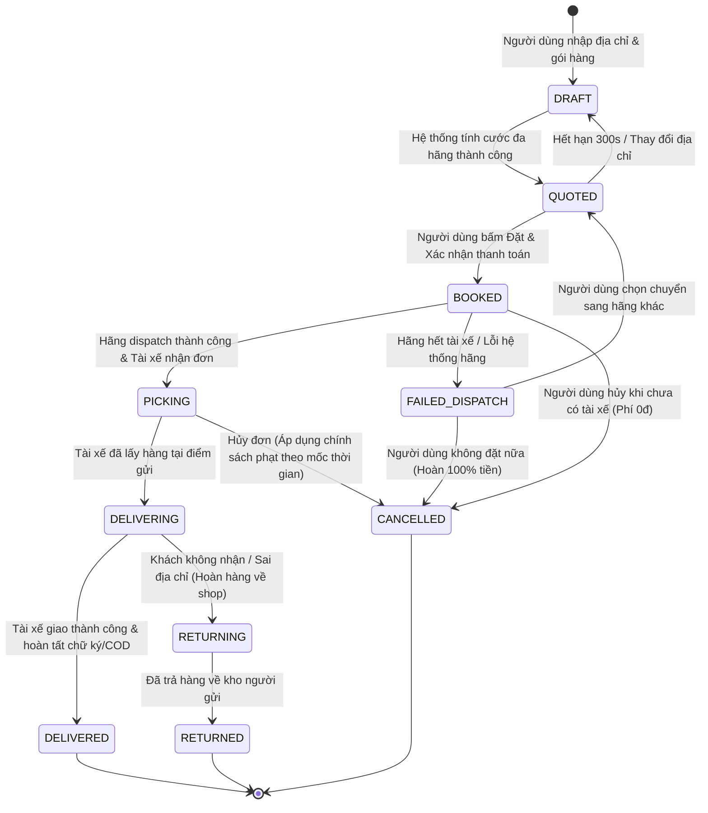
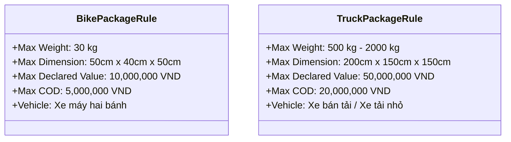
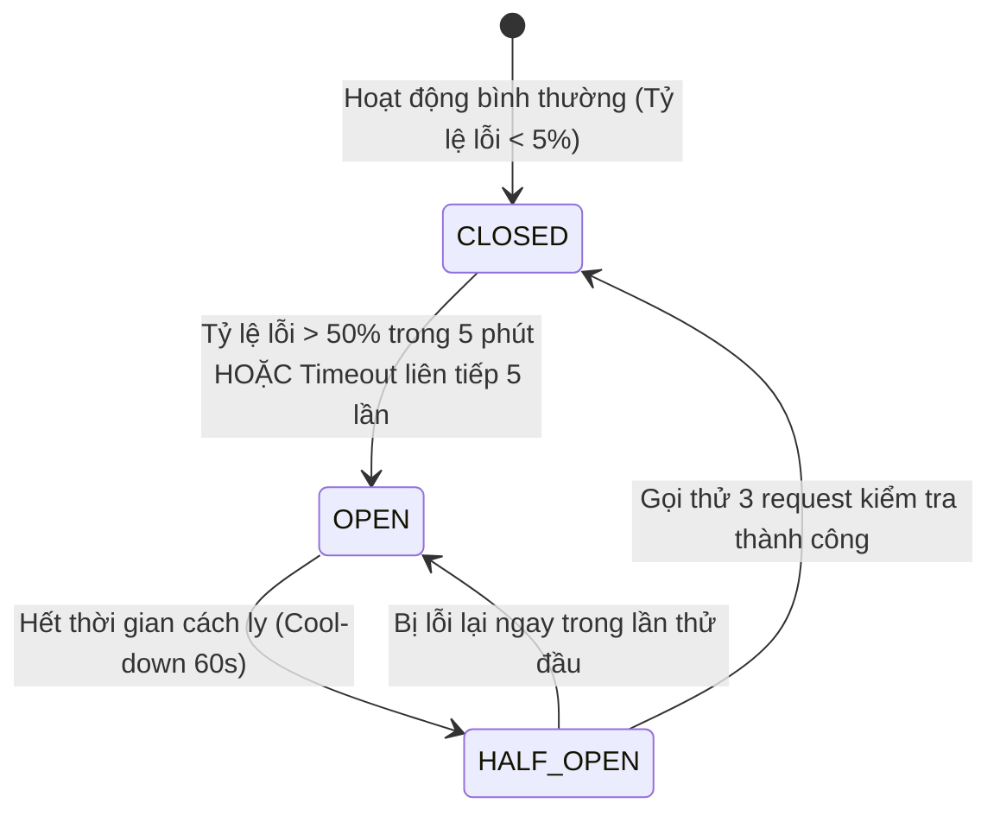

# TÀI LIỆU QUY TẮC NGHIỆP VỤ HỆ THỐNG (BUSINESS RULES SPECIFICATION)

> **Tên sản phẩm**: Nền Tảng Tích Hợp & So Sánh Giao Hàng Đa Hãng (`FAST-SHIP-HUB`)  
> **Mã tài liệu**: `DOC-BR-001` | **Phiên bản**: `1.0.0` | **Trạng thái**: `APPROVED_FOR_ARCHITECTURE`  
> **Tác giả**: `business-analyst` (Chuyên gia Phân tích Nghiệp vụ)  
> **Người tiếp nhận**: `system-architect`, `backend-engineer`, `database-engineer`, `qa-engineer`

---

## 1. MÁY TRẠNG THÁI VÒNG ĐỜI ĐƠN HÀNG (ORDER LIFECYCLE STATE MACHINE)

### 1.1. Sơ đồ chuyển đổi trạng thái (State Diagram)

### 1.2. Bảng định nghĩa trạng thái đơn hàng (Order State Dictionary)

| Mã trạng thái (State Enum) | Tên hiển thị người dùng | Ý nghĩa nghiệp vụ | Hành động hệ thống |
| :--- | :--- | :--- | :--- |
| `DRAFT` | **Đang soạn đơn** | Người dùng đang gõ thông tin tuyến đường, người gửi, người nhận, thông tin kiện hàng. | Chưa lưu vào bảng đơn chính; lưu tạm trong local session. |
| `QUOTED` | **Đã báo giá** | Đã gọi song song biểu phí của các hãng đối tác và trả về danh sách gói cước. | Sinh `quote_id`, áp dụng thời hạn TTL 300 giây (5 phút). |
| `BOOKED` | **Đã đặt đơn** | Người dùng đã chọn hãng, trừ ví (hoặc xác nhận VietQR) và gửi lệnh sang hãng đối tác. | Trừ/Khóa số dư ví; lưu đơn vào DB; chờ tài xế hãng nhận cuốc. |
| `PICKING` | **Tài xế đang đến lấy** | Hệ thống hãng đã ghép được tài xế; tài xế đang trên đường đến địa chỉ lấy hàng. | Cập nhật thông tin tài xế (Tên, SĐT, Biển số, Tọa độ GPS). |
| `DELIVERING` | **Đang giao hàng** | Tài xế đã bấm xác nhận lấy hàng thành công; đang di chuyển tới người nhận. | Khóa tính năng hủy đơn trên giao diện; kích hoạt live tracking liên tục. |
| `DELIVERED` | **Giao thành công** | Người nhận đã nhận được kiện hàng, thanh toán COD (nếu có). Đơn hoàn tất. | Quyết toán giao dịch ví; ghi nhận doanh thu hoa hồng sàn; giải phóng đơn. |
| `RETURNING` | **Đang hoàn trả hàng** | Người nhận từ chối nhận hoặc không liên lạc được 3 lần; tài xế đang trả lại hàng về shop. | Thông báo cho chủ shop chuẩn bị nhận lại hàng và thanh toán phí hoàn (nếu có). |
| `RETURNED` | **Đã trả về điểm gửi** | Hàng hóa đã về lại tay chủ shop thành công. | Đóng chu trình đơn hàng; thanh toán phí vận chuyển hoàn theo quy chế. |
| `FAILED_DISPATCH` | **Điều xe thất bại** | Hãng đối tác trả lỗi không tìm thấy tài xế trong khu vực sau thời gian chờ. | Tự động hoàn lại tiền vào ví tức thì; gợi ý chuyển sang hãng khác. |
| `CANCELLED` | **Đã hủy đơn** | Đơn bị hủy bởi người dùng hoặc hệ thống theo quy định hoàn hủy. | Xử lý hoàn tiền theo ma trận quy định hủy đơn. |

### 1.3. Ma trận chuyển đổi trạng thái hợp lệ & Bất hợp lệ (State Transition Matrix)

| Từ trạng thái (From \ To) | DRAFT | QUOTED | BOOKED | PICKING | DELIVERING | DELIVERED | CANCELLED | FAILED_DISPATCH |
| :--- | :---: | :---: | :---: | :---: | :---: | :---: | :---: | :---: |
| **DRAFT** | - | **HỢP LỆ** | Không | Không | Không | Không | Không | Không |
| **QUOTED** | **HỢP LỆ** | - | **HỢP LỆ** | Không | Không | Không | **HỢP LỆ** | Không |
| **BOOKED** | Không | Không | - | **HỢP LỆ** | Không | Không | **HỢP LỆ** | **HỢP LỆ** |
| **PICKING** | Không | Không | Không | - | **HỢP LỆ** | Không | **HỢP LỆ** (Có điều kiện)| Không |
| **DELIVERING**| Không | Không | Không | Không | - | **HỢP LỆ** | **CẤM** | Không |
| **DELIVERED** | Không | Không | Không | Không | Không | - | **CẤM** | Không |
| **CANCELLED** | Không | Không | Không | Không | Không | Không | - | Không |

---

## 2. QUY TẮC TÍNH CƯỚC VẬN CHUYỂN TOÀN DIỆN (FARE CALCULATION RULES)

### 2.1. Công thức tính cước tổng quát (Master Fare Formula)
$$\text{Final Fare} = \max\Big(\text{Base Fare},\ \text{Tiered Distance Fare}\Big) \times \text{Surge Multiplier} + \sum \text{Surcharges} + \text{Platform Fee} - \text{Discount}$$

Trong đó:
1. **$\text{Base Fare}$ (Cước mở cửa / Cự ly tối thiểu)**: Áp dụng cho $0$ đến $X$ km đầu tiên (thường là 2km hoặc 3km tùy hãng).
2. **$\text{Tiered Distance Fare}$ (Cước lũy tiến theo km)**: Tính theo từng bậc khoảng cách vượt mức cự ly tối thiểu.
3. **$\text{Surge Multiplier}$ (Hệ số cao điểm / Thời tiết)**: Giá trị từ $1.0$ (bình thường) đến $1.8$ (mưa lớn / tắc đường nghiêm trọng).
4. **$\sum \text{Surcharges}$ (Tổng phụ phí)**: Gồm phụ phí ban đêm (22h00 - 06h00), phụ phí hàng cồng kềnh, phụ phí bốc xếp lên lầu.
5. **$\text{Platform Fee}$ (Phí dịch vụ sàn FAST-SHIP-HUB)**: Cố định $1.000\text{đ}$ hoặc $3\%$ giá cước.
6. **$\text{Discount}$ (Mã giảm giá)**: Khuyến mãi áp dụng theo chiến dịch.

---

### 2.2. Biểu phí tham chiếu chi tiết các hãng tích hợp (MVP Standard Carrier Tariffs)

```mermaid
gantt
    title Phân Bổ Giá Cước Cơ Bản Giữa Các Hãng Cho Xe Máy (Bike)
    dateFormat X
    axisFormat %s km
    section GrabExpress
    2km đầu (16.000đ) :0, 2
    2km - 5km (5.500đ/km) :2, 5
    Trên 5km (5.000đ/km) :5, 20
    section ShopeeFood Instant
    2km đầu (15.000đ) :0, 2
    2km - 5km (5.000đ/km) :2, 5
    Trên 5km (4.800đ/km) :5, 20
    section Xanh SM (EV Bike)
    2km đầu (14.000đ) :0, 2
    2km - 5km (5.200đ/km) :2, 5
    Trên 5km (4.900đ/km) :5, 20
```

#### Bảng chi tiết biểu phí chuẩn xe máy (Dịch vụ Instant Bike):

| Tiêu chí cước | GrabExpress Siêu Tốc | ShopeeFood Instant | Xanh SM Delivery (Xe Điện) | Ahamove Xe Máy Siêu Tốc | Be beDelivery | Sandbox Mock Carrier |
| :--- | :--- | :--- | :--- | :--- | :--- | :--- |
| **Giá mở cửa (2km đầu)** | **16.000 VNĐ** | **15.000 VNĐ** | **14.000 VNĐ** (Ưu đãi EV) | **18.000 VNĐ** (4km đầu) | **15.500 VNĐ** | **14.500 VNĐ** |
| **Giá mỗi km tiếp (2km - 5km)** | **5.500 VNĐ / km** | **5.000 VNĐ / km** | **5.200 VNĐ / km** | **5.000 VNĐ / km** (Sau 4km) | **5.400 VNĐ / km** | **5.000 VNĐ / km** |
| **Giá mỗi km tiếp (> 5km)** | **5.000 VNĐ / km** | **4.800 VNĐ / km** | **4.900 VNĐ / km** | **4.800 VNĐ / km** | **5.000 VNĐ / km** | **4.800 VNĐ / km** |
| **Phụ phí ban đêm (22h - 06h)** | +10.000 VNĐ | +8.000 VNĐ | +7.000 VNĐ | +10.000 VNĐ | +9.000 VNĐ | +5.000 VNĐ |
| **Hệ số giờ cao điểm (Surge)**| 1.1x – 1.6x | 1.1x – 1.4x | 1.0x – 1.3x (Ổn định giá) | 1.2x – 1.8x | 1.1x – 1.5x | 1.0x (Cố định) |
| **Phụ phí thời tiết mưa** | +5.000 – 15.000 VNĐ | +5.000 – 10.000 VNĐ| +5.000 VNĐ | +10.000 VNĐ | +7.000 VNĐ | 0 VNĐ |
| **Miễn phí thu hộ COD** | Dưới 2.000.000 VNĐ | Dưới 1.000.000 VNĐ | Dưới 3.000.000 VNĐ | Dưới 2.000.000 VNĐ | Dưới 2.000.000 VNĐ | Không giới hạn |
| **Phí vượt hạn mức COD** | 0.8% tiền COD | 1.0% tiền COD | 0.7% tiền COD | 0.8% tiền COD | 0.8% tiền COD | 0% |

---

### 2.3. Quy tắc gán nhãn thông minh (Smart Badge Assignment Rules)

Mỗi lần báo giá thành công, thuật toán sẽ duyệt qua danh sách các gói cước hợp lệ và tự động gán nhãn theo tiêu chí sau:

1. **Nhãn 🏆 `CHEAPEST` (Rẻ nhất)**:
   - Điều kiện: $\text{final\_total\_fee} = \min_{i \in \text{quotes}}(\text{final\_total\_fee}_i)$.
   - Giao diện: Viền xanh lá cây tươi (#10B981), huy hiệu vàng cam, hiển thị số tiền chênh lệch tiết kiệm:  
     $$\text{Tiết kiệm} = \max(\text{final\_total\_fee}) - \min(\text{final\_total\_fee})$$
2. **Nhãn ⚡ `FASTEST` (Nhanh nhất)**:
   - Điều kiện: $(\text{estimated\_pickup\_minutes} + \text{estimated\_delivery\_minutes}) = \min$.
   - Giao diện: Viền màu cam hổ phách (#F59E0B), hiển thị số phút dự kiến tới nơi.
3. **Nhãn 🌿 `GREENEST` (Xanh nhất / Xe điện không phát thải)**:
   - Điều kiện: Áp dụng riêng cho đối tác `XANH_SM` (Phương tiện thuần điện VinFast Feliz/Evo).
   - Giao diện: Huy hiệu chiếc lá màu xanh lục bích (#059669), ghi chú "100% Xe điện - Giảm 0.35kg CO2".
4. **Nhãn 🌟 `BEST_VALUE` (Đề xuất tối ưu)**:
   - Điều kiện: Điểm tối ưu $S = 0.6 \times \text{Chuẩn hóa Giá} + 0.4 \times \text{Chuẩn hóa Thời gian}$. Gói cước có $S$ nhỏ nhất sẽ nhận nhãn này (khi hãng rẻ nhất và nhanh nhất khác nhau).

---

## 3. QUY TẮC PHÍ DỊCH VỤ SÀN & MÔ HÌNH DOANH THU (PLATFORM FEES & COMMISSION)

1. **Phí nền tảng (Platform Convenience Fee)**:
   - Áp dụng mặc định: **+1.000 VNĐ / đơn hàng thành công** cộng trực tiếp vào giá hiển thị cho người gửi.
   - Khoản phí này nhằm duy trì hệ thống máy chủ, hạ tầng so sánh giá và bảo hiểm đơn hàng trung gian.
2. **Chính sách ưu đãi theo đối tượng**:
   - **Tài khoản mới (New Merchant)**: Miễn phí dịch vụ sàn cho 10 đơn hàng đầu tiên.
   - **Gói Hội viên Shop VIP**: Nếu tích lũy trên 200 đơn/tháng, hoàn trả 100% phí dịch vụ sàn vào ví cước vào ngày 01 đầu tháng tiếp theo.
3. **Hoa hồng đối tác (Carrier B2B Kickback/Affiliate)**:
   - Tùy theo thỏa thuận đối tác cấp 1, sàn được nhận thêm chiết khấu 5% - 8% từ hãng cho mỗi đơn điều phối thành công.

---

## 4. QUY ĐỊNH KÍCH THƯỚC, TRỌNG LƯỢNG & HÀNG HÓA CẤM (PACKAGE & SAFETY RULES)

### 4.1. Tiêu chuẩn gói hàng xe máy (Instant Bike):
- **Trọng lượng tối đa**: ≤ 30 kg (Một số hãng như Grab chỉ nhận ≤ 20kg; hệ thống sẽ tự động lọc bỏ gói Grab nếu khách nhập > 20kg).
- **Kích thước tối đa**: Dài 50cm x Rộng 40cm x Cao 50cm (vừa vặn thùng chở hàng sau xe máy).
- **Giá trị khai giá tối đa**: 10.000.000 VNĐ.

### 4.2. Danh mục hàng hóa nghiêm cấm vận chuyển (Strictly Prohibited Goods):
Hệ thống hiển thị điều khoản bắt buộc xác nhận: Không vận chuyển các mặt hàng cấm theo quy định pháp luật Việt Nam:
1. Chất nổ, chất cháy, khí gas, hóa chất ăn mòn, chất độc hại.
2. Vũ khí, đạn dược, công cụ hỗ trợ không có giấy phép.
3. Ma túy, các chất kích thích thần kinh bị cấm.
4. Tiền mặt số lượng lớn, vàng thỏi, kim loại quý, đá quý.
5. Động vật sống hoang dã hoặc thịt gia súc/gia cầm chưa qua kiểm dịch.

---

## 5. QUY TẮC AN TOÀN TÀI CHÍNH, VÍ & ĐỐI SOÁT COD (FINANCIAL INTEGRITY & COD)

### 5.1. Quy tắc Ví trả trước (Merchant Prepaid Wallet Rules):
- **Số dư khả dụng (`available_balance`)**: Số tiền thực tế có thể dùng để tạo đơn mới.
- **Số dư tạm giữ (`hold_balance`)**: Khi bấm đặt đơn, hệ thống tạm giữ số tiền đúng bằng cước phí ước tính:
  $$\text{available\_balance} = \text{total\_balance} - \text{hold\_balance}$$
- **Quyết toán cước**:
  - Khi đơn sang `DELIVERING` hoặc `DELIVERED`: Hệ thống thực hiện lệnh trừ vĩnh viễn tiền trong `hold_balance`.
  - Khi đơn bị `CANCELLED` hoặc `FAILED_DISPATCH`: Hoàn trả ngay lập tức khoản tạm giữ về `available_balance`.
- **Hạn mức nạp ví**: Tối thiểu 50.000 VNĐ / giao dịch; tối đa 20.000.000 VNĐ / giao dịch.

### 5.2. Quy tắc đối soát tiền thu hộ COD (COD Reconciliation Rules):
- **Hạn mức thu hộ**: Tối đa 5.000.000 VNĐ / đơn với xe máy; tối đa 20.000.000 VNĐ / đơn với xe tải.
- **Chu kỳ đối soát**:
  - **Phương thức 1 (Tài xế ứng trước)**: Tài xế trả tiền mặt ngay tại lúc lấy hàng cho chủ shop (áp dụng cho đơn COD ≤ 2.000.000 VNĐ).
  - **Phương thức 2 (Hãng thu hộ qua App)**: Tiền COD được đối soát tự động về Ví của Shop trong vòng 24 giờ sau khi giao hàng thành công (T+1).

---

## 6. QUY TẮC SLA KẾT NỐI ADAPTER & NGẮT MẠCH SỰ CỐ (ADAPTER SLA & CIRCUIT BREAKER)

1. **Quy định Timeout Adapter**: Mỗi yêu cầu gọi API sang hãng đối tác có ngưỡng Timeout nghiêm ngặt là **1.800 ms (1.8 giây)**. Nếu quá thời gian này, Adapter phải tự ngắt kết nối và trả mã `CARRIER_TIMEOUT`.
2. **Cơ chế Circuit Breaker (Ngắt mạch tự động)**:
   - **Trạng thái CLOSED**: Bình thường.
   - **Trạng thái OPEN (Ngắt mạch)**: Khi một hãng bị lỗi liên tục 5 lần hoặc tỷ lệ lỗi vượt quá 50% trong 5 phút, hệ thống tự động ngắt hãng này ra khỏi danh sách so sánh cước để không làm chậm các hãng khác.
   - **Trạng thái HALF-OPEN**: Sau 60 giây cách ly, hệ thống cho phép 1 luồng thử nghiệm gọi thăm dò. Nếu phản hồi thành công < 1000ms, tự động phục hồi về CLOSED.
