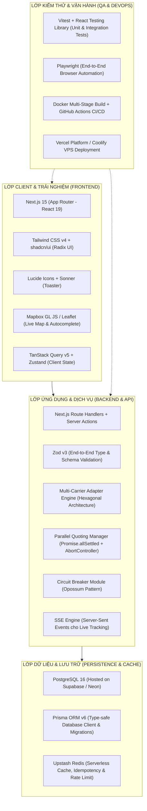
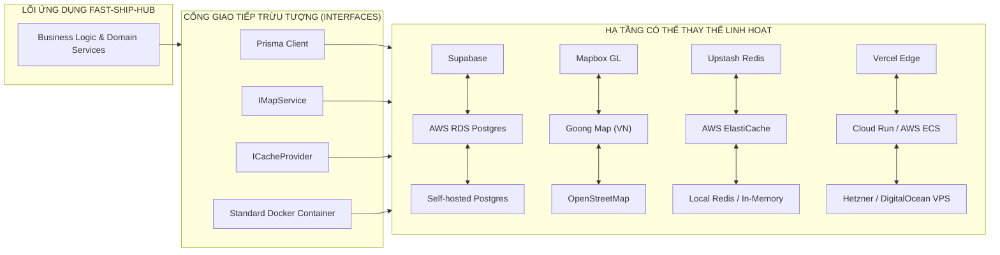

# TÀI LIỆU CHỐT PHẠM VI MVP VÀ BỘ CÔNG NGHỆ (TECH STACK SPECIFICATION)

> **Tên sản phẩm**: Nền Tảng Tích Hợp & So Sánh Giao Hàng Đa Hãng (`FAST-SHIP-HUB`)  
> **Mã tài liệu**: `DOC-ARCH-001` | **Phiên bản**: `1.0.0` | **Trạng thái**: `APPROVED_FOR_IMPLEMENTATION`  
> **Tác giả**: `system-architect` (Chuyên gia Kiến trúc Hệ thống)  
> **Đối tượng áp dụng**: `frontend-engineer`, `backend-engineer`, `database-engineer`, `devops-engineer`, `qa-engineer`

---

## 1. PHẠM VI SẢN PHẨM KHẢ DỤNG TỐI THIỂU (MVP SCOPE DEFINITION)

### 1.1. Triết lý MVP Tinh gọn (Lean MVP Philosophy)
Để tối ưu hóa thời gian đưa sản phẩm ra thị trường (**Time-to-Market ≤ 4 tuần**) và kiểm chứng giá trị cốt lõi trước người dùng thực tế, `FAST-SHIP-HUB` áp dụng chiến lược **Monolithic First — Modular Architecture**. Chúng tôi tập trung giải quyết bài toán cốt lõi: *"Giúp người gửi hàng nhìn thấy giá của tất cả các hãng trong vòng 1.5 giây và bấm đặt đơn ngay lập tức với mức giá tối ưu nhất."*

```mermaid
quadrantChart
    title Ma Trận Tính Năng MVP (Value vs Effort)
    x-axis Thấp (Low Effort) --> Cao (High Effort)
    y-axis Thấp (Low Value) --> Cao (High Value)
    quadrant-1 Triển khai ngay (MVP Core)
    quadrant-2 Kế hoạch tiếp theo (Phase 2)
    quadrant-3 Cân nhắc loại bỏ (De-prioritize)
    quadrant-4 Tối ưu hóa dần (Quick Wins)
    "So sánh giá đa hãng thời gian thực": [0.35, 0.95]
    "Bản đồ Autocomplete & Tọa độ": [0.25, 0.85]
    "Đặt đơn 1-Click tích hợp": [0.45, 0.90]
    "Mock Sandbox Carrier Adapter": [0.20, 0.88]
    "Live Tracking URL (không login)": [0.30, 0.80]
    "Ví trả trước & VietQR Top-up": [0.40, 0.78]
    "Nhập Excel đơn hàng loạt": [0.65, 0.60]
    "Ghép đơn đa điểm giao (Multi-drop)": [0.85, 0.50]
    "Cổng ví MoMo/ZaloPay": [0.70, 0.40]
```

### 1.2. Bảng Phân Định Phạm Vi Chi Tiết (In-Scope vs Out-of-Scope)

| STT | Nhóm Chức Năng | Phạm vi MVP (In-Scope Phase 1) | Ngoài phạm vi (Out-of-Scope -> Phase 2/3) |
| :---: | :--- | :--- | :--- |
| **1** | **Tuyến đường & Bản đồ** | • Autocomplete địa chỉ lấy/giao (Hà Nội & TP.HCM).<br>• Geocoding tọa độ vĩ độ/kinh độ.<br>• Tính khoảng cách đường bộ (Road Distance Matrix). | • Bản đồ ngoại tuyến (Offline maps).<br>• Điều hướng lộ trình xe buýt/tàu hỏa.<br>• Mở rộng 63 tỉnh thành (chỉ tập trung 2 đô thị lớn). |
| **2** | **Báo giá Đa Hãng** | • Gọi đồng thời (Parallel Quoting): Grab, ShopeeFood, Xanh SM, Ahamove, Be, Sandbox Mock.<br>• Timeout 1.8s, cô lập lỗi từng hãng.<br>• Gán nhãn thông minh: 🏆 Rẻ nhất, ⚡ Nhanh nhất, 🌿 Xanh nhất. | • Thuật toán AI dự báo giá cước tương lai.<br>• Đấu thầu giá cước theo lô hàng lớn.<br>• Đàm phán trực tiếp với tài xế riêng. |
| **3** | **Đặt đơn & Điều phối** | • Đặt đơn 1-Click đẩy sang API hãng đối tác.<br>• Điều phối xe máy tức thì (`BIKE_INSTANT`).<br>• Sandbox Mock Adapter giả lập 100% vòng đời điều phối. | • Giao xe tải chuyển nhà (`TRUCK_500KG+`).<br>• Ghép đơn đa điểm dừng (Multi-drop stops).<br>• Tự động tái điều phối (Re-dispatch) sang hãng thứ 2 khi hãng 1 hủy. |
| **4** | **Thanh toán & Ví** | • Ví trả trước dành cho Merchant (Nạp tiền, Tạm giữ, Quyết toán, Hoàn tiền).<br>• Cổng nạp tiền VietQR động (Napas 247).<br>• Thanh toán COD cho tài xế thu hộ. | • Cổng thẻ quốc tế Visa/Mastercard.<br>• Ví điện tử MoMo, ZaloPay, VNPay, Apple Pay.<br>• Cấp hạn mức tín dụng công nợ (Buy Now Pay Later). |
| **5** | **Tracking & Tra cứu** | • Trang Web tra cứu Live Map công khai qua `tracking_token` (không cần đăng nhập).<br>• Hiển thị thông tin tài xế, biển số, loại xe (xăng/điện), tọa độ GPS.<br>• Lịch sử trạng thái 10 bước. | • Thông báo qua SMS Brandname / Zalo ZNS.<br>• Ứng dụng di động Native (iOS/Android) cho người nhận.<br>• Gọi điện thoại VOIP trực tiếp trên web với shipper. |
| **6** | **Quản trị & Vận hành** | • Dashboard Admin cơ bản: Danh sách đơn hàng, Tra cứu mã đơn `FSH-XXXXX`.<br>• Công tắc ngắt mạch khẩn cấp (Circuit Breaker Toggle) cho từng hãng đối tác. | • Báo cáo đối soát kế toán chuyên sâu ERP.<br>• Phân quyền RBAC đa cấp độ chi tiết (Chỉ có Admin / Merchant / Guest). |

---

## 2. BỘ CÔNG NGHỆ CHUẨN HOÁ (STANDARDIZED TECH STACK)

FAST-SHIP-HUB được xây dựng trên nền tảng **TypeScript Fullstack Hiện Đại**, tận dụng tối đa thế mạnh của hệ sinh thái React 19 / Next.js 15 App Router để đạt hiệu năng cực hạn và trải nghiệm người dùng tức thì.



### 2.1. Danh mục Công nghệ Lựa chọn

| Tầng Kiến Trúc | Công Nghệ Lựa Chọn | Phiên Bản | Vai Trò & Trách Nhiệm Kỹ Thuật |
| :--- | :--- | :---: | :--- |
| **Framework Nền Tảng** | **Next.js (App Router)** | `15.0+` | Fullstack Web Framework, Server Components, Streaming SSR, Route Handlers tối ưu hóa latency. |
| **Ngôn Ngữ Cốt Lõi** | **TypeScript** | `5.6+` | Type Safety 100% từ Client tới Database Schema, ngăn ngừa lỗi runtime ở khâu tính cước tài chính. |
| **CSS & Design System**| **Tailwind CSS + shadcn/ui**| `3.4+ / v4` | Utility-first CSS kết hợp Headless Components (Radix UI), đảm bảo Accessibility (WAI-ARIA) và tốc độ tải trang cực nhanh. |
| **Quản Lý Biểu Mẫu** | **React Hook Form + Zod** | `7.53+ / 3.23+`| Validation dữ liệu đầu vào (tọa độ, số điện thoại, kích thước gói hàng) siêu tốc và đồng nhất giữa Client và Server. |
| **Bản Đồ & Định Vị** | **Mapbox GL JS / Leaflet** | `3.7+ / 1.9+` | Hiển thị bản đồ lộ trình, marker vị trí tài xế di chuyển thời gian thực, fallback OpenStreetMap khi không có Mapbox token. |
| **Cơ Sở Dữ Liệu** | **PostgreSQL** | `16.x` | Hệ quản trị CSDL quan hệ chuẩn công nghiệp, hỗ trợ ACID Transactions nghiêm ngặt cho Ví tiền và Đơn hàng. |
| **Database ORM** | **Prisma ORM** | `6.0+` | Quản lý Schema, Migrations an toàn, tự động sinh TypeScript Types, truy vấn cơ sở dữ liệu trực quan và an toàn injection. |
| **Cache & Khóa Trùng Lặp**| **Upstash Redis / In-Memory**| `Latest` | Lưu trữ tạm kết quả báo giá (TTL 300s), kiểm tra khóa chống click đúp (`Idempotency-Key`), đếm lỗi cho Circuit Breaker. |
| **Real-time Streaming**| **Server-Sent Events (SSE)** | `Native` | Đẩy tọa độ GPS shipper và trạng thái đơn hàng về trình duyệt người dùng mà không cần duy trì kết nối WebSocket phức tạp. |
| **Unit / Integration Test**| **Vitest** | `2.1+` | Khung kiểm thử siêu tốc tương thích Vite/TypeScript, thay thế Jest, đo lường độ bao phủ logic tính cước và Adapter. |
| **E2E Testing** | **Playwright** | `1.48+` | Kiểm thử tự động trên trình duyệt thật: luồng nhập địa chỉ -> so sánh giá -> chọn hãng -> đặt đơn -> tra cứu tracking. |

---

## 3. PHÂN TÍCH CHUYÊN SÂU LÝ DO LỰA CHỌN (DEEP-DIVE TECHNICAL RATIONALE)

### 3.1. Tại sao chọn Next.js 15 (App Router)?
1. **Hội tụ Fullstack trong một Repository duy nhất (Monorepo tinh gọn)**:
   - Loại bỏ rào cản chia tách dự án thành 2 repo (Frontend Next.js và Backend Express/NestJS), giảm 50% gánh nặng thiết lập CI/CD, phân phối biến môi trường và đồng bộ kiểu dữ liệu (Shared Types).
2. **Server Actions & Route Handlers**:
   - Các tác vụ nhạy cảm (như tính toán chiết khấu ví, lưu trữ API Keys của Grab, Xanh SM) được xử lý hoàn toàn phía Server (Zero Client Bundle Leak).
3. **Tối ưu hóa Core Web Vitals**:
   - Sử dụng React Server Components (RSC) cho các thành phần tĩnh, chỉ hydrate các thành phần tương tác (như form nhập địa chỉ, thẻ cước, live map), giúp chỉ số First Contentful Paint (FCP) đạt dưới 0.8s.

### 3.2. Tại sao chọn PostgreSQL kết hợp Prisma ORM?
1. **Bảo vệ Tính Toàn Vẹn Tài Chính (ACID Compliance)**:
   - FAST-SHIP-HUB vận hành ví tiền nạp và giao dịch tạm giữ cước phí (`hold_balance`). Việc dùng PostgreSQL với cơ chế khóa hàng (`SELECT ... FOR UPDATE`) và Transactions lồng nhau đảm bảo **tuyệt đối không xảy ra hiện tượng trừ trùng ví hoặc thất thoát tiền khi có tranh chấp đồng thời**.
2. **Trải nghiệm Lập trình Xuất sắc (Type-Safe DX với Prisma)**:
   - Mọi thay đổi trong `schema.prisma` tự động cập nhật Type trong toàn bộ mã nguồn. Nếu Backend Engineer thay đổi kiểu dữ liệu trạng thái đơn, TypeScript Compiler sẽ báo lỗi ngay lập tức tại các file giao diện hoặc Adapter liên quan.

### 3.3. Tại sao chọn Zod cho Toàn Bộ Tầng Dữ Liệu?
- Zod đóng vai trò "người gác cổng dữ liệu" (Data Gatekeeper). Chúng tôi áp dụng mô hình **Single Source of Truth**:
  $$\text{Zod Schema} \longrightarrow \text{Inferred TypeScript Types} \longrightarrow \text{API Validation} \longrightarrow \text{Form Validation}$$
- Mọi dữ liệu JSON từ các webhook đối tác (Grab, ShopeeFood) hay form đặt hàng đều phải đi qua `safeParse()`. Dữ liệu rác hoặc mã độc bị chặn đứng ngay trước khi chạm tới Controller.

### 3.4. Tại sao chọn Vitest và Playwright?
1. **Vitest**:
   - Nhanh hơn Jest gấp 4–8 lần nhờ khả năng tận dụng engine biến dịch ES modules và hỗ trợ TypeScript gốc mà không cần cấu hình Babel phức tạp.
   - Rất lý tưởng để kiểm thử Unit Test cho hàng chục kịch bản tính cước (Surge pricing, phụ phí ban đêm, logic gán nhãn huy hiệu).
2. **Playwright**:
   - Hỗ trợ cô lập browser context độc lập, khả năng ghi hình video test, bắt request mạng thời gian thực và kiểm thử đa trình duyệt (Chromium, Firefox, WebKit). Đảm bảo luồng đặt hàng hoạt động hoàn hảo trên cả Mobile Safari và Desktop Chrome.

---

## 4. PHÂN TÍCH TỔNG CHI PHÍ SỞ HỮU (TCO - INFRASTRUCTURE COST ANALYSIS)

Dự án được thiết kế theo nguyên tắc **Zero-to-Hero Cloud Architecture**, tối ưu chi phí từ $0 ở giai đoạn thử nghiệm cho đến khi đạt quy mô hàng trăm ngàn đơn/tháng.

```mermaid
xychart-beta
    title Chi Phí Hạ Tầng Dự Kiến Theo Quy Mô Đơn Hàng (USD / Tháng)
    x-axis ["MVP (1k đơn)", "Growth (10k đơn)", "Expansion (50k đơn)", "Scale (100k đơn)"]
    y-axis "Chi phí (USD/tháng)" 0 --> 200
    bar [0, 25, 75, 140]
```

### 4.1. Bảng Dự Toán Chi Phí Hạ Tầng Theo Giai Đoạn (USD / Tháng)

| Hạng mục Dịch vụ | Gói Dịch Vụ Nhà Cung Cấp | MVP Ban Đầu (≤ 1.000 đơn/tháng) | Giai đoạn Tăng trưởng (10.000 đơn/tháng) | Quy mô Vận hành Lớn (100.000 đơn/tháng) |
| :--- | :--- | :---: | :---: | :---: |
| **Compute / Hosting** | Vercel (Hobby -> Pro) / Coolify VPS | **$0** (Vercel Hobby) | **$20** (Vercel Pro) | **$40** (VPS 8 vCPU, 16GB RAM) |
| **Cơ Sở Dữ Liệu** | Supabase PostgreSQL / Neon | **$0** (Free Tier - 500MB) | **$25** (Supabase Pro) | **$25 - $50** (Scale compute) |
| **Bộ Nhớ Đệm Cache** | Upstash Redis | **$0** (Free Tier - 10k req/day) | **$10** (Pay-as-you-go) | **$20** |
| **Bản Đồ & Định Vị** | Mapbox GL API / OpenStreetMap | **$0** (Free 50k loads/month) | **$0** (Dưới ngưỡng tính phí) | **$25** |
| **Giám Sát & Logs** | Sentry / BetterStack | **$0** (Developer Free) | **$0** (Free quota) | **$15** |
| **TỔNG CHI PHÍ HẠ TẦNG**| — | **$0 / tháng** | **~$55 / tháng** | **~$125 - $150 / tháng** |
| **Chi phí trên mỗi đơn**| — | **0 VNĐ / đơn** | **~137 VNĐ / đơn** | **~37 VNĐ / đơn** |

> [!TIP]
> **Tỷ lệ chi phí cận biên trên mỗi đơn hàng cực kỳ thấp**: Với mức phí sàn thu cố định **1.000 VNĐ / đơn**, chi phí hạ tầng (37đ - 137đ) chỉ chiếm chưa đầy **3.7% đến 13.7%** doanh thu phí dịch vụ sàn, mang lại biên lợi nhuận gộp trên 85% cho nền tảng.

---

## 5. CHIẾN LƯỢC PHÒNG NGỪA RỦI RO VENDOR LOCK-IN (PORTABILITY STRATEGY)

Để đảm bảo hệ thống không bị "trói chân" vào bất kỳ nền tảng điện toán đám mây độc quyền nào, kiến trúc sư trưởng quy định 4 lớp trừu tượng hóa (Abstraction Layers):



1. **Khả Năng Di Chuyển Cơ Sở Dữ Liệu (Database Portability)**:
   - Không sử dụng các tính năng độc quyền gắn chặt của Supabase (như Supabase Row Level Security trực tiếp trên client hay Supabase Edge Functions).
   - Truy vấn 100% qua `Prisma ORM` với chuẩn kết nối PostgreSQL tiêu chuẩn (`DATABASE_URL`). Có thể chuyển từ Supabase sang Neon, AWS Aurora PostgreSQL hoặc một cụm PostgreSQL tự vận hành trên VPS trong vòng 5 phút chỉ bằng việc đổi biến môi trường.
2. **Khả Năng Độc Lập Dịch Vụ Bản Đồ (Map Engine Decoupling)**:
   - Xây dựng module trừu tượng `IMapService`. Nếu chi phí Mapbox vượt ngân sách hoặc cần độ chính xác cao hơn tại các ngõ ngách nông thôn Việt Nam, đội ngũ có thể chuyển sang sử dụng API của **Goong Map** (Bản đồ bản địa Việt Nam) mà không cần chỉnh sửa bất kỳ component giao diện nào.
3. **Đóng Gói Độc Lập Nền Tảng Triển Khai (Containerization Ready)**:
   - Chuẩn bị sẵn file `Dockerfile` cấu hình Multi-stage build (dựa trên Node.js Alpine). Ứng dụng có thể chạy trên Vercel, nhưng cũng có thể triển khai mượt mà lên Docker Swarm, Kubernetes, Coolify hoặc bất kỳ nhà cung cấp VPS giá rẻ nào (OVH, Hetzner, Vietnix).
4. **Trừu Tượng Hóa Bộ Nhớ Đệm (Cache Provider Isolation)**:
   - Hệ thống cung cấp `MemoryLRUCache` chạy cục bộ cho môi trường Development và Test mà không yêu cầu lập trình viên phải cài đặt Redis Server. Khi chạy Production, hệ thống tự động nhận biến `REDIS_URL` để kích hoạt kết nối `Upstash Redis`.

---

## 6. QUY CHUẨN MÔI TRƯỜNG & BIẾN MÔI TRƯỜNG (ENVIRONMENT CONFIGURATION)

Mọi cấu hình ứng dụng được kiểm tra chặt chẽ thông qua Zod schema khi khởi động hệ thống (`src/env.mjs`):

```typescript
// src/env.mjs - Khai báo và thẩm định biến môi trường bắt buộc
import { z } from 'zod';

export const envSchema = z.object({
  // Nền tảng & Ứng dụng
  NODE_ENV: z.enum(['development', 'test', 'production']).default('development'),
  NEXT_PUBLIC_APP_URL: z.string().url().default('http://localhost:3000'),

  // Cơ sở dữ liệu & Caching
  DATABASE_URL: z.string().url({ message: 'DATABASE_URL phải là chuỗi kết nối PostgreSQL hợp lệ' }),
  DIRECT_URL: z.string().url().optional(), // Dành cho Supabase pooling
  UPSTASH_REDIS_REST_URL: z.string().url().optional(),
  UPSTASH_REDIS_REST_TOKEN: z.string().min(1).optional(),

  // Dịch vụ Bản đồ
  NEXT_PUBLIC_MAPBOX_ACCESS_TOKEN: z.string().min(1).optional(),
  GOONG_MAPS_API_KEY: z.string().min(1).optional(),

  // Cấu hình Đối tác Vận chuyển (Production vs Sandbox)
  ENABLE_SANDBOX_MOCK: z.string().transform((v) => v === 'true').default('true'),
  GRAB_CLIENT_ID: z.string().min(1).optional(),
  GRAB_CLIENT_SECRET: z.string().min(1).optional(),
  XANH_SM_API_KEY: z.string().min(1).optional(),
  SHOPEE_FOOD_PARTNER_KEY: z.string().min(1).optional(),
  AHAMOVE_API_KEY: z.string().min(1).optional(),
  BE_PARTNER_SECRET: z.string().min(1).optional(),

  // An ninh & Bảo mật
  JWT_SECRET: z.string().min(32, { message: 'JWT_SECRET phải có độ dài tối thiểu 32 ký tự' }),
  WEBHOOK_SIGNING_SECRET: z.string().min(16),
});
```

---

## 7. KẾT LUẬN & CHỈ ĐẠO CHO CÁC GIAI ĐOẠN KẾ TIẾP

Tài liệu này chính thức **KHÓA BỘ CÔNG NGHỆ VÀ PHẠM VI MVP**. 
- `database-engineer` căn cứ vào các thực thể và yêu cầu ACID tại mục 2.1 & 3.2 để thiết kế Schema Prisma chi tiết (`docs/15` đến `docs/20`).
- `ui-ux-designer` căn cứ vào cấu trúc giao diện shadcn/ui, Tailwind CSS và luồng Mapbox/Leaflet tại mục 2.1 để dựng Wireframes & Component Design System (`docs/10` đến `docs/14`).
- Không thành viên nào được tự ý đưa thêm thư viện ngoài danh mục đã chốt nếu chưa thông qua quy trình cập nhật ADR (Architecture Decision Record).
