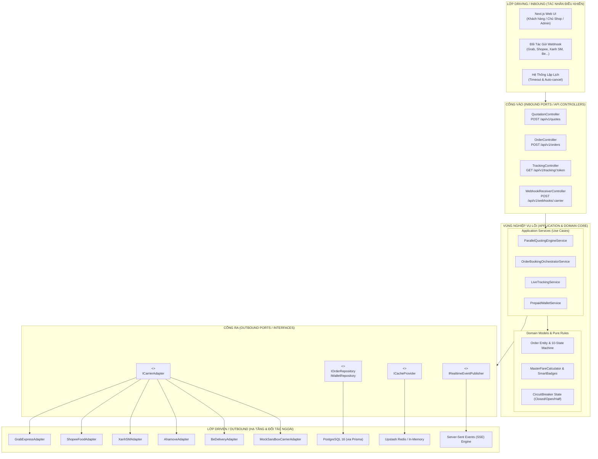
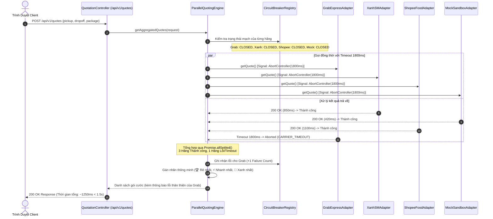
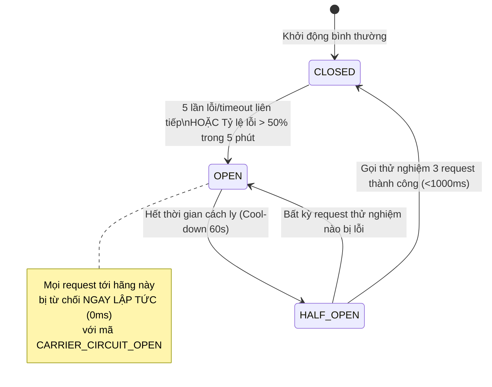
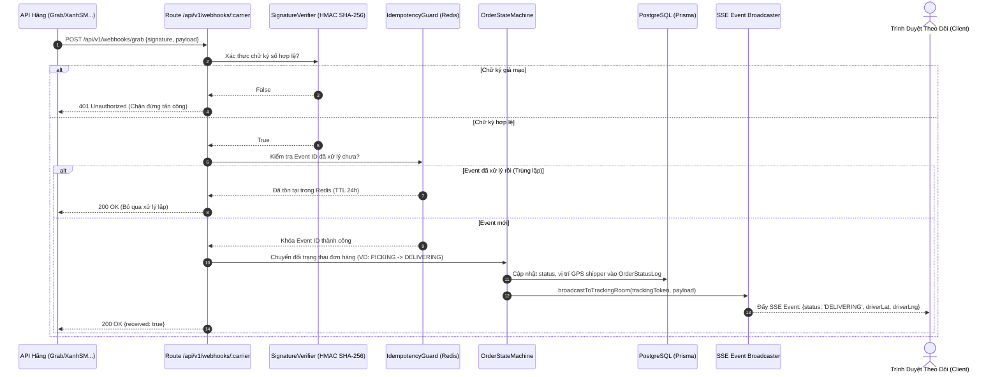

# TÀI LIỆU THIẾT KẾ KIẾN TRÚC HỆ THỐNG (SYSTEM ARCHITECTURE SPECIFICATION)

> **Tên sản phẩm**: Nền Tảng Tích Hợp & So Sánh Giao Hàng Đa Hãng (`FAST-SHIP-HUB`)  
> **Mã tài liệu**: `DOC-ARCH-002` | **Phiên bản**: `1.0.0` | **Trạng thái**: `APPROVED_FOR_IMPLEMENTATION`  
> **Tác giả**: `system-architect` (Chuyên gia Kiến trúc Hệ thống)  
> **Đối tượng áp dụng**: `backend-engineer`, `frontend-engineer`, `database-engineer`, `security-reviewer`, `qa-engineer`

---

## 1. TỔNG QUAN KIẾN TRÚC CỐT LÕI: PORTS & ADAPTERS (HEXAGONAL ARCHITECTURE)

FAST-SHIP-HUB áp dụng mô hình **Kiến trúc Lục giác (Hexagonal Architecture / Ports and Adapters)**. Mục tiêu sống còn của kiến trúc này là:
1. **Cô lập Nghiệp vụ Lõi (Domain Core Isolation)**: Logic so sánh cước, quy tắc gán nhãn, máy trạng thái đơn hàng (Order State Machine), và tài chính ví hoàn toàn độc lập với các thư viện giao diện, cơ sở dữ liệu hay API của các hãng thứ ba.
2. **Cắm - Rút Linh Hoạt (Pluggable Carriers)**: Thêm mới một hãng vận chuyển (như Lalamove, J&T Instant) hoặc thay đổi nhà cung cấp cơ sở dữ liệu mà không cần sửa đổi dù chỉ 1 dòng code logic nghiệp vụ trung tâm.



---

## 2. CHUẨN GIAO TIẾP INTERFACE CHUNG: `ICarrierAdapter`

Mọi hãng vận chuyển (kể cả Sandbox Mock) đều **bắt buộc triển khai đầy đủ 100%** interface chuẩn TypeScript sau đây. Không được phép bypass hoặc gọi trực tiếp API hãng từ UI/Controller.

```typescript
// src/core/ports/carrier-adapter.interface.ts

/** Danh sách mã hãng hợp lệ trong toàn hệ thống */
export type CarrierCode = 
  | 'GRAB' 
  | 'SHOPEE_FOOD' 
  | 'XANH_SM' 
  | 'AHAMOVE' 
  | 'BE' 
  | 'SANDBOX_MOCK';

/** Phân hạng phương tiện vận chuyển */
export type ServiceTier = 
  | 'BIKE_INSTANT' 
  | 'BIKE_SAME_DAY' 
  | 'CAR_DELIVERY' 
  | 'TRUCK_500KG';

/** Tọa độ địa lý chuẩn WGS84 */
export interface GeoPoint {
  latitude: number;
  longitude: number;
  address: string;
  senderOrReceiverName: string;
  phoneNumber: string;
  note?: string;
}

/** Thông tin kiện hàng */
export interface PackageDetails {
  weightInGrams: number;
  lengthCm: number;
  widthCm: number;
  heightCm: number;
  packageType: 'DOCUMENT' | 'FOOD' | 'FASHION' | 'FRAGILE' | 'ELECTRONICS';
  declaredValueVnd: number;
  codAmountVnd: number;
  isFragile?: boolean;
  deliverToDoor?: boolean;
}

/** Dữ liệu đầu vào để yêu cầu báo giá */
export interface CarrierQuoteRequest {
  pickup: GeoPoint;
  dropoff: GeoPoint;
  packageDetails: PackageDetails;
  serviceTier: ServiceTier;
}

/** Kết quả báo giá chuẩn hóa trả về từ Adapter */
export interface CarrierQuoteItem {
  carrierCode: CarrierCode;
  carrierServiceName: string;
  serviceTier: ServiceTier;
  baseFee: number;
  surcharges: number;
  discountAmount: number;
  carrierOriginalTotal: number;
  platformFee: number;
  finalTotalFee: number;
  estimatedPickupMinutes: number;
  estimatedDeliveryMinutes: number;
  totalEstimatedMinutes: number;
  currency: 'VND';
  expiredAt: Date;
  quoteReferenceId: string; // Token định danh báo giá phía đối tác
}

export interface CarrierQuoteResponse {
  success: boolean;
  carrierCode: CarrierCode;
  quote?: CarrierQuoteItem;
  errorMessage?: string;
  errorCode?: string;
  durationMs: number;
}

/** Dữ liệu yêu cầu đặt đơn */
export interface CarrierBookingRequest {
  orderCode: string; // Mã đơn FAST-SHIP-HUB: FSH-YYYYMMDD-XXXX
  pickup: GeoPoint;
  dropoff: GeoPoint;
  packageDetails: PackageDetails;
  serviceTier: ServiceTier;
  quoteReferenceId: string;
  notesForDriver?: string;
}

/** Thông tin tài xế do hãng cung cấp */
export interface DriverInfo {
  name: string;
  phone: string;
  licensePlate: string;
  vehicleType: 'GAS_BIKE' | 'ELECTRIC_BIKE' | 'CAR';
  avatarUrl?: string;
  currentLocation?: {
    latitude: number;
    longitude: number;
    updatedAt: Date;
  };
}

/** Kết quả đặt đơn từ Adapter */
export interface CarrierBookingResponse {
  success: boolean;
  carrierCode: CarrierCode;
  carrierOrderId: string; // Mã đơn đối tác cấp
  carrierStatus: string;
  normalizedStatus: 'BOOKED' | 'PICKING' | 'FAILED_DISPATCH';
  driver?: DriverInfo;
  trackingUrl?: string;
  rawResponse?: unknown;
}

/** Yêu cầu hủy đơn */
export interface CarrierCancelRequest {
  carrierOrderId: string;
  orderCode: string;
  reason: string;
}

export interface CarrierCancelResponse {
  success: boolean;
  carrierCode: CarrierCode;
  cancellationFee: number;
  message: string;
}

/** Tra cứu trạng thái theo dõi từ hãng */
export interface CarrierTrackingRequest {
  carrierOrderId: string;
  orderCode: string;
}

export interface CarrierTrackingResponse {
  carrierCode: CarrierCode;
  carrierOrderId: string;
  normalizedStatus: 'BOOKED' | 'PICKING' | 'DELIVERING' | 'DELIVERED' | 'RETURNING' | 'RETURNED' | 'CANCELLED';
  driver?: DriverInfo;
  timeline: Array<{
    status: string;
    description: string;
    timestamp: Date;
  }>;
}

/** Sự kiện Webhook đã được chuẩn hóa */
export interface WebhookNormalizedEvent {
  carrierCode: CarrierCode;
  carrierOrderId: string;
  eventId: string;
  eventType: 'DRIVER_ASSIGNED' | 'DRIVER_ARRIVING' | 'PICKED_UP' | 'DELIVERED' | 'CANCELLED' | 'LOCATION_UPDATE';
  normalizedStatus: 'PICKING' | 'DELIVERING' | 'DELIVERED' | 'CANCELLED' | 'RETURNING' | 'RETURNED';
  timestamp: Date;
  driver?: DriverInfo;
  cancellationReason?: string;
  rawPayload: unknown;
}

/** INTERFACE HẠNG NHẤT CỦA CÁC CARRIER ADAPTER */
export interface ICarrierAdapter {
  readonly carrierCode: CarrierCode;
  readonly displayName: string;

  /** Lấy báo giá cước thời gian thực */
  getQuote(request: CarrierQuoteRequest): Promise<CarrierQuoteResponse>;

  /** Tạo đơn hàng và yêu cầu tìm tài xế */
  createBooking(request: CarrierBookingRequest): Promise<CarrierBookingResponse>;

  /** Hủy đơn hàng đã đặt */
  cancelBooking(request: CarrierCancelRequest): Promise<CarrierCancelResponse>;

  /** Lấy thông tin tracking trực tiếp từ hãng */
  getTracking(request: CarrierTrackingRequest): Promise<CarrierTrackingResponse>;

  /** Thẩm định chữ ký số Webhook để chống giả mạo */
  verifyWebhookSignature(rawBody: string, headers: Record<string, string>): boolean;

  /** Chuẩn hóa payload webhook của hãng về định dạng chuẩn hệ thống */
  parseWebhookPayload(payload: unknown): WebhookNormalizedEvent;
}
```

---

## 3. THIẾT KẾ CHI TIẾT 6 ADAPTER VẬN CHUYỂN

### 3.1. GrabExpressAdapter (`GRAB`)
- **Giao thức**: REST API v2 trên nền HTTPS.
- **Xác thực**: OAuth2 Client Credentials (`/v2/oauth2/token`) sinh Bearer Token (TTL 3600s, lưu trong Redis).
- **Endpoint mapping**:
  - Báo giá: `POST https://partner-api.grab.com/grabexpress/v2/deliveries/quotes`
  - Đặt đơn: `POST https://partner-api.grab.com/grabexpress/v2/deliveries`
  - Hủy đơn: `DELETE https://partner-api.grab.com/grabexpress/v2/deliveries/{deliveryId}`
- **Đặc thù**: Giới hạn trọng lượng xe máy tối đa 20kg (khắt khe hơn chuẩn 30kg chung). Tự động chặn gói cước nếu kiện hàng > 20kg.
- **Xác thực Webhook**: Kiểm tra header `X-Grab-Signature` bằng thuật toán HMAC-SHA256 với secret key đối tác.

### 3.2. ShopeeFoodAdapter (`SHOPEE_FOOD`)
- **Giao thức**: ShopeeFood Open Platform API.
- **Xác thực**: Ký request bằng Timestamp + PartnerId + HMAC-SHA256 Secret trên từng lời gọi.
- **Endpoint mapping**:
  - Báo giá: `POST https://open-api.shopeefood.vn/v1/shipment/quote`
  - Đặt đơn: `POST https://open-api.shopeefood.vn/v1/shipment/create`
- **Đặc thù**: Thời gian phản hồi API biến động mạnh trong khung giờ 11h30 - 13h00 (cao điểm đặt thức ăn trưa). Yêu cầu AbortController ngắt mạch nhanh.

### 3.3. XanhSMAdapter (`XANH_SM`)
- **Giao thức**: VinFast GSM Delivery B2B Partner API.
- **Xác thực**: Bearer Token cố định qua Header `Authorization: Bearer <XANH_SM_API_KEY>`.
- **Thế mạnh độc quyền**:
  - Đội ngũ tài xế 100% sử dụng xe máy điện **VinFast Feliz S / Evo 200**.
  - Không chịu ảnh hưởng của biến động giá xăng dầu, phụ phí surge mưa bão luôn thấp hơn 30% so với Grab.
- **Dữ liệu bổ sung**: Trả về chỉ số giảm thiểu khí thải: `co2SavingGrams = distanceKm * 42.5` để hiển thị nhãn 🌿 **Xanh Nhất**.

### 3.4. AhamoveAdapter (`AHAMOVE`)
- **Giao thức**: Ahamove OpenAPI (Shared Order Protocol).
- **Xác thực**: API Token truyền qua Query Parameter `?token=<API_KEY>`.
- **Endpoint mapping**:
  - Báo giá: `POST https://apionline.ahamove.com/v1/order/estimated_fee`
  - Đặt đơn: `POST https://apionline.ahamove.com/v1/order/create`
- **Đặc thù**: Phù hợp cho cự ly dài trên 10km nội thành với biểu phí rẻ bậc thang.

### 3.5. BeDeliveryAdapter (`BE`)
- **Giao thức**: BeGroup Partner Delivery API.
- **Xác thực**: mTLS (Mutual TLS) hoặc Partner Token JWT.
- **Endpoint mapping**:
  - Báo giá: `POST https://api.be.com.vn/delivery/v1/quotation`
  - Đặt đơn: `POST https://api.be.com.vn/delivery/v1/booking`
- **Đặc thù**: Đội ngũ tài xế beBike dày đặc tại các quận trung tâm Hà Nội & TP.HCM.

### 3.6. MockSandboxCarrierAdapter (`SANDBOX_MOCK`) — Thành Phần Hạng Nhất (First-Class Citizen)
Để phục vụ quá trình phát triển (Local Dev), chạy CI/CD tự động và kiểm thử E2E Playwright mà không tốn chi phí gọi API thật của các hãng, hệ thống xây dựng **Mock Sandbox Adapter với độ mô phỏng trung thực 100%**:

```typescript
// src/core/adapters/sandbox-mock.adapter.ts
export class MockSandboxCarrierAdapter implements ICarrierAdapter {
  readonly carrierCode = 'SANDBOX_MOCK';
  readonly displayName = 'FAST-SHIP Sandbox Express (Mô phỏng)';

  /** Bộ cờ kiểm soát hành vi mô phỏng (dùng cho QA Test) */
  private simulateDelayMs = 400;
  private shouldFailTimeout = false;
  private shouldFailNoDriver = false;

  async getQuote(request: CarrierQuoteRequest): Promise<CarrierQuoteResponse> {
    const startTime = Date.now();
    
    if (this.shouldFailTimeout) {
      await new Promise(resolve => setTimeout(resolve, 2500)); // Quá 1800ms
    } else {
      await new Promise(resolve => setTimeout(resolve, this.simulateDelayMs));
    }

    // Tính khoảng cách ước lượng theo công thức Haversine
    const distKm = calculateDistance(
      request.pickup.latitude, request.pickup.longitude,
      request.dropoff.latitude, request.dropoff.longitude
    );

    // Tính cước theo biểu phí chuẩn Mock trong Business Rules
    const baseFee = 14500;
    const distanceFee = distKm <= 2 ? 0 : (distKm - 2) * 4900;
    const finalTotalFee = Math.round(baseFee + distanceFee + 1000); // Đã gồm 1k phí sàn

    return {
      success: true,
      carrierCode: this.carrierCode,
      durationMs: Date.now() - startTime,
      quote: {
        carrierCode: this.carrierCode,
        carrierServiceName: 'FAST-SHIP Sandbox Siêu Tốc',
        serviceTier: request.serviceTier,
        baseFee,
        surcharges: 0,
        discountAmount: 0,
        carrierOriginalTotal: finalTotalFee - 1000,
        platformFee: 1000,
        finalTotalFee,
        estimatedPickupMinutes: 5,
        estimatedDeliveryMinutes: Math.round(distKm * 3.5),
        totalEstimatedMinutes: 5 + Math.round(distKm * 3.5),
        currency: 'VND',
        expiredAt: new Date(Date.now() + 300 * 1000), // TTL 5 phút
        quoteReferenceId: `MOCK-QUOTE-${Date.now()}`
      }
    };
  }

  async createBooking(request: CarrierBookingRequest): Promise<CarrierBookingResponse> {
    if (this.shouldFailNoDriver) {
      return {
        success: false,
        carrierCode: this.carrierCode,
        carrierOrderId: '',
        carrierStatus: 'NO_DRIVER_AVAILABLE',
        normalizedStatus: 'FAILED_DISPATCH'
      };
    }

    return {
      success: true,
      carrierCode: this.carrierCode,
      carrierOrderId: `MOCK-ORDER-${Date.now()}`,
      carrierStatus: 'DRIVER_ALLOCATED',
      normalizedStatus: 'BOOKED',
      driver: {
        name: 'Nguyễn Văn Test',
        phone: '0988776655',
        licensePlate: '29-M1 999.88',
        vehicleType: 'ELECTRIC_BIKE',
        currentLocation: {
          latitude: request.pickup.latitude + 0.002,
          longitude: request.pickup.longitude + 0.002,
          updatedAt: new Date()
        }
      }
    };
  }

  // Triển khai cancelBooking, getTracking, verifyWebhook, parseWebhook đầy đủ...
}
```

---

## 4. CƠ CHẾ PARALLEL QUOTING & CHỊU LỖI (CIRCUIT BREAKER)

### 4.1. Luồng Báo Giá Song Song (Parallel Quoting Sequence Diagram)
Người dùng tuyệt đối không phải chờ đợi tuần tự từng hãng. Yêu cầu báo giá được bắn đồng thời tới toàn bộ 6 adapter bằng `Promise.allSettled()`.



### 4.2. Thiết Kế Circuit Breaker (Bộ Ngắt Mạch Bảo Vệ Từng Đối Tác)
Để ngăn ngừa tình trạng 1 đối tác bị sập làm cạn kiệt tài nguyên máy chủ hoặc kéo tụt trải nghiệm toàn sàn, mỗi Adapter được quản lý bởi một Circuit Breaker độc lập:



```typescript
// src/core/services/circuit-breaker.service.ts
export class CarrierCircuitBreaker {
  private state: 'CLOSED' | 'OPEN' | 'HALF_OPEN' = 'CLOSED';
  private failureCount = 0;
  private readonly failureThreshold = 5;
  private readonly cooldownPeriodMs = 60000; // 60s
  private nextAttemptAt: number = 0;

  canExecute(): boolean {
    if (this.state === 'CLOSED') return true;
    if (this.state === 'OPEN') {
      if (Date.now() >= this.nextAttemptAt) {
        this.state = 'HALF_OPEN';
        return true; // Thử nghiệm
      }
      return false; // Chặn ngay tức thì
    }
    return true; // Đang ở HALF_OPEN
  }

  recordSuccess(): void {
    this.failureCount = 0;
    this.state = 'CLOSED';
  }

  recordFailure(): void {
    this.failureCount++;
    if (this.failureCount >= this.failureThreshold || this.state === 'HALF_OPEN') {
      this.state = 'OPEN';
      this.nextAttemptAt = Date.now() + this.cooldownPeriodMs;
    }
  }
}
```

---

## 5. KIẾN TRÚC XỬ LÝ WEBHOOK & ĐỒNG BỘ LIVE TRACKING (SSE)

### 5.1. Luồng Xử Lý Webhook Bất Đồng Bộ
Các hãng vận chuyển sẽ bắn Webhook về FAST-SHIP-HUB khi có biến động: tìm thấy tài xế, tài xế đã lấy hàng, tài xế đã giao xong hoặc shipper di chuyển tọa độ GPS.



### 5.2. Tại sao chọn Server-Sent Events (SSE) thay vì WebSocket cho Live Tracking?
1. **Giao thức 1 chiều tối ưu (Uni-directional)**:
   - Trong bài toán theo dõi shipper, dữ liệu chỉ di chuyển 1 chiều duy nhất từ **Server -> Client** (Client chỉ nghe tọa độ của tài xế và trạng thái đơn hàng, không cần gửi thông tin ngược lại).
2. **Tương thích hoàn hảo với Hạ tầng Serverless / Edge**:
   - WebSocket đòi hỏi duy trì Stateful Server phức tạp và tốn kém tài nguyên mở cổng TCP. Trong khi đó, SSE chạy hoàn toàn trên chuẩn HTTP/1.1 hoặc HTTP/2 tiêu chuẩn, được hỗ trợ gốc trong Next.js Route Handlers (`ReadableStream`).
3. **Cơ chế Tự Động Kết Nối Lại (Native Auto-reconnect)**:
   - Trình duyệt tích hợp sẵn đối tượng `EventSource`. Nếu người dùng đi vào vùng sóng yếu hoặc mất mạng tạm thời, trình duyệt tự động kết nối lại và gửi header `Last-Event-ID` để tiếp tục luồng dữ liệu mà không cần viết thêm mã xử lý phức tạp.
