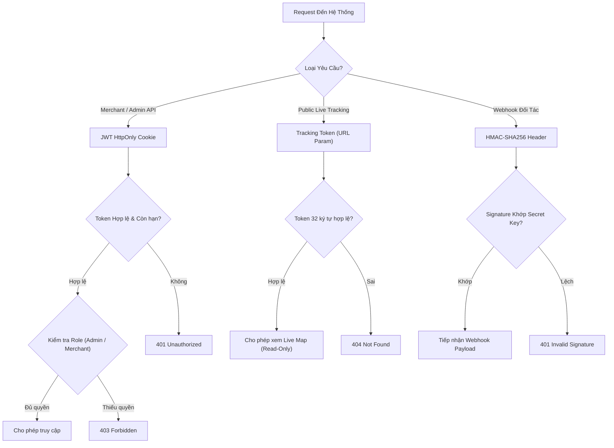
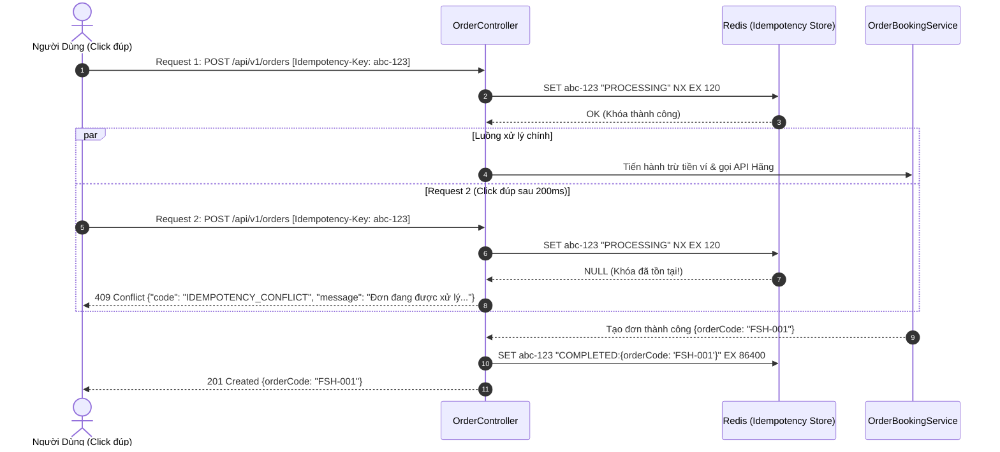

# TÀI LIỆU QUY CHUẨN THIẾT KẾ API VÀ TÍCH HỢP (API CONVENTIONS & INTEGRATION SPEC)

> **Tên sản phẩm**: Nền Tảng Tích Hợp & So Sánh Giao Hàng Đa Hãng (`FAST-SHIP-HUB`)  
> **Mã tài liệu**: `DOC-ARCH-003` | **Phiên bản**: `1.0.0` | **Trạng thái**: `APPROVED_FOR_IMPLEMENTATION`  
> **Tác giả**: `system-architect` (Chuyên gia Kiến trúc Hệ thống)  
> **Đối tượng áp dụng**: `backend-engineer`, `frontend-engineer`, `security-reviewer`, `qa-engineer`

---

## 1. NGUYÊN TẮC THIẾT KẾ RESTFUL VÀ ĐỊNH DANH (RESTFUL DESIGN PRINCIPLES)

Mọi API nội bộ và công khai của FAST-SHIP-HUB đều phải tuân thủ nghiêm ngặt các quy tắc sau:

1. **Phiên bản hóa bắt buộc (API Versioning)**:  
   Tất cả endpoint đều bắt đầu bằng tiền tố `/api/v1/...` để đảm bảo khả năng tương thích ngược khi nâng cấp hệ thống.
2. **Quy tắc đặt tên đường dẫn (URI Naming Conventions)**:
   - Sử dụng danh từ số nhiều, chữ thường, phân tách bằng dấu gạch ngang (kebab-case):  
     Ví dụ: `/api/v1/carrier-quotes`, `/api/v1/wallet-transactions`.
   - Các hành động đặc thù (RPC-style Actions) không thể mô tả thuần túy qua động từ HTTP được đặt ở cuối URI:  
     Ví dụ: `POST /api/v1/orders/{order_code}/cancel`, `POST /api/v1/wallet/topup/qr`.
3. **Sử dụng đúng mã trạng thái HTTP (HTTP Status Codes)**:
   - `200 OK`: Thành công với dữ liệu trả về (GET, PUT, PATCH).
   - `201 Created`: Tạo mới tài nguyên thành công (POST tạo đơn hàng, tạo giao dịch).
   - `400 Bad Request`: Lỗi cú pháp dữ liệu hoặc validation thất bại (Zod validation error).
   - `401 Unauthorized`: Chưa xác thực danh tính (Thiếu hoặc hết hạn JWT/Session).
   - `403 Forbidden`: Đã xác thực nhưng không đủ quyền hạn (Merchant cố xem đơn của shop khác).
   - `404 Not Found`: Không tìm thấy tài nguyên (Mã đơn hoặc tracking token không tồn tại).
   - `409 Conflict`: Xung đột trạng thái đơn hàng hoặc trùng lặp yêu cầu Idempotency đang xử lý.
   - `422 Unprocessable Entity`: Dữ liệu đúng cú pháp nhưng vi phạm quy tắc nghiệp vụ (Ví không đủ tiền, khoảng cách quá xa).
   - `429 Too Many Requests`: Vượt quá hạn mức tần suất truy vấn (Rate Limit).
   - `502 Bad Gateway`: Hãng đối tác trả về phản hồi lỗi hoặc không xác định.
   - `504 Gateway Timeout`: Hãng đối tác quá thời gian chờ (Timeout > 1800ms).

---

## 2. CHUẨN CẤU TRÚC PHẢN HỒI JSON DỮ LIỆU THỐNG NHẤT (UNIFIED API RESPONSE FORMAT)

Mọi phản hồi từ hệ thống (kể cả thành công hay thất bại) đều phải được bọc trong một phong bì chuẩn (`ApiResponseEnvelope`):

```typescript
// src/core/types/api-response.interface.ts

export interface ApiSuccessResponse<T> {
  success: true;
  data: T;
  metadata?: {
    page?: number;
    limit?: number;
    totalCount?: number;
    processingTimeMs?: number;
    [key: string]: unknown;
  };
  timestamp: string; // ISO 8601 UTC (VD: "2026-11-03T16:00:00.000Z")
  traceId: string;   // Chuỗi UUIDv4 phục vụ truy vết log và debug
}

export interface ApiErrorResponse {
  success: false;
  error: {
    code: string;           // Mã lỗi hệ thống định danh duy nhất (VD: "VALIDATION_ERROR")
    message: string;        // Thông báo lỗi thân thiện bằng Tiếng Việt
    details?: Array<{       // Chi tiết danh sách các trường bị lỗi validation
      field: string;
      issue: string;
    }> | unknown;
  };
  timestamp: string;
  traceId: string;
}

export type ApiResponse<T> = ApiSuccessResponse<T> | ApiErrorResponse;
```

### 2.1. Ví dụ Phản hồi Thành Công (`200 OK`)
```json
{
  "success": true,
  "data": {
    "orderCode": "FSH-20261103-8899",
    "status": "BOOKED",
    "carrierCode": "XANH_SM",
    "carrierOrderId": "GSM-DELIVERY-99123",
    "finalTotalFee": 28000,
    "trackingUrl": "/tracking/fsh_live_89a7df6b02a4"
  },
  "metadata": {
    "processingTimeMs": 620
  },
  "timestamp": "2026-11-03T16:15:00.123Z",
  "traceId": "c8b417d9-291b-4b2a-a9e8-4ffea0731a29"
}
```

### 2.2. Ví dụ Phản hồi Thất Bại (`422 Unprocessable Entity`)
```json
{
  "success": false,
  "error": {
    "code": "INSUFFICIENT_WALLET_BALANCE",
    "message": "Số dư khả dụng trong ví không đủ để thanh toán cước phí đơn hàng",
    "details": {
      "requiredAmount": 35000,
      "availableBalance": 12000,
      "deficit": 23000
    }
  },
  "timestamp": "2026-11-03T16:16:10.500Z",
  "traceId": "9fa83d21-f3b1-4c92-80dc-32890adcb812"
}
```

---

## 3. DANH MỤC MÃ LỖI CHUẨN HÓA TOÀN DỰ ÁN (ERROR CODE CATALOG)

| Mã Lỗi Hệ Thống (Error Code) | HTTP Status | Thông Báo Tiếng Việt | Mô Tả Kỹ Thuật & Hướng Xử Lý |
| :--- | :---: | :--- | :--- |
| `VALIDATION_ERROR` | `400` | Dữ liệu đầu vào không hợp lệ hoặc thiếu trường bắt buộc | Trả về chi tiết các field vi phạm theo Zod Schema |
| `INVALID_CREDENTIALS` | `401` | Số điện thoại hoặc mật khẩu không chính xác | Người dùng nhập sai thông tin đăng nhập |
| `TOKEN_EXPIRED` | `401` | Phiên đăng nhập đã hết hạn, vui lòng đăng nhập lại | JWT token đã quá hạn sử dụng |
| `UNAUTHORIZED_ACCESS` | `403` | Bạn không có quyền truy cập vào tài nguyên này | Cố tình đọc đơn hàng của người khác hoặc trái role |
| `ORDER_NOT_FOUND` | `404` | Không tìm thấy thông tin đơn hàng yêu cầu | Mã `order_code` không tồn tại trong CSDL |
| `TRACKING_TOKEN_INVALID` | `404` | Mã tra cứu hành trình không hợp lệ hoặc đã bị thu hồi | URL tracking bị gõ sai hoặc mã token giả mạo |
| `IDEMPOTENCY_CONFLICT` | `409` | Yêu cầu tạo đơn đang được xử lý, vui lòng không bấm lặp lại | Phát hiện `Idempotency-Key` đang ở trạng thái `PROCESSING` |
| `INVALID_STATE_TRANSITION`| `409` | Thao tác không hợp lệ đối với trạng thái hiện tại của đơn | Cố tình hủy đơn khi trạng thái đã là `DELIVERING` |
| `INSUFFICIENT_WALLET_BALANCE`| `422` | Số dư khả dụng trong ví không đủ để thanh toán | Yêu cầu nạp thêm tiền qua VietQR trước khi đặt |
| `PACKAGE_EXCEEDS_LIMITS` | `422` | Kiện hàng vượt quá kích thước hoặc trọng lượng xe máy cho phép | Trọng lượng > 30kg hoặc kích thước > 50x40x50cm |
| `DISTANCE_EXCEEDS_LIMIT` | `422` | Khoảng cách giao hàng vượt quá bán kính nội thành (50km) | Lộ trình quá xa, không hỗ trợ giao tức thì |
| `RATE_LIMIT_EXCEEDED` | `429` | Bạn đã gửi quá nhiều yêu cầu trong thời gian ngắn | Áp dụng Rate Limit: tối đa 60 req/phút/IP |
| `CARRIER_TIMEOUT` | `504` | Đối tác vận chuyển phản hồi quá thời gian cho phép | Adapter bị ngắt sau 1800ms bởi AbortController |
| `CARRIER_CIRCUIT_OPEN` | `503` | Cổng kết nối đối tác đang bảo trì hoặc tự ngắt để bảo vệ hệ thống | Circuit Breaker của hãng đang ở trạng thái `OPEN` |
| `CARRIER_DISPATCH_FAILED`| `502` | Đối tác không tìm thấy tài xế trong khu vực | Hãng hết xe xung quanh; tự động hoàn tiền ví |
| `INTERNAL_SERVER_ERROR` | `500` | Hệ thống gặp sự cố ngoài dự kiến, vui lòng thử lại sau | Bắt unhandled exception và gửi cảnh báo về Sentry |

---

## 4. CƠ CHẾ XÁC THỰC VÀ BẢO MẬT (AUTH & SECURITY SPEC)



### 4.1. Xác thực Người dùng Nội bộ (Merchant / Admin):
- Sử dụng **JWT (JSON Web Token)** được mã hóa bằng thuật toán `HS256` với khóa bí mật `JWT_SECRET`.
- **Cơ chế lưu trữ**: Lưu trữ bên trong Cookie với đầy đủ các cờ an toàn:
  - `HttpOnly: true` (Ngăn chặn triệt để mã độc XSS đánh cắp token từ `document.cookie`).
  - `Secure: true` (Chỉ truyền qua giao thức mã hóa HTTPS).
  - `SameSite: 'Lax'` (Bảo vệ chống tấn công CSRF).
- **Thời hạn sống**: Access Token có TTL là **7 ngày**.

### 4.2. Tra Cứu Công Khai Không Cần Đăng Nhập (Guest Live Tracking Token):
- Người nhận hàng (Receiver) không có tài khoản trên FAST-SHIP-HUB.
- Hệ thống tự sinh một chuỗi ngẫu nhiên cryptographically secure 32 ký tự theo định dạng: `fsh_live_[hex_token_32]`.
- Token này chỉ cấp quyền **ĐỌC (Read-Only)** duy nhất một bản ghi đơn hàng tương ứng, tuyệt đối không lộ thông tin nhạy cảm của người gửi hay số dư ví.

### 4.3. Xác thực Webhook Đối tác (Webhook Signature Verification):
- Mỗi hãng gửi kèm chữ ký trên Header HTTP (Ví dụ: `X-Grab-Signature`, `X-Shopee-Signature`).
- Backend giải mã bằng thuật toán `crypto.createHmac('sha256', SECRET).update(rawBody).digest('hex')` và so sánh an toàn bằng `crypto.timingSafeEqual()` để chống tấn công Timing Attack.

---

## 5. CƠ CHẾ CHỐNG TRÙNG LẶP VÀ CLICK ĐÚP (IDEMPOTENCY SPECIFICATION)

Đối với các endpoint làm thay đổi dữ liệu tài chính hoặc tạo đơn sang hãng (`POST /api/v1/orders`), Client **bắt buộc** phải gửi kèm header:
`Idempotency-Key: <UUIDv4>`



---

## 6. ĐẶC TẢ CHI TIẾT CÁC ENDPOINT CỐT LÕI (OPENAPI STYLE ENDPOINT SPECS)

### 6.1. Endpoint So Sánh Cước Đa Hãng
- **Đường dẫn**: `POST /api/v1/quotes`
- **Xác thực**: Public (hoặc Optional JWT cho Merchant).
- **Tần suất giới hạn**: Tối đa 30 requests / phút / IP.
- **Request Body (Zod Schema)**:
```json
{
  "pickup": {
    "latitude": 21.0167,
    "longitude": 105.7841,
    "address": "Tòa nhà Keangnam, Mễ Trì, Nam Từ Liêm, Hà Nội",
    "senderOrReceiverName": "Nguyễn Văn A",
    "phoneNumber": "0987654321",
    "note": "Cổng sau tòa nhà"
  },
  "dropoff": {
    "latitude": 21.0285,
    "longitude": 105.8542,
    "address": "Nhà hát Lớn Hà Nội, Tràng Tiền, Hoàn Kiếm, Hà Nội",
    "senderOrReceiverName": "Trần Thị B",
    "phoneNumber": "0912345678",
    "note": "Gọi trước khi tới 5 phút"
  },
  "packageDetails": {
    "packageType": "DOCUMENT",
    "weightInGrams": 500,
    "lengthCm": 30,
    "widthCm": 20,
    "heightCm": 5,
    "declaredValueVnd": 500000,
    "codAmountVnd": 0,
    "isFragile": false
  },
  "serviceTier": "BIKE_INSTANT"
}
```

- **Response Body (`200 OK`)**:
```json
{
  "success": true,
  "data": {
    "quoteSessionId": "qs_a8f9d02c",
    "expiresAt": "2026-11-03T16:25:00.000Z",
    "distanceKm": 8.5,
    "quotes": [
      {
        "carrierCode": "XANH_SM",
        "carrierServiceName": "Xanh SM Delivery - Xe máy điện",
        "finalTotalFee": 44800,
        "baseFee": 14000,
        "surcharges": 0,
        "platformFee": 1000,
        "estimatedPickupMinutes": 4,
        "estimatedDeliveryMinutes": 22,
        "totalEstimatedMinutes": 26,
        "tags": ["CHEAPEST", "GREENEST", "BEST_VALUE"],
        "co2SavingGrams": 361.25,
        "quoteReferenceId": "GSM-Q-89712"
      },
      {
        "carrierCode": "SHOPEE_FOOD",
        "carrierServiceName": "ShopeeFood Instant",
        "finalTotalFee": 47200,
        "baseFee": 15000,
        "surcharges": 0,
        "platformFee": 1000,
        "estimatedPickupMinutes": 3,
        "estimatedDeliveryMinutes": 20,
        "totalEstimatedMinutes": 23,
        "tags": ["FASTEST"],
        "quoteReferenceId": "SPF-Q-12093"
      },
      {
        "carrierCode": "GRAB",
        "carrierServiceName": "GrabExpress Siêu Tốc",
        "finalTotalFee": 51000,
        "baseFee": 16000,
        "surcharges": 0,
        "platformFee": 1000,
        "estimatedPickupMinutes": 5,
        "estimatedDeliveryMinutes": 25,
        "totalEstimatedMinutes": 30,
        "tags": [],
        "quoteReferenceId": "GRB-Q-66712"
      }
    ],
    "unresponsiveCarriers": []
  },
  "metadata": {
    "processingTimeMs": 912
  },
  "timestamp": "2026-11-03T16:20:00.000Z",
  "traceId": "7e3b129a-241b-4d44-a951-897123abcdef"
}
```

---

### 6.2. Endpoint Tạo Đơn Hàng & Điều Phối
- **Đường dẫn**: `POST /api/v1/orders`
- **Headers bắt buộc**: `Idempotency-Key: <UUIDv4>`
- **Request Body**:
```json
{
  "quoteReferenceId": "GSM-Q-89712",
  "selectedCarrierCode": "XANH_SM",
  "paymentMethod": "PREPAID_WALLET",
  "notesForDriver": "Bấm chuông tầng 2"
}
```
- **Response Body (`201 Created`)**:
```json
{
  "success": true,
  "data": {
    "orderCode": "FSH-20261103-0042",
    "status": "BOOKED",
    "carrierCode": "XANH_SM",
    "carrierOrderId": "GSM-ORD-991203",
    "amountPaid": 44800,
    "remainingWalletBalance": 1955200,
    "trackingToken": "fsh_live_89a7df6b02a41289feea901234567890",
    "trackingUrl": "/tracking/fsh_live_89a7df6b02a41289feea901234567890"
  },
  "timestamp": "2026-11-03T16:21:05.120Z",
  "traceId": "1b2c3d4e-5f6a-7b8c-9d0e-1f2a3b4c5d6e"
}
```

---

### 6.3. Endpoint Tra Cứu Live Tracking Công Khai (Server-Sent Events)
- **Đường dẫn**: `GET /api/v1/tracking/{tracking_token}/stream`
- **Headers phản hồi**:
  - `Content-Type: text/event-stream`
  - `Cache-Control: no-cache, no-transform`
  - `Connection: keep-alive`
- **Mẫu Event đẩy về Trình duyệt**:
```text
event: status_change
data: {"orderCode":"FSH-20261103-0042","status":"PICKING","timestamp":"2026-11-03T16:22:10Z"}

event: driver_location
data: {"latitude":21.0182,"longitude":105.7855,"heading":135,"speedKmh":32,"updatedAt":"2026-11-03T16:22:15Z"}

event: status_change
data: {"orderCode":"FSH-20261103-0042","status":"DELIVERING","timestamp":"2026-11-03T16:28:00Z"}
```

---

### 6.4. Endpoint Hủy Đơn Hàng
- **Đường dẫn**: `POST /api/v1/orders/{order_code}/cancel`
- **Request Body**:
```json
{
  "reason": "Khách đổi giờ nhận hàng"
}
```
- **Response Body (`200 OK`)**:
```json
{
  "success": true,
  "data": {
    "orderCode": "FSH-20261103-0042",
    "previousStatus": "BOOKED",
    "currentStatus": "CANCELLED",
    "refundAmount": 44800,
    "cancellationFee": 0,
    "walletBalanceAfterRefund": 2000000
  },
  "timestamp": "2026-11-03T16:23:00.000Z",
  "traceId": "8f9a0b1c-2d3e-4f5a-6b7c-8d9e0f1a2b3c"
}
```
