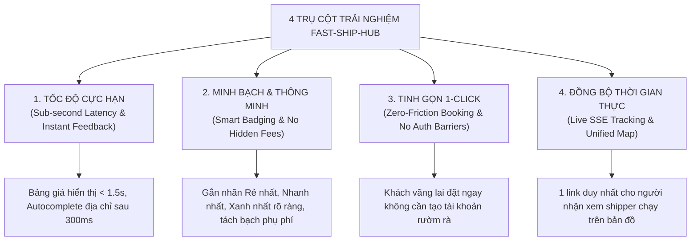
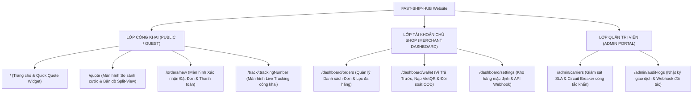

# TÀI LIỆU ĐẶC TẢ TRẢI NGHIỆM NGƯỜI DÙNG (UX SPECIFICATION)

> **Tên sản phẩm**: Nền Tảng Tích Hợp & So Sánh Giao Hàng Đa Hãng (`FAST-SHIP-HUB`)  
> **Mã tài liệu**: `DOC-UX-001` | **Phiên bản**: `1.0.0` | **Trạng thái**: `APPROVED_FOR_FRONTEND`  
> **Tác giả**: `ui-ux-designer` (Chuyên gia Thiết kế UI/UX & Design System)  
> **Đối tượng áp dụng**: `frontend-engineer`, `backend-engineer`, `system-architect`, `qa-engineer`

---

## 1. TỔNG QUAN TRIẾT LÝ THIẾT KẾ & NGUYÊN TẮC UX CỐT LÕI

`FAST-SHIP-HUB` giải quyết nỗi đau lớn nhất của người gửi hàng trực tuyến: **Phân mảnh nền tảng, thiếu minh bạch giá cước và tốn thời gian thao tác qua lại giữa các ứng dụng di động**. Chúng tôi định hình trải nghiệm sản phẩm theo 4 nguyên tắc vàng (UX Core Pillars):



1. **Tốc độ phản hồi cực hạn (Speed-First)**:
   - Mọi tương tác nhập địa chỉ đều có phản hồi gõ (debounced 300ms).
   - Bảng so sánh 5-6 hãng phải sẵn sàng trong vòng ≤ 1.5 giây. Nếu một đối tác phản hồi chậm, các đối tác khác vẫn hiển thị trước kèm Skeleton Shimmer mượt mà, không khóa giao diện (Non-blocking UI).
2. **Minh bạch & Thông minh (Radical Transparency & Smart Recommendation)**:
   - Hiển thị cước phí cuối cùng (`final_total_fee`) không có chi phí ẩn. Tách bạch rõ: Cước cơ bản, phụ phí thời tiết/cao điểm và tiền thu hộ COD.
   - Hệ thống tự động gắn 4 nhãn thông minh (`Smart Badges`): 🏆 **Rẻ nhất**, ⚡ **Nhanh nhất**, 🌿 **Xanh nhất (EV)**, 🌟 **Đề xuất tối ưu**.
3. **Tinh giản 1-Click (Zero-Friction Booking)**:
   - Cho phép khách hàng vãng lai (Guest) tra cứu cước và đặt giao hàng qua VietQR 24/7 mà không bắt buộc tạo tài khoản qua 5 bước xác minh.
   - Với Merchant đã đăng nhập, hệ thống ghi nhớ kho lấy hàng mặc định, hỗ trợ đặt đơn với đúng 1 cú click chuột thông qua số dư ví trả trước.
4. **Theo dõi tập trung thời gian thực (Unified Live Tracking)**:
   - Người gửi và người nhận cùng truy cập 1 đường dẫn web duy nhất (`/track/:trackingNumber` hoặc `/tracking/:token`).
   - Sử dụng công nghệ Server-Sent Events (SSE) để tự động cập nhật vị trí GPS của tài xế và chuyển đổi trạng thái giao hàng mà người dùng không bao giờ phải tải lại trang (F5).

---

## 2. KIẾN TRÚC THÔNG TIN & DANH MỤC TUYẾN ĐƯỜNG (INFORMATION ARCHITECTURE & ROUTE INVENTORY)

### 2.1. Sơ đồ Kiến trúc Thông tin (Information Architecture Tree)



### 2.2. Danh mục Tuyến đường Chi tiết (Route Inventory Table)

| Tuyến đường (Route Path) | Tiêu đề Trang (Page Title) | Quyền hạn (Access Control) | Mục đích & Trách nhiệm UX | Dữ liệu chính hiển thị |
| :--- | :--- | :---: | :--- | :--- |
| `/` | `Trang Chủ — So Sánh Giá Cước Giao Hàng Đa Hãng` | Public | Giới thiệu giá trị sản phẩm, Quick Quote Form nhập nhanh 2 địa chỉ để kích hoạt so sánh. | Banner tính năng, Form tra cứu nhanh, Đối tác liên kết (Grab, XanhSM, ShopeeFood, Be, Ahamove). |
| `/quote` | `Bảng So Sánh Giá Cước Thời Gian Thực` | Public | Màn hình cốt lõi: Split view hiển thị form lộ trình, danh sách 6 thẻ cước đa hãng, đồng hồ đếm ngược 5 phút, bản đồ hiển thị đường đi Polyline. | Form chi tiết lộ trình, Cự ly km, Danh sách báo giá đã xếp hạng, 4 Smart Badges, Bản đồ tương tác. |
| `/orders/new` | `Xác Nhận Đặt Đơn & Thanh Toán` | Public / Merchant | Xác nhận chi tiết đơn hàng, chọn người trả cước, ghi chú cho shipper, chọn hình thức thanh toán (Ví hoặc VietQR). | Tóm tắt kiện hàng, Biểu phí chi tiết, Phương thức thanh toán, Mã VietQR động, Nút Xác nhận đặt đơn. |
| `/track/:trackingNumber` | `Theo Dõi Hành Trình Đơn Hàng Live` | Public (Read-Only) | Tra cứu trực tiếp vị trí tài xế, thời gian giao dự kiến, tiến trình 10 trạng thái đơn qua mã hoặc token không cần login. | Bản đồ GPS tài xế, Thẻ thông tin tài xế & xe (xăng/điện), Stepper tiến trình, Nút gọi điện shipper. |
| `/dashboard/orders` | `Quản Lý Đơn Hàng Tập Trung` | Merchant / Admin | Quản lý toàn bộ đơn hàng đa hãng của shop, xem trạng thái, bộ lọc theo hãng, xuất báo cáo, hủy đơn. | Bảng dữ liệu đơn hàng (DataTable), Bộ lọc ngày/hãng/status, Nút tra cứu nhanh, Nút Hủy đơn. |
| `/dashboard/wallet` | `Ví Trả Trước & Đối Soát COD` | Merchant | Quản lý số dư ví khả dụng, nạp tiền tự động qua VietQR Napas 247, theo dõi dòng tiền COD tạm giữ và đối soát. | Thẻ số dư ví, Thẻ tiền COD chờ đối soát, Modal tạo mã nạp VietQR, Lịch sử biến động số dư. |

---

## 3. ĐẶC TẢ BỐ CỤC CHI TIẾT 4 MÀN HÌNH TRỌNG ĐIỂM (CORE SCREEN SPECS)

---

### 3.1. MÀN HÌNH 1: SO SÁNH GIÁ CƯỚC ĐA HÃNG THỜI GIAN THỰC (`/quote`)

#### A. Mục tiêu UX
Giúp người dùng nhìn thấy toàn bộ tùy chọn giá cước của 6 hãng đối tác trong vòng 1.5 giây, nhận diện ngay hãng rẻ nhất hoặc nhanh nhất nhờ Smart Badges, và tương tác trực quan với lộ trình bản đồ.

#### B. Sơ đồ Wireframe Bố cục Split-View (Desktop 1280px+)

```
+--------------------------------------------------------------------------------------------------------------------+
| [LOGO FAST-SHIP-HUB]   Tra cứu cước   |   Theo dõi đơn   |   Quản lý đơn (3)           [Ví: 1.250.000đ]  [Shop Linh v] |
+--------------------------------------------------------------------------------------------------------------------+
|  CỘT TRÁI: FORM LỘ TRÌNH & BẢNG GIÁ (520px - Cuộn độc lập)   |  CỘT PHẢI: BẢN ĐỒ LỘ TRÌNH & MARKER (Tự co giãn 100%)|
|                                                              |                                                     |
|  [ĐIỂM ĐI]  o 24 Tạ Quang Bửu, Phường Bách Khoa, Hai Bà Trưng|  +-------------------------------------------------+ |
|  [ĐIỂM ĐẾN] * 182 Lê Duẩn, Phường Nguyễn Du, Đống Đa         |  |                                                 | |
|  [THÔNG SỐ] Cự ly: 4.8 km  |  Thời gian ước tính: 14 phút   |  |          (A) [Pickup: Bách Khoa]                | |
|  ----------------------------------------------------------- |  |            \                                    | |
|  [KIỆN HÀNG] [V] Quần áo/Thời trang  |  Khối lượng: [ 1.5 ] kg|  |             \========= [Polyline Tuyến Đường]   | |
|  [THU HỘ]    COD: [ 350.000 ] đ      |  Khai giá: [ 500.000]đ|  |                       \                         | |
|  ----------------------------------------------------------- |  |                        * (B) [Dropoff: Lê Duẩn] | |
|  [ĐỒNG HỒ HIỆU LỰC BÁO GIÁ]  (i) Giá có hiệu lực trong: [04:42] |  |                                                 | |
|                                                              |  |  [Layer: Giao thông thực] [Nút Căn giữa lộ trình]| |
|  DANH SÁCH BÁO GIÁ ĐA HÃNG (Sắp xếp: Tối ưu nhất):           |  +-------------------------------------------------+ |
|                                                              |  | THÔNG TIN LỘ TRÌNH TÓM TẮT:                      | |
|  +---------------------------------------------------------+ |  | • Quãng đường: 4.8 km đường bộ                   | |
|  | [XANH SM] Xanh SM Bike                     [26.000 đ]    | |  | • Tuyến đường tối ưu: Đại Cồ Việt - Lê Duẩn      | |
|  | [🏆 RẺ NHẤT] [🌿 XANH NHẤT (EV)]            Tiết kiệm 8k  | |  | • Giảm phát thải CO2: ~204g CO2 (nếu chọn EV)    | |
|  | ETA lấy hàng: 4 phút | ETA giao: 16 phút                  | |  +-------------------------------------------------+ |
|  | [ Nút: Chọn & Đặt Ngay ]                                 | |                                                     |
|  +---------------------------------------------------------+ |                                                     |
|                                                              |                                                     |
|  +---------------------------------------------------------+ |                                                     |
|  | [SHOPEE] ShopeeFood Instant               [28.000 đ]    | |                                                     |
|  | [⚡ NHANH NHẤT] (Tài xế cách 300m)                       | |                                                     |
|  | ETA lấy hàng: 2 phút | ETA giao: 14 phút                  | |                                                     |
|  | [ Nút: Chọn ]                                            | |                                                     |
|  +---------------------------------------------------------+ |                                                     |
|                                                              |                                                     |
|  +---------------------------------------------------------+ |                                                     |
|  | [GRAB] GrabExpress Siêu Tốc                [34.000 đ]    | |                                                     |
|  | Phụ phí giờ cao điểm: +4.000đ                             | |                                                     |
|  | ETA lấy hàng: 6 phút | ETA giao: 20 phút                  | |                                                     |
|  | [ Nút: Chọn ]                                            | |                                                     |
|  +---------------------------------------------------------+ |                                                     |
|                                                              |                                                     |
|  +---------------------------------------------------------+ |                                                     |
|  | [BE] beDelivery                          [31.000 đ]     | |                                                     |
|  | ETA lấy hàng: 5 phút | ETA giao: 18 phút                  | |                                                     |
|  | [ Nút: Chọn ]                                            | |                                                     |
|  +---------------------------------------------------------+ |                                                     |
|                                                              |                                                     |
|  +---------------------------------------------------------+ |                                                     |
|  | [AHAMOVE] Siêu Tốc Đồ Gọn                 [32.000 đ]     | |                                                     |
|  | ETA lấy hàng: 7 phút | ETA giao: 22 phút                  | |                                                     |
|  | [ Nút: Chọn ]                                            | |                                                     |
|  +---------------------------------------------------------+ |                                                     |
+--------------------------------------------------------------------------------------------------------------------+
```

#### C. Chi tiết Tương tác & Micro-copywriting
1. **Ô Autocomplete Điểm A & Điểm B**:
   - Khi gõ ký tự thứ 3 trở lên, dropdown gợi ý hiển thị tối đa 5 kết quả với phân loại rõ: *Tên tòa nhà/địa điểm nổi bật* (chữ đậm) và *Địa chỉ hành chính chi tiết* (chữ xám).
   - Có nút **"Đổi chiều lộ trình" (Swap button)** với icon mũi tên đảo chiều giữa 2 ô để người dùng đổi Điểm đi <-> Điểm đến trong 1 cú click.
2. **Thẻ Báo Giá (Carrier Quote Card)**:
   - Thẻ được đề xuất cao nhất (Best Value hoặc Cheapest) tự động được bao viền `border-2 border-primary-500` và đổ bóng nhẹ `shadow-md` kèm badge nổi bật.
   - Khi hover vào một thẻ, trên bản đồ sẽ hiển thị vị trí ước lượng của các shipper khả dụng thuộc hãng đó (nếu có dữ liệu) hoặc đổi màu viền card để tạo sự tập trung.
3. **Đồng hồ đếm ngược hiệu lực giá (TTL Timer)**:
   - Hiển thị thanh đếm ngược lùi dần từ `05:00` xuống `00:00`.
   - Khi còn dưới 60 giây: Chuyển màu chữ sang cam cảnh báo (`text-amber-600`).
   - Khi hết giờ (00:00): Hiển thị modal nhẹ hoặc banner mềm: *"Báo giá đã hết hạn do biến động cước giờ cao điểm. Đang làm mới lại giá..."* kèm nút **"Làm mới cước phí (Refresh)"**.

---

### 3.2. MÀN HÌNH 2: XÁC NHẬN ĐẶT ĐƠN 1-CLICK (`/orders/new`)

#### A. Mục tiêu UX
Tập trung toàn bộ sự chú ý của người dùng vào việc thẩm định lại thông tin người nhận, ghi chú tài xế và hoàn tất thanh toán trong thời gian ngắn nhất (mục tiêu hoàn thành < 15 giây).

#### B. Sơ đồ Wireframe Bố cục

```
+--------------------------------------------------------------------------------------------------------------------+
| [< Quay lại Bảng So Sánh]                XÁC NHẬN ĐẶT ĐƠN GIAO HÀNG                                   Hỗ trợ: 1900-xxxx |
+--------------------------------------------------------------------------------------------------------------------+
|  CỘT TRÁI: CHI TIẾT ĐƠN HÀNG & LIÊN HỆ (65% Width)          |  CỘT PHẢI: TÓM TẮT CƯỚC & THANH TOÁN (35% Width)     |
|                                                              |                                                     |
|  1. THÔNG TIN NGƯỜI GỬI (PICKUP)                             |  THÔNG TIN THANH TOÁN                               |
|  Họ tên: [ Nguyễn Thùy Linh        ]  SĐT: [ 0912345678    ] |  Đơn vị vận chuyển:  [LOGO XANH SM] Xanh SM Bike    |
|  Địa chỉ: 24 Tạ Quang Bửu, P. Bách Khoa, Hai Bà Trưng, HN    |  Loại dịch vụ:       Giao siêu tốc xe máy điện      |
|  Ghi chú lấy hàng: [ Lấy tại quầy lễ tân tầng 1 tòa B1     ] |  Thời gian lấy dự kiến: 4 phút                      |
|                                                              |  -------------------------------------------------  |
|  2. THÔNG TIN NGƯỜI NHẬN (DROPOFF)                           |  Cước phí gốc:                       26.000 đ       |
|  Họ tên: [ Trần Quốc Tuấn          ]  SĐT: [ 0987654321    ] |  Phụ phí thời tiết / cao điểm:            0 đ       |
|  Địa chỉ: 182 Lê Duẩn, P. Nguyễn Du, Đống Đa, Hà Nội         |  Phí dịch vụ nền tảng:               +1.000 đ       |
|  Ghi chú giao hàng: [ Giao giờ hành chính, gọi trước 5p   ] |  Mã ưu đãi (Voucher): [ GIAM5K    ] [-5.000 đ]      |
|                                                              |  -------------------------------------------------  |
|  3. THÔNG TIN HÀNG HÓA & DỊCH VỤ CỘNG THÊM                  |  TỔNG CƯỚC THANH TOÁN:               22.000 đ       |
|  • Loại hàng: Quần áo / Thời trang   • Khối lượng: 1.5 kg    |  (Đã bao gồm VAT và bảo hiểm bồi thường 100%)       |
|  • Tiền thu hộ (COD): 350.000 đ                              |  -------------------------------------------------  |
|  [v] Cho khách xem hàng trước khi nhận                       |  CHỌN PHƯƠNG THỨC THANH TOÁN:                       |
|  [ ] Yêu cầu giao tận tay tầng chung cư (+5.000 đ)          |                                                     |
|  [v] Chụp ảnh xác nhận giao hàng thành công                  |  (*) VÍ TRẢ TRƯỚC (Dành cho Shop)                  |
|                                                              |      Số dư khả dụng: 1.250.000 đ  [ĐỦ ĐIỀU KIỆN]    |
|                                                              |      (Trừ 22.000đ trực tiếp vào ví sau khi đặt)     |
|                                                              |                                                     |
|                                                              |  ( ) QUÉT MÃ VIETQR (Napas 247 Khách lẻ)            |
|                                                              |      Tự động nhận diện thanh toán trong 3 giây      |
|                                                              |                                                     |
|                                                              |  +-------------------------------------------------+ |
|                                                              |  |  [ NÚT: XÁC NHẬN ĐẶT ĐƠN NGAY (1-CLICK) ]       | |
|                                                              |  |  (Cam kết tìm tài xế trong 60 giây)             | |
|                                                              |  +-------------------------------------------------+ |
|                                                              |  Cam kết hoàn 100% cước nếu không tìm được tài xế   |
+--------------------------------------------------------------------------------------------------------------------+
```

#### C. Chi tiết Trạng thái Thanh toán VietQR Động
Nếu người dùng chọn phương thức **QUÉT MÃ VIETQR**:
- Thay vì chuyển trang, một khung hiển thị mã QR VietQR chuẩn Napas 247 tự động bung ra mượt mà:
  - Mã QR chứa sẵn: Ngân hàng thụ hưởng, Số tài khoản, Đúng số tiền `22.000đ`, Nội dung chuyển khoản duy nhất: `FSH 8899`.
  - Hiệu ứng Scanner tia laser màu xanh quét qua lại trên mã QR tạo cảm giác hệ thống đang lắng nghe giao dịch trực tiếp.
  - Bộ đếm ngược thời gian giữ chỗ tài xế: `03:00` phút.
  - Ngay khi nhận được Webhook biến động số dư từ ngân hàng (trong ~1.5s - 3s), màn hình lập tức phát hiệu ứng âm thanh nhẹ và hiển thị dấu tích xanh thành công `Payment Verified` rồi tự động chuyển sang Màn hình Live Tracking.

---

### 3.3. MÀN HÌNH 3: LIVE TRACKING BẢN ĐỒ VỚI SHIPPER GPS (`/track/:trackingNumber`)

#### A. Mục tiêu UX
Mang lại sự an tâm tuyệt đối cho cả người gửi lẫn người nhận hàng. Cung cấp tầm nhìn thời gian thực về vị trí shipper đang di chuyển, thông tin liên lạc rõ ràng và trạng thái đơn minh bạch mà **không cần đăng nhập**.

#### B. Sơ đồ Wireframe Bố cục

```
+--------------------------------------------------------------------------------------------------------------------+
| [LOGO FAST-SHIP-HUB]   Đơn Hàng #FSH-20261103-8899         [ĐANG GIAO HÀNG]                 [Chia sẻ link theo dõi]|
+--------------------------------------------------------------------------------------------------------------------+
|  THANH TIẾN TRÌNH ĐƠN HÀNG (STEPPER 4 GIAI ĐOẠN):                                                                  |
|  (v) Đã Tạo Đơn  -------- (v) Tài Xế Nhận  -------- (*) Đang Giao Hàng (ETA: 12p) -------- ( ) Đã Giao Thành Công   |
+--------------------------------------------------------------------------------------------------------------------+
|  CỘT TRÁI: THẺ THÔNG TIN TÀI XẾ & ĐƠN HÀNG (420px)           |  CỘT PHẢI: BẢN ĐỒ THEO DÕI LIVE GPS (Toàn màn hình)   |
|                                                              |                                                     |
|  +---------------------------------------------------------+ |  +-------------------------------------------------+ |
|  | THÔNG TIN TÀI XẾ ĐIỀU PHỐI                              | |  |                                                 | |
|  | [AVATAR]  Nguyễn Văn Hùng                                | |  |    (A) [Điểm Lấy: Đã lấy lúc 14:15]             | |
|  | Đơn vị:   Xanh SM Delivery [🌿 Xe Điện VinFast Feliz S] | |  |      \                                          | |
|  | Biển số:  29-M1 888.99 | Đánh giá: 4.9 * (1.240 chuyến) | |  |       \                                         | |
|  |                                                         | |  |        [🏍️ SHIPPER ĐANG DI CHUYỂN]               | |
|  | [ NÚT: GỌI ĐIỆN 0988.xxx.xxx ]  [ GỬI TIN NHẮN SMS ]    | |  |         (Cập nhật 2 giây trước qua GPS)          | |
|  +---------------------------------------------------------+ |  |          \                                      | |
|                                                              |  |           \                                     | |
|  THỜI GIAN GIAO HÀNG DỰ KIẾN:                                |  |            * (B) [Điểm Giao: Dự kiến 14:32]      | |
|  14:32 (Còn khoảng 12 phút nữa - Cự ly còn lại: 2.1 km)      |  |                                                 | |
|                                                              |  |  [Nút: Căn giữa vị trí Tài xế]  [Tự động xoay]  | |
|  LỊCH SỬ HÀNH TRÌNH CHI TIẾT (TIMELINE):                    |  +-------------------------------------------------+ |
|  • 14:20: Tài xế đã nhận hàng và đang di chuyển tới điểm B.  |                                                     |
|  • 14:15: Tài xế đã có mặt tại điểm lấy hàng Bách Khoa.      |                                                     |
|  • 14:04: Tài xế Nguyễn Văn Hùng nhận cuốc giao.             |                                                     |
|  • 14:02: Đơn hàng được tạo thành công trên sàn FAST-SHIP.   |                                                     |
|                                                              |                                                     |
|  THÔNG TIN KIỆN HÀNG:                                        |                                                     |
|  • Kiện hàng: 01 Hộp quần áo (1.5 kg)                        |                                                     |
|  • Tiền thu hộ COD: 350.000 đ (Người nhận thanh toán)        |                                                     |
|  • Người gửi: Shop Thùy Linh (0912xxx678)                    |                                                     |
|  • Người nhận: Anh Tuấn (0987xxx321)                         |                                                     |
+--------------------------------------------------------------------------------------------------------------------+
```

#### C. Chi tiết Cơ chế Cập nhật Real-Time (SSE Client Experience)
- Khi mở trang, client tự động thiết lập kết nối tới endpoint SSE: `/api/v1/tracking/:token/stream`.
- Trên góc bản đồ có một đèn báo sóng nhỏ dạng Radar Pulse màu xanh lục kèm dòng chữ: *"Kết nối vệ tinh trực tiếp (Live GPS)"*.
- Khi có tọa độ mới từ Webhook tài xế:
  - Marker chiếc xe máy điện VinFast (hoặc xe máy Grab xanh lá) xoay góc theo hướng di chuyển (`bearing`) và lướt mượt mà giữa 2 tọa độ bằng hiệu ứng CSS / Mapbox Marker Interpolation Animation (thời lượng transition 1000ms), không bị giật cục.
  - Cự ly và số phút còn lại tự động đếm lùi thích ứng theo vận tốc thực tế của tài xế.

---

### 3.4. MÀN HÌNH 4: QUẢN LÝ ĐƠN HÀNG & VÍ ĐỐI SOÁT (`/dashboard/orders`, `/dashboard/wallet`)

#### A. Màn hình Quản lý Đơn hàng (`/dashboard/orders`)
- **Bộ lọc đa chiều (Filter Bar)**:
  - Lọc theo Hãng vận chuyển: Tất cả, Grab, Xanh SM, ShopeeFood, Ahamove, Be.
  - Lọc theo Trạng thái: Tất cả, Chờ tài xế (`BOOKED`), Đang lấy (`PICKING`), Đang giao (`DELIVERING`), Thành công (`DELIVERED`), Đã hủy (`CANCELLED`).
  - Lọc theo khoảng ngày (Date Range Picker) và Ô tìm kiếm theo mã đơn `FSH-XXXX` hoặc số điện thoại người nhận.
- **Bảng dữ liệu Đơn hàng (Orders Data Table)**:
  - Cột 1: Mã đơn & Ngày tạo (có nút copy mã đơn nhanh).
  - Cột 2: Hãng & Dịch vụ (Hiển thị Logo hãng kèm nhãn xe xăng/xe điện).
  - Cột 3: Tuyến đường (Gom gọn Điểm A -> Điểm B kèm tooltip hiển thị địa chỉ chi tiết).
  - Cột 4: Tiền cước & COD (Ví dụ: Cước: 26.000đ | COD: 350.000đ).
  - Cột 5: Trạng thái đơn (Badge màu tương ứng với 10 trạng thái chuẩn).
  - Cột 6: Hành động (Nút mở link Live Tracking, Nút Tải hóa đơn/Phiếu gửi hàng, Nút Hủy đơn nếu còn ở trạng thái `BOOKED`).

#### B. Màn hình Ví Trả Trước & Đối Soát COD (`/dashboard/wallet`)
- **3 Thẻ Thống kê Tài chính Trực quan (Financial Stat Cards)**:
  1. **Số dư khả dụng (Available Balance)**: Số tiền có thể sử dụng ngay để đặt đơn. Kèm nút CTA nổi bật: **[ + Nạp Tiền Ví VietQR ]**.
  2. **Số dư tạm giữ (Hold Balance)**: Tiền cước đang được tạm khóa cho các đơn hàng đang trên đường giao. Tự động giải phóng khi đơn hoàn tất hoặc hủy.
  3. **Tiền COD chờ đối soát (Pending COD Credit)**: Tổng số tiền các tài xế đối tác đã thu của khách nhận nhưng chưa chuyển về tài khoản ngân hàng của shop.
- **Quy trình Nạp Tiền Nhanh qua VietQR**:
  - Bấm nút "Nạp Tiền" -> Modal mở ra cho chọn các mệnh giá nhanh: `200.000đ`, `500.000đ`, `1.000.000đ`, `2.000.000đ` hoặc nhập số tùy chọn (tối thiểu `50.000đ`).
  - Hệ thống sinh ngay mã QR Napas 247 chính xác số tiền.
  - Sau khi chuyển khoản, webhook ngân hàng kích hoạt cập nhật số dư trong vòng 2 giây mà không cần bấm xác nhận tay.

---

## 4. MA TRẬN PHÂN QUYỀN TRUY CẬP THEO MÀN HÌNH (ACCESS CONTROL MATRIX)

| Màn hình | Khách vãng lai (Guest) | Chủ shop đã đăng nhập (Merchant) | Quản trị viên (Admin) |
| :--- | :---: | :---: | :---: |
| Trang chủ & Tra cước (`/`, `/quote`) | Toàn quyền tra cứu & so sánh | Toàn quyền, tự điền địa chỉ kho | Toàn quyền |
| Tạo & Đặt đơn (`/orders/new`) | Thanh toán qua VietQR | Thanh toán qua Ví hoặc VietQR | Đặt đơn thử nghiệm Sandbox |
| Live Tracking (`/track/:trackingNumber`) | Xem vị trí tài xế (Read-only) | Xem vị trí, chia sẻ link, gọi tài xế | Xem chi tiết kỹ thuật Webhook payload |
| Danh sách đơn (`/dashboard/orders`) | Chỉ xem đơn vừa đặt qua Cookie | Xem toàn bộ lịch sử đơn của shop | Xem toàn bộ đơn của tất cả các shop |
| Ví trả trước (`/dashboard/wallet`) | Không truy cập (Yêu cầu login) | Quản lý ví, nạp tiền, xem đối soát | Quản trị giao dịch, điều chỉnh số dư |
| Cấu hình Circuit Breaker (`/admin`) | Bị chặn (403) | Bị chặn (403) | Toàn quyền bật/tắt cổng kết nối hãng |

---

## 5. NGUYÊN TẮC THIẾT KẾ PHÒNG NGỪA LỖI & PHỤC HỒI (DEFENSIVE UX DESIGN)

1. **Phòng chống Click đúp khi Đặt đơn (Double Click Prevention)**:
   - Khi người dùng nhấn nút "Xác nhận đặt đơn", nút bấm lập tức chuyển sang trạng thái `Loading` kèm spinner, nhãn đổi thành *"Đang kết nối đối tác điều xe..."*, đồng thời vô hiệu hóa (`disabled`) toàn bộ tương tác trên form.
   - Header request gửi kèm `Idempotency-Key` (UUID) do client sinh ra trước đó để ngăn chặn trừ tiền 2 lần nếu đường truyền mạng chập chờn.
2. **Xử lý sự cố Báo giá Timeout từng hãng (Graceful Degradation)**:
   - Nếu 1 hãng (ví dụ Grab) bị timeout sau 1800ms, giao diện vẫn hiển thị kết quả của 5 hãng còn lại bình thường.
   - Thẻ của hãng bị lỗi được hiển thị ở cuối danh sách dưới dạng xám nhẹ (Muted Card) kèm thông điệp: *"Grab tạm thời không phản hồi giá cước. Vui lòng chọn các đối tác sẵn sàng bên trên."* Điều này đảm bảo người dùng không bị gián đoạn luồng đặt hàng.
3. **Chính sách Hủy đơn minh bạch (Transparent Cancellation Policy)**:
   - Khi đơn ở trạng thái `BOOKED` (Tài xế chưa di chuyển tới điểm lấy): Nút "Hủy đơn" hiển thị màu đỏ kèm ghi chú *"Miễn phí hủy đơn 100%, hoàn tiền ví lập tức"*.
   - Khi đơn đã ở trạng thái `PICKING` hoặc `DELIVERING`: Nút hủy đơn bị vô hiệu hóa hoặc mở hộp thoại cảnh báo: *"Tài xế đã nhận hàng và đang di chuyển. Vui lòng gọi trực tiếp tài xế qua số [SĐT] để phối hợp."*

---

> **Kết luận**: Bản đặc tả UX này cung cấp đầy đủ thông số hành vi, cấu trúc sitemap và bố cục chi tiết cho toàn bộ các màn hình trọng điểm, đảm bảo đội ngũ `frontend-engineer` có thể tiến hành hiện thực hóa mã nguồn Next.js 15 một cách nhất quán và chuẩn xác.
