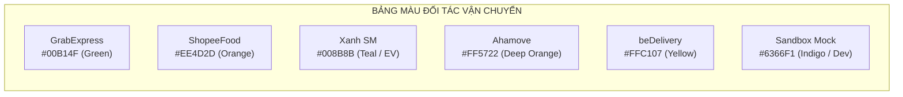

# TÀI LIỆU HỆ THỐNG THIẾT KẾ & BỘ DESIGN TOKENS (DESIGN SYSTEM SPECIFICATION)

> **Tên sản phẩm**: Nền Tảng Tích Hợp & So Sánh Giao Hàng Đa Hãng (`FAST-SHIP-HUB`)  
> **Mã tài liệu**: `DOC-UX-002` | **Phiên bản**: `1.0.0` | **Trạng thái**: `APPROVED_FOR_FRONTEND`  
> **Tác giả**: `ui-ux-designer` (Chuyên gia Thiết kế UI/UX & Design System)  
> **Công nghệ áp dụng**: Tailwind CSS v4 / v3.4+, Radix UI (shadcn/ui), Lucide React Icons

---

## 1. TỔNG QUAN HỆ THỐNG THIẾT KẾ (DESIGN SYSTEM OVERVIEW)

Hệ thống thiết kế của **FAST-SHIP-HUB** được xây dựng trên triết lý **"Clean, Trustworthy, Fast & Accessible"**. Giao diện hướng đến việc xử lý khối lượng thông tin lớn (báo giá nhiều hãng, bản đồ thời gian thực, số dư ví, lộ trình di chuyển) một cách mạch lạc, giảm thiểu căng thẳng thị giác cho người gửi hàng và chủ shop trực tuyến.

### Các Nguyên Tắc Thiết Kế Trực Quan:
1. **Tính Nhất Quán Tuyệt Đối (Strict Consistency)**: Toàn bộ kích thước khoảng cách, cỡ chữ và bo góc đều tuân thủ lưới cơ sở 4px (`4px Base Grid`).
2. **Nhận Diện Thương Hiệu Đối Tác Chuẩn Xác (Carrier Brand Fidelity)**: Giữ nguyên màu sắc nhận diện đặc trưng của các hãng (Grab, ShopeeFood, Xanh SM, Ahamove, Be) nhưng được tinh chỉnh độ tương phản (WCAG AA/AAA) để hài hòa trên tổng thể giao diện FAST-SHIP-HUB.
3. **Thị Giác Phân Cấp Rõ Ràng (Visual Hierarchy & Scannability)**: Sử dụng các huy hiệu thông minh (`Smart Badges`) để đôi mắt người dùng chỉ mất 0.3 giây là tìm ra lựa chọn cước phù hợp nhất.

---

## 2. BẢNG MÀU DESIGN TOKENS (COLOR PALETTE & TOKENS)

### 2.1. Màu Nhận Diện Thương Hiệu FAST-SHIP-HUB (Brand Colors)

FAST-SHIP-HUB sử dụng sắc thái **Xanh Biển Sâu (Navy Blue)** kết hợp với **Cam Tốc Độ (Fast Orange)** để truyền tải thông điệp về sự tin cậy, công nghệ tiên tiến và tốc độ vượt trội.

| Token Name | Hex Code | Tailwind Class | Ứng dụng trong giao diện |
| :--- | :---: | :--- | :--- |
| `brand-primary-50` | `#EFF6FF` | `bg-blue-50` | Nền thẻ báo giá được chọn, background thông báo thông tin |
| `brand-primary-500` | `#2563EB` | `bg-blue-600` | Màu chủ đạo nút CTA chính, viền thẻ active, link điều hướng |
| `brand-primary-600` | `#1D4ED8` | `bg-blue-700` | Trạng thái Hover của nút CTA chính |
| `brand-primary-900` | `#1E3A8A` | `text-blue-900` | Tiêu đề chính, Header thanh điều hướng Navbar |
| `brand-accent-500` | `#F97316` | `bg-orange-500` | Điểm nhấn tốc độ, nút Nạp tiền nhanh, đồng hồ đếm ngược |
| `brand-accent-600` | `#EA580C` | `bg-orange-600` | Hover nút nạp tiền, nhãn khuyến mãi đặc biệt |

---

### 2.2. Bảng Màu Nhận Diện Đối Tác Vận Chuyển (Carrier Brand Colors)

Mỗi hãng vận chuyển đối tác được định nghĩa một bộ màu đại diện riêng biệt phục vụ hiển thị Logo, Viền thẻ báo giá, Huy hiệu hãng và Icon trên bản đồ lộ trình:



| Hãng Vận Chuyển | Mã Hãng (`CarrierCode`) | Màu Nhận Diện (Hex) | Màu Nền Badge Nhạt | Màu Viền Khuyên Dùng |
| :--- | :---: | :---: | :---: | :---: |
| **GrabExpress** | `GRAB` | `#00B14F` | `#E8F8F0` | `#A3E7C3` |
| **ShopeeFood Instant**| `SHOPEE_FOOD` | `#EE4D2D` | `#FEEFEA` | `#FCA591` |
| **Xanh SM Delivery** | `XANH_SM` | `#008B8B` | `#E6F7F7` | `#80CBC4` |
| **Ahamove** | `AHAMOVE` | `#FF5722` | `#FFF0EB` | `#FFAB91` |
| **beDelivery** | `BE` | `#F59E0B` (`#FFC107`) | `#FEF9E7` | `#FDE68A` |
| **Sandbox Mock Express**| `SANDBOX_MOCK` | `#6366F1` | `#EEF2FF` | `#C7D2FE` |

---

### 2.3. Bảng Màu Ngữ Nghĩa & 4 Smart Badges (Semantic & Smart Badges)

4 Huy hiệu thông minh là "vũ khí chuyển đổi" cốt lõi của FAST-SHIP-HUB, giúp phân loại giá trị các gói cước:

```
+----------------------------------------------------------------------------------------------------+
| [🏆 RẺ NHẤT (BEST PRICE)]         Nền: #DCFCE7 (Green 100)  | Chữ: #15803D (Green 700)  | Viền: #86EFAC   |
| [⚡ NHANH NHẤT (FASTEST)]         Nền: #FEF3C7 (Amber 100)  | Chữ: #B45309 (Amber 700)  | Viền: #FCD34D   |
| [🌿 XANH NHẤT (ECO-FRIENDLY)]    Nền: #CCFBF1 (Teal 100)   | Chữ: #0F766E (Teal 700)   | Viền: #5EEAD4   |
| [🌟 ĐỀ XUẤT TỐI ƯU (RECOMMENDED)] Nền: #EEF2FF (Indigo 100) | Chữ: #4338CA (Indigo 700) | Viền: #A5B4FC   |
+----------------------------------------------------------------------------------------------------+
```

| Huy Hiệu Thông Minh | Icon Đề Xuất | Token Background | Token Text | Tiêu Chí Kích Hoạt |
| :--- | :---: | :--- | :--- | :--- |
| 🏆 **Rẻ Nhất** (`CHEAPEST`) | `Trophy` | `bg-emerald-100` (`#DCFCE7`) | `text-emerald-800` (`#166534`) | Cước cuối cùng thấp nhất trong các báo giá hợp lệ. |
| ⚡ **Nhanh Nhất** (`FASTEST`) | `Zap` | `bg-amber-100` (`#FEF3C7`) | `text-amber-800` (`#92400E`) | Thời gian ETA giao hàng ngắn nhất (phút). |
| 🌿 **Xanh Nhất** (`GREENEST`) | `Leaf` | `bg-teal-100` (`#CCFBF1`) | `text-teal-800` (`#115E59`) | Đơn vị sử dụng 100% xe máy điện (Xanh SM VinFast EV). |
| 🌟 **Đề Xuất** (`BEST_VALUE`) | `Sparkles` | `bg-indigo-100` (`#EEF2FF`) | `text-indigo-800` (`#3730A3`) | Cân bằng hoàn hảo giữa chênh lệch giá và thời gian giao. |

---

### 2.4. Màu Sắc Trạng Thái Hệ Thống (Feedback & System States)

- **Success (Thành công / Đã giao hàng)**: `text-emerald-600` (`#059669`), `bg-emerald-50` (`#ECFDF5`).
- **Warning (Cảnh báo / Báo giá sắp hết hạn)**: `text-amber-600` (`#D97706`), `bg-amber-50` (`#FFFBEB`).
- **Danger / Destructive (Lỗi / Hủy đơn / Quá tải)**: `text-rose-600` (`#E11D48`), `bg-rose-50` (`#FFF1F2`).
- **Neutral / Surface (Nền giao diện & Đường kẻ)**:
  - Nền trang (`page-bg`): `#F8FAFC` (`slate-50`)
  - Thẻ card (`card-surface`): `#FFFFFF` (`white`)
  - Viền phân cách (`border-default`): `#E2E8F0` (`slate-200`)
  - Chữ chính (`text-primary`): `#0F172A` (`slate-900`)
  - Chữ phụ (`text-secondary`): `#64748B` (`slate-500`)

---

## 3. HỆ THỐNG KIỂU CHỮ (TYPOGRAPHY SCALE)

FAST-SHIP-HUB sử dụng họ phông chữ **Be Vietnam Pro** (ưu tiên số 1 cho thị trường Việt Nam nhờ hỗ trợ dấu tiếng Việt chuẩn xác, bo tròn hiện đại) kết hợp cùng phông dự phòng **Inter** và hệ thống chữ số mono cho số tiền tài chính.

### 3.1. Thang Đo Cỡ Chữ & Trọng Lượng

| Kiểu Chữ (Typography Style) | Cỡ Chữ (Font Size) | Chiều Cao Dòng (Line Height) | Trọng Lượng (Font Weight) | Tailwind Utility Classes |
| :--- | :---: | :---: | :---: | :--- |
| **Display H1** | `32px (2.0rem)` | `38px` | Bold (`700`) | `text-3xl font-bold tracking-tight` |
| **Heading H2** | `24px (1.5rem)` | `32px` | Semibold (`600`) | `text-2xl font-semibold` |
| **Heading H3** | `20px (1.25rem)` | `28px` | Semibold (`600`) | `text-xl font-semibold` |
| **Subheading H4** | `16px (1.0rem)` | `24px` | Medium (`500`) | `text-base font-medium` |
| **Body Large** | `16px (1.0rem)` | `24px` | Regular (`400`) | `text-base font-normal` |
| **Body Regular** | `14px (0.875rem)` | `20px` | Regular (`400`) | `text-sm font-normal` |
| **Body Small** | `12px (0.75rem)` | `16px` | Regular (`400`) | `text-xs font-normal` |
| **Currency / Financial** | `20px / 24px` | `28px` | Bold (`700`) | `font-mono font-bold tracking-tight` |
| **Badge Label** | `11px (0.687rem)`| `14px` | Semibold (`600`) | `text-[11px] font-semibold uppercase tracking-wider` |

---

## 4. HỆ THỐNG KHOẢNG CÁCH, BO GÓC & ĐỔ BÓNG (SPACING, RADIUS & SHADOWS)

### 4.1. Lưới Khoảng Cách Cơ Sở 4px (4px Spacing Grid)

```
[ 4px ]  space-1   : Khoảng cách giữa icon và chữ nhỏ
[ 8px ]  space-2   : Padding bên trong badge, khoảng cách giữa các badge
[ 12px ] space-3   : Padding nút bấm nhỏ, margin các trường nhập liệu liền kề
[ 16px ] space-4   : Padding mặc định của Input, Button, Card nhỏ
[ 20px ] space-5   : Khoảng cách giữa các thẻ báo giá trong danh sách cuộn
[ 24px ] space-6   : Padding thân chính của Card, khoảng cách giữa các Section
[ 32px ] space-8   : Khoảng cách giữa các khối lớn trên màn hình Desktop
[ 48px ] space-12  : Padding đỉnh trang, khoảng cách lề trên Container
```

### 4.2. Thang Đo Bo Góc (Border Radius Scale)

- `rounded-sm` (`4px`): Sử dụng cho Checkbox, Tag nhỏ, Tooltip.
- `rounded-md` (`6px`): Sử dụng cho Input Field, Button kích thước vừa.
- `rounded-lg` (`8px`): Sử dụng cho Dropdown Menu, Modal Popup nhỏ.
- `rounded-xl` (`12px`): Sử dụng cho **Thẻ Báo Giá (Quotation Card)**, Form Box.
- `rounded-2xl` (`16px`): Sử dụng cho Thẻ Ví Số Dư, Khung Bản Đồ Nổi.
- `rounded-full` (`9999px`): Sử dụng cho Smart Badges, Avatar tài xế, Nút Icon tròn.

### 4.3. Thang Đo Đổ Bóng & Hiệu Ứng Nổi (Box Shadows & Elevation)

| Token Name | Cấu Hình CSS Shadow | Ứng Dụng Thực Tế |
| :--- | :--- | :--- |
| `shadow-sm` | `0 1px 2px 0 rgb(0 0 0 / 0.05)` | Thẻ báo giá ở trạng thái bình thường (Default) |
| `shadow-md` | `0 4px 6px -1px rgb(0 0 0 / 0.1)` | Thẻ báo giá khi Hover hoặc khi được Đề Xuất Tối Ưu |
| `shadow-lg` | `0 10px 15px -3px rgb(0 0 0 / 0.1)` | Bảng điều khiển nổi trên bản đồ, Drawer Bottom Sheet Mobile |
| `shadow-xl` | `0 20px 25px -5px rgb(0 0 0 / 0.1)` | Modal Xác nhận thanh toán VietQR |
| `ring-focus` | `box-shadow: 0 0 0 3px rgba(37, 99, 235, 0.25)` | Hiệu ứng viền phát sáng khi focus vào ô nhập địa chỉ |

---

## 5. THƯ VIỆN THÀNH PHẦN GIAO DIỆN CỐT LÕI (CORE UI COMPONENTS)

### 5.1. Các Biến Thể Nút Bấm (Button Variants)

Hệ thống hỗ trợ 5 biến thể nút bấm chuẩn WAI-ARIA accessible:

1. **Button Primary (`bg-blue-600 hover:bg-blue-700 text-white font-medium shadow-sm h-11 px-5 rounded-lg active:scale-[0.98] transition-all`)**:
   - Dùng cho: "Xác nhận đặt đơn", "Tính cước ngay", "Chọn cước này".
2. **Button Secondary (`bg-slate-100 hover:bg-slate-200 text-slate-800 h-10 px-4 rounded-lg font-medium`)**:
   - Dùng cho: "Đổi chiều lộ trình", "Lọc theo hãng", "Lưu nháp".
3. **Button Accent (`bg-orange-500 hover:bg-orange-600 text-white font-semibold shadow-sm h-10 px-4 rounded-lg`)**:
   - Dùng cho: "+ Nạp ví VietQR", "Xem ưu đãi".
4. **Button Outline (`border border-slate-300 hover:bg-slate-50 text-slate-700 h-10 px-4 rounded-lg`)**:
   - Dùng cho: "Quay lại", "Xem chi tiết phụ phí", "Đóng".
5. **Button Destructive (`bg-rose-50 hover:bg-rose-100 text-rose-700 border border-rose-200 h-10 px-4 rounded-lg`)**:
   - Dùng cho: "Hủy đơn hàng", "Xóa bộ lọc".

### 5.2. Trường Nhập Liệu & Autocomplete (Form Inputs)

- Chiều cao chuẩn: `h-11` (44px — đảm bảo chuẩn chạm ngón tay trên mobile).
- Icon tiền tố (Leading Icon): Pin địa chỉ màu xanh cho Điểm lấy hàng, Pin cờ đỏ cho Điểm giao hàng.
- Nút xóa nhanh (Clear Button): Icon chữ `x` xuất hiện khi ô có dữ liệu để người dùng xóa nhanh 1 chạm.
- Trạng thái Lỗi (Validation Error): Viền chuyển màu đỏ `border-rose-500`, xuất hiện icon `AlertCircle` bên phải và dòng giải thích lỗi bên dưới `text-rose-600 text-xs mt-1`.

---

## 6. MẪU CẤU HÌNH TAILWIND TOKENS (`tailwind.config.ts`)

Đoạn mã sau được trích xuất sẵn sàng để tích hợp trực tiếp vào dự án Next.js 15:

```typescript
// tailwind.config.ts
import type { Config } from 'tailwindcss';

const config: Config = {
  darkMode: ['class'],
  content: [
    './src/pages/**/*.{js,ts,jsx,tsx,mdx}',
    './src/components/**/*.{js,ts,jsx,tsx,mdx}',
    './src/app/**/*.{js,ts,jsx,tsx,mdx}',
  ],
  theme: {
    extend: {
      colors: {
        brand: {
          primary: {
            50: '#EFF6FF',
            100: '#DBEAFE',
            500: '#2563EB',
            600: '#1D4ED8',
            700: '#1E40AF',
            900: '#1E3A8A',
          },
          accent: {
            500: '#F97316',
            600: '#EA580C',
          },
        },
        carrier: {
          grab: {
            DEFAULT: '#00B14F',
            light: '#E8F8F0',
            border: '#A3E7C3',
          },
          shopee: {
            DEFAULT: '#EE4D2D',
            light: '#FEEFEA',
            border: '#FCA591',
          },
          xanhsm: {
            DEFAULT: '#008B8B',
            light: '#E6F7F7',
            border: '#80CBC4',
          },
          ahamove: {
            DEFAULT: '#FF5722',
            light: '#FFF0EB',
            border: '#FFAB91',
          },
          be: {
            DEFAULT: '#F59E0B',
            light: '#FEF9E7',
            border: '#FDE68A',
          },
          sandbox: {
            DEFAULT: '#6366F1',
            light: '#EEF2FF',
            border: '#C7D2FE',
          },
        },
        smartbadge: {
          cheapest: {
            bg: '#DCFCE7',
            text: '#166534',
            border: '#86EFAC',
          },
          fastest: {
            bg: '#FEF3C7',
            text: '#92400E',
            border: '#FCD34D',
          },
          greenest: {
            bg: '#CCFBF1',
            text: '#115E59',
            border: '#5EEAD4',
          },
          recommended: {
            bg: '#EEF2FF',
            text: '#3730A3',
            border: '#A5B4FC',
          },
        },
      },
      fontFamily: {
        sans: ['var(--font-be-vietnam-pro)', 'Inter', 'sans-serif'],
        mono: ['var(--font-jetbrains-mono)', 'monospace'],
      },
      borderRadius: {
        lg: '8px',
        md: '6px',
        sm: '4px',
        xl: '12px',
        '2xl': '16px',
      },
      keyframes: {
        shimmer: {
          '100%': { transform: 'translateX(100%)' },
        },
        pulseLaser: {
          '0%, 100%': { transform: 'translateY(0%)', opacity: '0.8' },
          '50%': { transform: 'translateY(100%)', opacity: '0.3' },
        },
      },
      animation: {
        shimmer: 'shimmer 1.5s infinite',
        laser: 'pulseLaser 2s infinite ease-in-out',
      },
    },
  },
  plugins: [require('tailwindcss-animate')],
};

export default config;
```

---

> **Kết luận**: Bộ Design System & Tokens trên cung cấp quy chuẩn thị giác toàn diện, nhất quán và sẵn sàng chuyển giao cho lập trình viên Frontend triển khai giao diện pixel-perfect.
