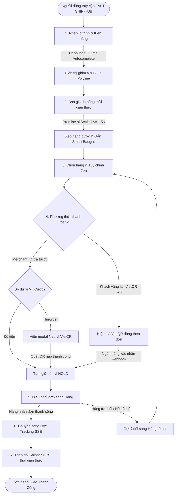
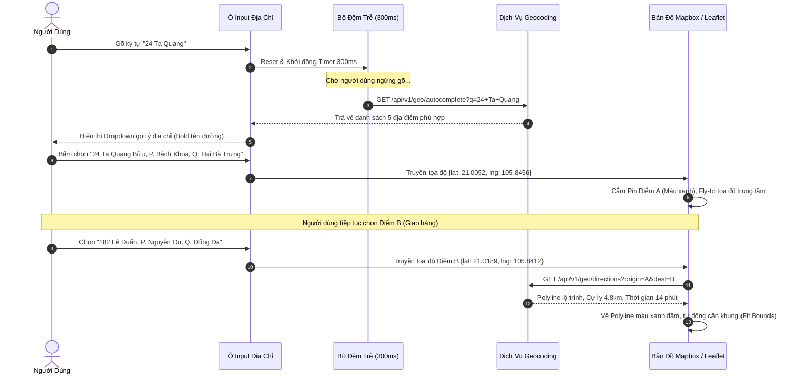
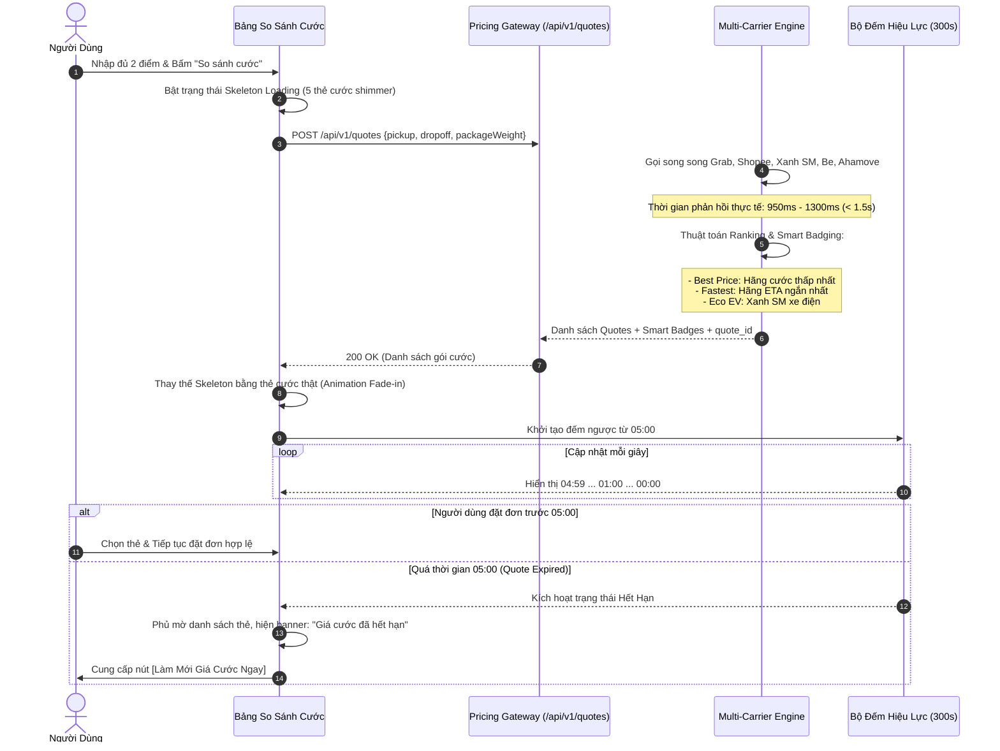
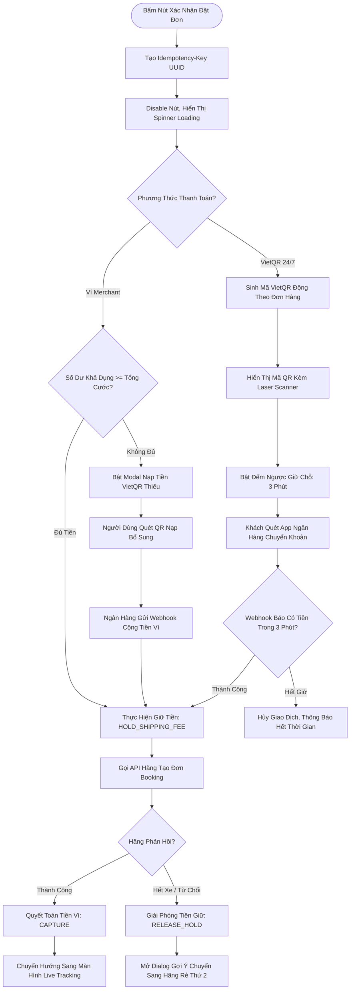
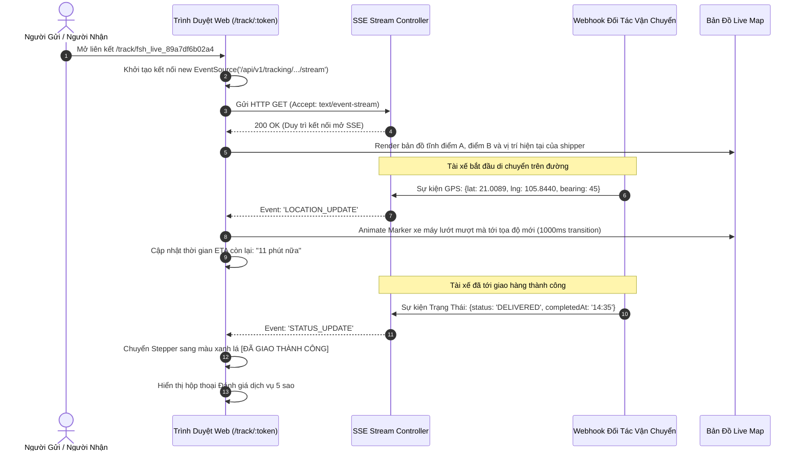

# TÀI LIỆU ĐẶC TẢ LUỒNG NGƯỜI DÙNG (USER FLOWS & INTERACTION SPECIFICATION)

> **Tên sản phẩm**: Nền Tảng Tích Hợp & So Sánh Giao Hàng Đa Hãng (`FAST-SHIP-HUB`)  
> **Mã tài liệu**: `DOC-UX-003` | **Phiên bản**: `1.0.0` | **Trạng thái**: `APPROVED_FOR_FRONTEND`  
> **Tác giả**: `ui-ux-designer` (Chuyên gia Thiết kế UI/UX & Design System)  
> **Đối tượng áp dụng**: `frontend-engineer`, `backend-engineer`, `qa-engineer`

---

## 1. SƠ ĐỒ HÀNH TRÌNH TỔNG THỂ CỦA NGƯỜI DÙNG (END-TO-END USER JOURNEY)

Toàn bộ trải nghiệm của người dùng trên FAST-SHIP-HUB được thiết kế theo một dòng chảy khép kín, tối ưu từng điểm chạm nhằm rút ngắn thời gian từ lúc có nhu cầu gửi hàng đến khi đơn hàng được tài xế tiếp nhận xuống dưới **30 giây**:



---

## 2. LUỒNG CHI TIẾT 1: AUTOCOMPLETE ĐỊA CHỈ & DỰNG TUYẾN ĐƯỜNG BẢN ĐỒ

### 2.1. Sơ đồ Luồng Tương Tác Ô Nhập Địa Chỉ (Autocomplete Interaction Flow)



### 2.2. Các Trạng Thái Ngoại Lệ Cần Xử Lý (Edge Cases):
1. **Người dùng nhập địa chỉ không có trên bản đồ (No Results Found)**:
   - Dropdown hiển thị thông báo nhẹ: *"Không tìm thấy địa chỉ khớp. Bạn có thể kéo thả ghim trực tiếp trên bản đồ để chọn tọa độ chính xác."*
2. **Khoảng cách 2 điểm quá gần (< 50 mét)**:
   - Hiển thị badge màu vàng cảnh báo dưới ô Điểm đến: *"Điểm lấy và giao hàng đang trùng hoặc quá gần nhau."* Khóa nút lấy cước.
3. **Khoảng cách vượt quá bán kính xe máy (> 50 km)**:
   - Hiển thị cảnh báo: *"Lộ trình 62km vượt quá giới hạn giao xe máy tức thì (tối đa 50km). Vui lòng chọn dịch vụ liên tỉnh."*

---

## 3. LUỒNG CHI TIẾT 2: BÁO GIÁ ĐA HÃNG, GÁN SMART BADGES & ĐẾM NGƯỢC 5 PHÚT

### 3.1. Sơ đồ Luồng Báo Giá Đa Hãng



---

## 4. LUỒNG CHI TIẾT 3: ĐẶT ĐƠN 1-CLICK, THANH TOÁN VÍ & CỔNG VIETQR ĐỘNG

### 4.1. Sơ đồ Phân Nhánh Thanh Toán & Điều Phối



---

## 5. LUỒNG CHI TIẾT 4: MỞ TRANG LIVE TRACKING & NHẬN SỰ KIỆN SSE

### 5.1. Sơ đồ Đồng Bộ Tọa Độ GPS & Trạng Thái 10 Bước



---

## 6. LUỒNG XỬ LÝ SỰ CỐ & NGOẠI LỆ (EXCEPTION HANDLING FLOWS)

### 6.1. Khi Một Hãng Bị Sự Cố Hoặc Timeout (> 1.8 Giây)
- **Hành vi hệ thống**: Bộ ngắt mạch Circuit Breaker cô lập lỗi của hãng đó. Giao diện vẫn hiển thị các hãng còn lại.
- **Trải nghiệm thị giác**: Thẻ của hãng gặp lỗi được chuyển xuống đáy danh sách báo giá, chuyển sang tông màu xám nhạt (`bg-slate-50 opacity-70`) kèm nhãn `[TẠM GIÁN ĐOẠN]`.
- **Thông điệp hiển thị**: *"Hệ thống kết nối Grab đang quá tải. Bạn hãy chọn Xanh SM hoặc ShopeeFood để được phục vụ ngay."*

### 6.2. Khi Hãng Đối Tác Trả Về Lỗi "Không Tìm Thấy Tài Xế" (No Driver Found)
- Hệ thống lập tức hoàn trả tiền ví `RELEASE_HOLD` (trong 100ms).
- Màn hình hiển thị Modal gợi ý thông minh:
  ```
  +-------------------------------------------------------------+
  |  [!] RẤT TIẾC, XANH SM HIỆN ĐANG HẾT TÀI XẾ QUANH KHU VỰC   |
  |                                                             |
  |  Hệ thống đã tự động hoàn lại 26.000đ vào ví của bạn.      |
  |  Gợi ý thay thế tốt nhất:                                  |
  |  • ShopeeFood Instant: 28.000đ (Chỉ chênh lệch +2.000đ)    |
  |  • Có 3 tài xế sẵn sàng cách bạn 400m                       |
  |                                                             |
  |  [ Nút: Đổi Sang ShopeeFood Ngay ]   [ Nút: Về Bảng Giá ]   |
  +-------------------------------------------------------------+
  ```

---

> **Kết luận**: Các luồng người dùng trên đã bao phủ trọn vẹn cả kịch bản hoàn hảo (Happy Path) lẫn các kịch bản ngoại lệ (Exception Paths), tạo tiền đề vững chắc cho việc xây dựng logic State Machine trên giao diện Frontend.
