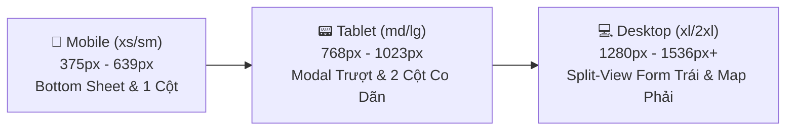

# TÀI LIỆU QUY TẮC THIẾT KẾ ĐÁP ỨNG (RESPONSIVE DESIGN SPECIFICATION)

> **Tên sản phẩm**: Nền Tảng Tích Hợp & So Sánh Giao Hàng Đa Hãng (`FAST-SHIP-HUB`)  
> **Mã tài liệu**: `DOC-UX-004` | **Phiên bản**: `1.0.0` | **Trạng thái**: `APPROVED_FOR_FRONTEND`  
> **Tác giả**: `ui-ux-designer` (Chuyên gia Thiết kế UI/UX & Design System)  
> **Đối tượng áp dụng**: `frontend-engineer`, `qa-engineer`

---

## 1. TRIẾT LÝ MOBILE-FIRST & CHIẾN LƯỢC ĐA THIẾT BỊ

Hơn **70%** người gửi hàng cá nhân và chủ shop thời trang online truy cập dịch vụ giao hàng thông qua điện thoại thông minh (smartphone). Do đó, FAST-SHIP-HUB được phát triển theo triết lý **Mobile-First toàn diện**:
- Thiết kế trải nghiệm hoàn hảo trên màn hình nhỏ hẹp trước (từ `375px`), sau đó mở rộng linh hoạt (Progressive Enhancement) lên giao diện máy tính bảng và màn hình máy tính lớn (`1280px+`).
- **Cam kết Không Tràn Ngang 100% (Zero Horizontal Scroll Guarantee)**: Tuyệt đối không bao giờ xuất hiện thanh cuộn ngang ở bất kỳ độ phân giải nào từ `320px` trở lên.

---

## 2. HỆ THỐNG ĐIỂM NGẮT CHUẨN HOÁ (STANDARDIZED BREAKPOINTS)

Hệ thống điểm ngắt được định nghĩa chuẩn hóa theo Tailwind CSS v4, tối ưu riêng cho thói quen người dùng tại Việt Nam:



| Điểm Ngắt (Breakpoint) | Kích Thước Tối Thiểu (Min-Width) | Thiết Bị Mục Tiêu | Chiến Lược Bố Cục (Layout Strategy) |
| :--- | :---: | :--- | :--- |
| **`xs` (Mobile Portrait)** | `375px` | iPhone SE, iPhone 13/14/15, Samsung Galaxy S22 | 1 cột đơn duy nhất, Bản đồ làm nền phía trên, Bảng giá nằm trong **Bottom Sheet / Drawer kéo vuốt**. Thanh CTA cố định đáy màn hình (Sticky Bottom Bar). |
| **`sm` (Mobile Landscape)**| `640px` | Phablet xoay ngang, điện thoại màn hình gập | 1 cột mở rộng, tối ưu chiều dọc để không bị bàn phím ảo che khuất form nhập. |
| **`md` (Tablet Portrait)** | `768px` | iPad Mini, iPad Air, Galaxy Tab | Bố cục dạng ngăn xếp (Stacked Layout): Bản đồ chiếm 40% chiều cao cố định phía trên, danh sách cước cuộn phía dưới chia làm 2 cột nhỏ. |
| **`lg` (Laptop Nhỏ)** | `1024px` | MacBook Air 13", Màn hình phụ | Bắt đầu chuyển sang **Split-View (Chia 2 cột)**: Cột trái (Form + Cước) chiếm 45%, Bản đồ bên phải chiếm 55%. |
| **`xl` (Desktop Chuẩn)** | `1280px` | Màn hình văn phòng, iMac, PC | **Split-View hoàn chỉnh**: Cột trái cố định bề rộng `540px` với thanh cuộn riêng biệt (`overflow-y-auto`), Bản đồ toàn cảnh bên phải khóa cứng màn hình. |
| **`2xl` (Màn Hình Lớn)** | `1536px` | Màn hình 2K, 4K Ultrawide | Khống chế độ rộng tối đa `max-w-7xl` (1440px) và căn giữa trang (`mx-auto`) để tránh kéo giãn thị giác quá mức. |

---

## 3. ĐẶC TẢ BỐ CỤC THEO ĐIỂM NGẮT (WIREFRAME CHUYỂN ĐỔI GIAO DIỆN)

### 3.1. Giao Diện Mobile (Màn Hình 375px — Bottom Sheet & Thumb-Zone)

Trên thiết bị di động, thao tác một tay bằng ngón tay cái (**Thumb-Zone Accessibility**) là yếu tố quyết định tỷ lệ hoàn tất đơn hàng:

```
+-----------------------------------+  <- Đỉnh màn hình (Tai thỏ / Dynamic Island)
| [=] FAST-SHIP-HUB       [Ví: 1.2M]|
+-----------------------------------+
|  BẢN ĐỒ LỘ TRÌNH (Cao 35% màn hình|
|                                   |
|       (A) [Pickup]                |
|        \                          |
|         \===[Polyline Lộ Trình]   |
|          \                        |
|           * (B) [Dropoff]         |
|  [Cự ly: 4.8 km - ETA: 14 phút]   |
+-----------------------------------+
|  === THANH KÉO VUỐT BOTTOM SHEET =|  <- Kéo vuốt lên để xem thêm các hãng khác
|  🏆 GỢI Ý TỐT NHẤT CHO BẠN:       |
|                                   |
|  +-----------------------------+  |
|  | [XANH SM] Xanh SM    [26k]  |  |
|  | [🏆 Rẻ nhất] [🌿 Xe điện EV]|  |
|  | ETA lấy: 4p | Giao: 16p     |  |
|  | (*) Chọn gói này            |  |
|  +-----------------------------+  |
|                                   |
|  +-----------------------------+  |
|  | [SHOPEE] ShopeeFood  [28k]  |  |
|  | [⚡ Nhanh nhất]              |  |
|  | ETA lấy: 2p | Giao: 14p     |  |
|  | ( ) Chọn gói này            |  |
|  +-----------------------------+  |
|  (Còn 3 hãng khác bên dưới...)    |
+-----------------------------------+
|  [ NÚT: ĐẶT XANH SM (26.000 đ) ]  |  <- Sticky Bottom Action Bar (Cố định đáy)
+-----------------------------------+  <- Đáy màn hình (iOS Home Indicator Safe Area)
```

#### Quy Tắc Riêng Cho Mobile:
1. **Sticky Bottom Action Bar**: Nút bấm Đặt Hàng luôn nổi cố định ở mép dưới màn hình với chiều cao tối thiểu `56px` kèm nhãn to rõ: `[ ĐẶT ĐƠN NGAY — 26.000 đ ]`. Người dùng không cần cuộn tìm nút bấm.
2. **Khoảng Đệm Vùng An Toàn iOS (Safe Area Padding)**:
   - Sử dụng lớp tiện ích Tailwind: `pb-[calc(1rem+env(safe-area-inset-bottom))]` để thanh nút không bị thanh gạt home của iPhone che khuất.
3. **Kích Thước Vùng Chạm (Touch Targets)**:
   - Mọi nút bấm, ô chọn checkbox, nút đóng dialog đều có kích thước tối thiểu **44x44px** (chuẩn WAI-ARIA và Apple Human Interface Guidelines).
   - Khoảng cách giữa các phần tử có thể bấm tối thiểu là **8px** để ngăn chặn việc bấm nhầm (Fat-finger syndrome).

---

### 3.2. Giao Diện Desktop (Màn Hình 1280px+ — Split-View 2 Cột Cân Xứng)

```
+----------------------------------------------------------------------------------------------------+
| [LOGO FAST-SHIP-HUB]   Tra cứu cước   |   Đơn hàng của tôi   |   Hỗ trợ      [Ví: 1.250.000 đ] [Linh v]|
+----------------------------------------------------------------------------------------------------+
| <------ CỘT TRÁI (520px) ------> | <------------------- CỘT PHẢI (Phần còn lại) ------------------> |
| - Chiều cao: 100vh - 64px Header | - Chiều cao: 100vh - 64px Header                                |
| - Cuộn độc lập (overflow-y-auto) | - Cố định (Fixed Position), không bị cuộn theo danh sách        |
| - Chứa Form nhập lộ trình        | - Bản đồ Mapbox/Leaflet hiển thị Polyline và GPS tài xế         |
| - Chứa toàn bộ 6 thẻ báo giá     | - Các công cụ bản đồ: Zoom (+/-), Căn giữa, Lớp giao thông      |
| - Thanh đếm ngược 5 phút         | - Widget nổi tóm tắt thông số lộ trình (Km, Phút, Tiết kiệm CO2)|
+----------------------------------------------------------------------------------------------------+
```

---

## 4. QUY TẮC CHỐNG TRÀN NGANG 100% (ZERO HORIZONTAL SCROLL ENFORCEMENT)

Để đảm bảo trang web không bao giờ bị vỡ giao diện hoặc sinh thanh cuộn ngang ngoài ý muốn, đội ngũ Frontend phải tuân thủ nghiêm ngặt các quy tắc sau:

1. **Khóa Khung Gốc Ứng Dụng (Global Viewport Guard)**:
   - Tại thẻ `body` và thẻ container gốc:
     ```css
     html, body {
       max-width: 100vw;
       overflow-x: hidden;
     }
     ```
2. **Quy Tắc Xử Lý Văn Bản Dài (Text Truncation & Ellipsis)**:
   - Tên địa chỉ đường phố tại Việt Nam thường rất dài (Ví dụ: *"Số nhà 12 ngách 45/67 ngõ 89 đường Hoàng Hoa Thám, Phường Liễu Giai, Quận Ba Đình, Hà Nội"*).
   - Trên mobile, toàn bộ ô hiển thị địa chỉ bắt buộc áp dụng: `truncate` (hoặc `line-clamp-1` / `line-clamp-2`), kết hợp hiển thị Tooltip đầy đủ khi người dùng chạm giữ hoặc di chuột.
3. **Bảng Dữ Liệu Co Dãn (Responsive Tables)**:
   - Tại màn hình Quản lý đơn hàng (`/dashboard/orders`), thẻ `<table>` được bọc bên trong container có class: `w-full overflow-x-auto shadow-sm border rounded-lg`.
   - Trên màn hình di động nhỏ hơn `640px`, bảng dạng table tự động chuyển đổi sang dạng **Thẻ Đơn Hàng Ngăn Xếp (Stacked Cards Layout)** thay vì bắt người dùng cuộn ngang bảng tính.
4. **Hình Ảnh & Bản Đồ Tự Thích Ứng (Responsive Media & Canvas)**:
   - Bản đồ Mapbox Canvas luôn có thuộc tính `w-full h-full` và kích hoạt hàm `map.resize()` mỗi khi cửa sổ trình duyệt thay đổi kích thước hoặc khi Bottom Sheet trên mobile mở rộng/thu gọn.

---

## 5. BẢNG TỔNG HỢP KIỂM THỬ TRÊN THIẾT BỊ THỰC TẾ (DEVICE TEST MATRIX)

| Thiết Bị Kiểm Thử | Độ Phân Giải (Resolution) | Trình Duyệt | Trạng Thái Bố Cục Mong Đợi |
| :--- | :---: | :---: | :--- |
| **iPhone SE / 8** | `375 x 667` | Safari iOS | Bottom Sheet co gọn, nút Đặt cước nổi đáy, không tràn lề. |
| **iPhone 15 Pro Max** | `430 x 932` | Safari iOS | Đệm an toàn Dynamic Island và Home Bar hoạt động chính xác. |
| **Samsung Galaxy S23**| `360 x 780` | Chrome Android | Bàn phím ảo mở lên không làm méo mó bản đồ phía sau. |
| **iPad Air 11"** | `820 x 1180` | Safari iPadOS | Giao diện 2 cột ngăn xếp mượt mà, cảm ứng chạm mượt mà. |
| **MacBook Air 13"** | `1440 x 900` | Chrome / Safari | Split-View chuẩn: Form cuộn mượt bên trái, Map cố định bên phải. |
| **Dell 27" 4K** | `3840 x 2160` | Edge / Chrome | Nội dung được khống chế ở `max-w-7xl`, hình ảnh sắc nét. |

---

> **Kết luận**: Bản quy chuẩn Responsive này là kim chỉ nam để lập trình viên Frontend xây dựng giao diện liền mạch, đảm bảo khách hàng có trải nghiệm đặt xe hoàn hảo trên mọi thiết bị cầm tay lẫn máy tính bàn.
