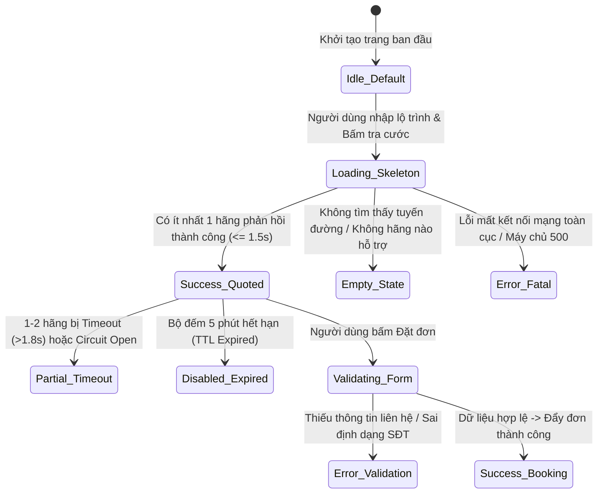

# TÀI LIỆU ĐẶC TẢ THÀNH PHẦN GIAO DIỆN & MÁY TRẠNG THÁI UI (COMPONENT & UI STATE SPECIFICATION)

> **Tên sản phẩm**: Nền Tảng Tích Hợp & So Sánh Giao Hàng Đa Hãng (`FAST-SHIP-HUB`)  
> **Mã tài liệu**: `DOC-UX-005` | **Phiên bản**: `1.0.0` | **Trạng thái**: `APPROVED_FOR_FRONTEND`  
> **Tác giả**: `ui-ux-designer` (Chuyên gia Thiết kế UI/UX & Design System)  
> **Đối tượng áp dụng**: `frontend-engineer`, `backend-engineer`, `qa-engineer`

---

## 1. MÁY TRẠNG THÁI GIAO DIỆN BẮT BUỘC (6 MANDATORY UI STATES)

Mọi thành phần giao diện trên FAST-SHIP-HUB — đặc biệt là **Bảng So Sánh Cước Đa Hãng** và **Form Tạo Đơn** — đều phải được triển khai đầy đủ **6 trạng thái giao diện chuẩn mực (Strict 6-State UI Machine)**. Tuyệt đối không được bỏ sót trạng thái xử lý lỗi hay trạng thái tải trang:



---

### Chi Tiết 6 Trạng Thái UI Cho Bảng Báo Giá Đa Hãng:

| STT | Trạng Thái (UI State) | Điều Kiện Kích Hoạt | Hành Vi Giao Diện & Trải Nghiệm Người Dùng (Visual Behavior) |
| :---: | :--- | :--- | :--- |
| **1** | **Default / Idle** | Người dùng vừa mở trang, chưa nhập đủ Điểm đi và Điểm đến. | Hiển thị Form lộ trình sạch sẽ. Vùng danh sách cước hiển thị hình minh họa đồ họa (Illustration) kèm lời gợi ý: *"Nhập địa chỉ lấy và giao hàng để xem bảng giá so sánh giữa Grab, Xanh SM, ShopeeFood, Be và Ahamove trong tích tắc."* |
| **2** | **Loading (Skeleton Shimmer)** | Đang gọi API `/api/v1/quotes` (thời gian từ 0ms đến 1500ms). | Hiển thị **5 khung thẻ cước giả lập (Skeleton Cards)** với hiệu ứng ánh sáng quét ngang (Shimmer Animation) đồng bộ. Bản đồ hiển thị vòng tròn xoay nhẹ (Pulse Spinner) tại vị trí 2 điểm ghim. Khóa không cho người dùng bấm đặt đơn. |
| **3** | **Empty State** | Tuyến đường nằm ngoài vùng phủ sóng (ngoài Hà Nội / TP.HCM) hoặc cự ly > 50km. | Không hiển thị thẻ cước rỗng. Hiển thị thông báo thân thiện: *"Hiện tại các hãng chưa hỗ trợ tuyến đường này qua xe máy tức thì. Vui lòng kiểm tra lại địa chỉ hoặc chọn dịch vụ giao hàng liên tỉnh."* Kèm nút bấm: **[Đổi Địa Chỉ Khác]**. |
| **4** | **Error / Timeout** | **Trường hợp A**: 1 hãng bị lỗi/timeout.<br>**Trường hợp B**: Tất cả các hãng đều thất bại. | **Trường hợp A**: Thẻ của hãng bị lỗi được đưa xuống cuối, đổi màu nền xám mờ (`bg-slate-100 opacity-60`), có nhãn `[Tạm gián đoạn]` để không làm nghẽn các hãng khác.<br>**Trường hợp B**: Hiển thị Banner cảnh báo màu đỏ kèm nút bấm nổi bật: **[Thử Lại Ngay (Retry)]**. |
| **5** | **Disabled (Hết Hạn / Thiếu Điều Kiện)** | Báo giá quá hạn 5 phút (TTL > 300s) HOẶC người dùng chưa tích chọn hãng nào. | Danh sách thẻ cước bị phủ một lớp màng kính mờ bán trong suốt (Backdrop Blur `bg-white/60`). Nút Đặt đơn bị vô hiệu hóa (`opacity-50 cursor-not-allowed`). Xuất hiện nút nổi bật: **[Làm Mới Giá Cước Ngay (Refresh Fares)]**. |
| **6** | **Validation Feedback** | Người dùng bỏ trống SĐT người nhận hoặc số tiền COD âm. | Các ô input vi phạm lập tức phát sáng viền đỏ `border-rose-500`, xuất hiện icon chấm than `AlertCircle` bên trong ô và dòng thông báo lỗi cụ thể bên dưới theo chuẩn Zod Schema. Tự động cuộn mượt (Smooth Scroll) tới ô lỗi đầu tiên. |

---

## 2. ĐẶC TẢ TYPESCRIPT PROPS CHO CÁC THÀNH PHẦN CỐT LÕI (COMPONENT PROPS SPEC)

Toàn bộ các component đều được định kiểu (Type-safe) chặt chẽ bằng TypeScript:

### 2.1. Thành Phần Thẻ Báo Giá (`QuotationCard`)

```typescript
// src/components/quoting/QuotationCard.tsx
import { CarrierCode } from '@/core/ports/carrier-adapter.interface';

export type SmartBadgeType = 'CHEAPEST' | 'FASTEST' | 'GREENEST' | 'BEST_VALUE';

export interface QuotationCardProps {
  /** Mã định danh duy nhất của gói cước trong phiên */
  quoteItemId: string;
  /** Mã hãng vận chuyển chuẩn hóa */
  carrierCode: CarrierCode;
  /** Tên hiển thị của dịch vụ (VD: "GrabExpress Siêu Tốc") */
  serviceName: string;
  /** Cước phí cuối cùng người gửi phải trả (VND) */
  finalTotalFee: number;
  /** Cước phí gốc trước khi giảm trừ (nếu có khuyến mãi) */
  originalFee?: number;
  /** Thời gian ước tính tài xế tới lấy hàng (phút) */
  estimatedPickupMinutes: number;
  /** Thời gian ước tính giao hàng tới nơi (phút) */
  estimatedDeliveryMinutes: number;
  /** Danh sách các nhãn thông minh được gán */
  badges: SmartBadgeType[];
  /** Chỉ số tiết kiệm CO2 bằng xe điện VinFast (gam) */
  co2SavingGrams?: number;
  /** Trạng thái thẻ đang được chọn */
  isSelected: boolean;
  /** Trạng thái hãng bị lỗi kết nối riêng lẻ */
  isTimeoutOrUnavailable?: boolean;
  /** Callback kích hoạt khi người dùng bấm chọn thẻ */
  onSelect: (quoteItemId: string) => void;
}
```

---

### 2.2. Thành Phần Huy Hiệu Thông Minh (`SmartBadge`)

```typescript
// src/components/common/SmartBadge.tsx
export interface SmartBadgeProps {
  type: 'CHEAPEST' | 'FASTEST' | 'GREENEST' | 'BEST_VALUE';
  /** Chuỗi văn bản bổ sung (Ví dụ: "-204g CO2" cho nhãn GREENEST) */
  extraText?: string;
  /** Kích thước huy hiệu */
  size?: 'sm' | 'md';
}
```

---

### 2.3. Thành Phần Form Lộ Trình & Kiện Hàng (`RouteInputForm`)

```typescript
// src/components/booking/RouteInputForm.tsx
export interface LocationAddress {
  addressText: string;
  latitude: number;
  longitude: number;
  contactName?: string;
  contactPhone?: string;
  notes?: string;
}

export interface PackageDetails {
  category: 'DOCUMENT' | 'FOOD' | 'FASHION' | 'FRAGILE' | 'ELECTRONICS';
  weightGrams: number;
  codAmountVnd: number;
  declaredValueVnd: number;
  isDeliverToDoor: boolean;
}

export interface RouteInputFormProps {
  initialPickup?: Partial<LocationAddress>;
  initialDropoff?: Partial<LocationAddress>;
  initialPackage?: Partial<PackageDetails>;
  isLoading: boolean;
  /** Callback khi người dùng nhập xong và kích hoạt so sánh */
  onSubmitRoute: (pickup: LocationAddress, dropoff: LocationAddress, pkg: PackageDetails) => void;
  /** Callback khi người dùng bấm nút đảo chiều lộ trình */
  onSwapPoints: () => void;
}
```

---

### 2.4. Thành Phần Bản Đồ Trực Tiếp (`LiveTrackingMap`)

```typescript
// src/components/tracking/LiveTrackingMap.tsx
export interface LiveTrackingMapProps {
  pickupLocation: { latitude: number; longitude: number; label: string };
  dropoffLocation: { latitude: number; longitude: number; label: string };
  /** Tuyến đường Polyline mã hóa hoặc danh sách tọa độ kinh độ/vĩ độ */
  routeCoordinates: Array<[number, number]>;
  /** Tọa độ GPS tài xế di chuyển thời gian thực từ SSE */
  driverLocation?: {
    latitude: number;
    longitude: number;
    bearing: number; // Góc xoay hướng di chuyển (0 - 360 độ)
    updatedAt: Date;
  };
  /** Loại phương tiện hiển thị icon trên bản đồ */
  vehicleType: 'GAS_BIKE' | 'ELECTRIC_BIKE' | 'CAR';
  /** Trạng thái kết nối luồng dữ liệu vệ tinh */
  connectionState: 'CONNECTING' | 'CONNECTED' | 'DISCONNECTED';
  className?: string;
}
```

---

### 2.5. Thành Phần Thẻ Thông Tin Tài Xế (`DriverCard`)

```typescript
// src/components/tracking/DriverCard.tsx
export interface DriverCardProps {
  driverName: string;
  driverPhone: string;
  licensePlate: string;
  avatarUrl?: string;
  vehicleType: 'GAS_BIKE' | 'ELECTRIC_BIKE' | 'CAR';
  ratingStars: number;
  totalTripsCount: number;
  carrierCode: CarrierCode;
  carrierServiceName: string;
  /** Khoảng cách và số phút còn lại tới điểm giao */
  remainingDistanceKm: number;
  remainingMinutes: number;
}
```

---

### 2.6. Thành Phần Widget Tóm Tắt Ví Trả Trước (`WalletSummaryWidget`)

```typescript
// src/components/dashboard/WalletSummaryWidget.tsx
export interface WalletSummaryWidgetProps {
  availableBalance: number;
  holdBalance: number;
  pendingCodCredit: number;
  onTopupClick: () => void;
  onViewHistoryClick: () => void;
}
```

---

## 3. CÂY PHÂN RÃ THÀNH PHẦN THEO CẤU TRÚC NEXT.JS 15 (COMPONENT HIERARCHY)

Để đảm bảo mã nguồn sạch sẽ và tái sử dụng tối đa, cấu trúc thư mục components được tổ chức như sau:

```
src/components/
├── common/                     # Các thành phần giao diện nền tảng
│   ├── SmartBadge.tsx          # 4 Huy hiệu thông minh (Rẻ nhất, Nhanh nhất...)
│   ├── CountdownTimer.tsx      # Đồng hồ đếm ngược hiệu lực cước 5 phút
│   ├── CurrencyDisplay.tsx     # Định dạng tiền tệ VND chuẩn font mono
│   └── EmptyStateView.tsx      # Khung hiển thị trạng thái rỗng
│
├── quoting/                    # Nhóm thành phần So sánh giá cước
│   ├── QuotationCard.tsx       # Thẻ báo giá từng hãng vận chuyển
│   ├── QuotationCardSkeleton.tsx # Khung tải Shimmer giả lập
│   ├── QuotationList.tsx       # Danh sách cuộn 6 thẻ cước đã sắp xếp
│   └── PricingBreakdownDialog.tsx # Modal xem chi tiết cước & phụ phí
│
├── booking/                    # Nhóm thành phần Đặt đơn & Lộ trình
│   ├── RouteInputForm.tsx      # Form nhập địa chỉ kèm Autocomplete
│   ├── AddressAutocomplete.tsx # Ô nhập gợi ý địa chỉ Mapbox
│   ├── OrderSummarySidebar.tsx # Cột tóm tắt đơn & chi phí thanh toán
│   └── VietQrPaymentModal.tsx  # Modal quét mã VietQR Napas động kèm laser
│
├── tracking/                   # Nhóm thành phần Theo dõi Live Tracking
│   ├── LiveTrackingMap.tsx     # Bản đồ Mapbox render Polyline & Shipper Marker
│   ├── DriverCard.tsx          # Thẻ liên hệ tài xế (Ảnh, Tên, Biển số, Gọi)
│   ├── OrderStepper.tsx        # Thanh tiến trình trạng thái đơn 4 chặng
│   └── TrackingTimeline.tsx    # Lịch sử ghi nhận trạng thái chi tiết theo giờ
│
└── dashboard/                  # Nhóm thành phần Quản trị Shop
    ├── WalletSummaryWidget.tsx # 3 Thẻ thống kê tài chính ví & COD
    ├── OrdersDataTable.tsx     # Bảng quản lý đơn hàng lọc đa hãng
    └── CarrierCircuitBadge.tsx # Huy hiệu báo trạng thái kết nối hãng
```

---

> **Kết luận**: Bản đặc tả thành phần và máy trạng thái UI này đã quy chuẩn hóa toàn bộ cấu trúc dữ liệu giao diện và hành vi tương tác, đảm bảo việc code Frontend không phát sinh sự không nhất quán giữa các màn hình.
