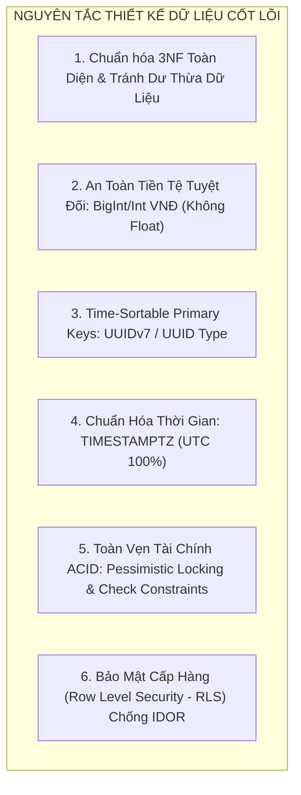
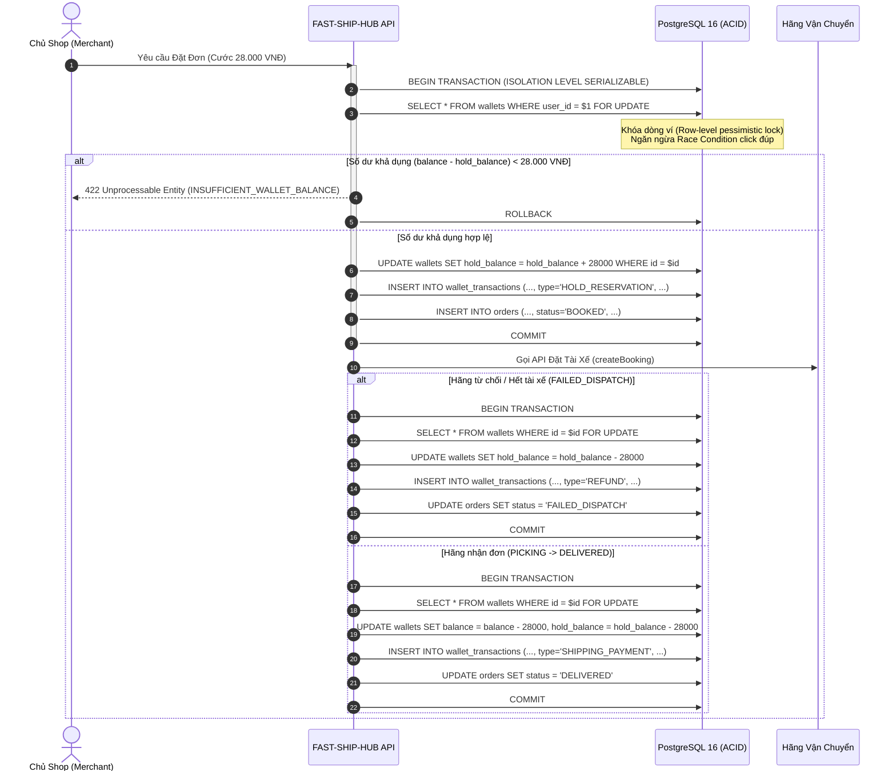

# THIẾT KẾ CƠ SỞ DỮ LIỆU TỔNG THỂ (DATABASE DESIGN SPECIFICATION)

> **Tên sản phẩm**: Nền Tảng Tích Hợp & So Sánh Giao Hàng Đa Hãng (`FAST-SHIP-HUB`)  
> **Mã tài liệu**: `DOC-DB-001` | **Phiên bản**: `1.0.0` | **Trạng thái**: `APPROVED_FOR_MIGRATION`  
> **Tác giả**: `database-engineer` (Kỹ sư Cơ sở Dữ liệu & Data Modeling)  
> **Người tiếp nhận**: `backend-engineer`, `security-reviewer`, `qa-engineer`, `system-architect`

---

## 1. NGUYÊN TẮC THIẾT KẾ CƠ SỞ DỮ LIỆU (DATABASE DESIGN PRINCIPLES)

Hệ thống cơ sở dữ liệu `FAST-SHIP-HUB` được thiết kế dựa trên các nguyên tắc công nghệ hiện đại nhằm đảm bảo độ tin cậy tuyệt đối về tài chính, tốc độ truy vấn thời gian thực (< 1.5s cho toàn bộ luồng so sánh cước) và khả năng mở rộng ngang:



### 1.1. Chuẩn hóa 3NF (Third Normal Form) & Tối Ưu Hóa Truy Vấn
- Toàn bộ 10 thực thể cốt lõi đạt chuẩn hóa 3NF: Mọi thuộc tính phi khóa đều phụ thuộc trực tiếp vào khóa chính, không có sự phụ thuộc bắc cầu (transitive dependency).
- Đối với các trường hợp đặc thù cần tối ưu tốc độ đọc thời gian thực (như tọa độ GPS mới nhất của tài xế trên bảng `Order`), hệ thống lưu trữ cache có kiểm soát đồng thời duy trì toàn bộ lịch sử chi tiết trong `OrderStatusLog`.

### 1.2. Quy Chuẩn Kiểu Dữ Liệu Tiền Tệ VNĐ (Financial Integrity)
- **Tuyệt đối cấm sử dụng kiểu số thực (`FLOAT`, `REAL`, `DOUBLE PRECISION`)** cho các trường tiền tệ, cước phí, số dư ví và chiết khấu. Số thực có sai số dấu phẩy động (floating-point precision error) gây thất thoát hoặc sai lệch kế toán.
- **Quy chuẩn bắt buộc**:
  - `BIGINT` (8 bytes, phạm vi lên tới $\pm 9 \times 10^{18}$): Dùng cho số dư ví (`balance`, `hold_balance`) và các giao dịch lũy kế lớn trong `Wallet`, `WalletTransaction`.
  - `INTEGER` (4 bytes, phạm vi lên tới 2.147.483.647 VNĐ): Dùng cho cước phí từng đơn hàng (`base_fee`, `surcharges`, `platform_fee`, `final_total_fee`, `cod_amount_vnd`) vì chi phí giao hàng chặng cuối tại Việt Nam không vượt quá 2 tỷ VNĐ/đơn.
  - Toàn bộ đơn vị tính là số nguyên Đồng Việt Nam (**VNĐ**), không lưu trữ số thập phân lẻ.

### 1.3. Chiến Lược Khóa Chính (Primary Key Strategy: UUIDv7)
- Hệ thống sử dụng định dạng **UUIDv7** (hoặc native `UUID` của PostgreSQL kết hợp hàm sinh Unix Epoch Timestamp 48-bit ở đầu):
  - **Lợi ích vượt trội so với UUIDv4 ngẫu nhiên**: Khóa chính UUIDv7 được sắp xếp tuần tự theo thời gian (time-sortable), giảm thiểu hiện tượng phân mảnh B-Tree Index (B-Tree fragmentation) khi lượng ghi (writes) đạt hàng triệu bản ghi, tăng tốc độ truy vấn phân trang `WHERE id > last_seen_id LIMIT 20`.
  - **Bảo mật hơn Auto-Increment Integer**: Ngăn chặn hoàn toàn kẻ xấu dò quét ID tuần tự (ID Enumeration Attack).

### 1.4. Quy Chuẩn Thời Gian & Múi Giờ (Timezone & Timestamps)
- 100% các cột lưu trữ thời gian đều sử dụng kiểu `TIMESTAMPTZ` (Timestamp with Time Zone) trong PostgreSQL.
- Mọi mốc thời gian được chuẩn hóa lưu trữ theo chuẩn UTC (`00:00:00Z`).
- Việc chuyển đổi sang múi giờ Việt Nam (`Asia/Ho_Chi_Minh` - UTC+7) được thực hiện ở tầng hiển thị Client hoặc qua cấu hình session của PostgreSQL khi trích xuất báo cáo.
- Mọi bảng đều bắt buộc có 2 trường audit cơ sở:
  - `created_at TIMESTAMPTZ NOT NULL DEFAULT CURRENT_TIMESTAMP`
  - `updated_at TIMESTAMPTZ NOT NULL DEFAULT CURRENT_TIMESTAMP` (được cập nhật tự động bằng PostgreSQL Trigger).

---

## 2. QUY CHUẨN ĐỊNH DANH MÃ NGHIỆP VỤ (BUSINESS IDENTIFIER SPECIFICATION)

| Tên Định Danh | Định Dạng Cú Pháp | Ví Dụ | Mục Đích Nghiệp Vụ |
| :--- | :--- | :--- | :--- |
| **Order Code** | `FSH-YYYYMMDD-XXXX` (16 ký tự) | `FSH-20261103-8899` | Mã đơn hàng hiển thị cho khách và tổng đài viên hỗ trợ, dễ đọc, dễ đối soát. |
| **Tracking Token**| `fsh_live_[a-z0-9]{24}` (33 ký tự) | `fsh_live_89a7df6b02a4b3c1d9e20011` | Token ngẫu nhiên URL-safe dùng để truy cập trang Live Tracking thời gian thực mà không cần đăng nhập. |
| **Quote Ref ID** | `QUO-[A-Z0-9]{12}` | `QUO-98F1A20BC345` | Mã phiên báo giá tạm thời có thời hạn hiệu lực (TTL 300 giây). |
| **Transaction Code** | `TXN-YYYYMMDD-[A-Z0-9]{8}` | `TXN-20261103-A1B2C3D4` | Mã giao dịch biến động số dư ví (Nạp tiền, trừ cước, hoàn cước). |

---

## 3. DANH MỤC ENUM TOÀN HỆ THỐNG (SYSTEM ENUM CATALOG)

Mọi trạng thái, vai trò và phân loại nghiệp vụ đều được quản lý bằng native PostgreSQL `ENUM` để đảm bảo tính toàn vẹn dữ liệu từ tầng Database:

```sql
-- 1. Phân quyền người dùng
CREATE TYPE user_role AS ENUM (
    'GUEST',       -- Khách vãng lai (không bắt buộc mật khẩu)
    'MERCHANT',    -- Chủ shop / Doanh nghiệp có ví trả trước
    'ADMIN'        -- Quản trị viên vận hành sàn
);

-- 2. Trạng thái tài khoản người dùng
CREATE TYPE user_status AS ENUM (
    'ACTIVE',      -- Hoạt động bình thường
    'SUSPENDED',   -- Tạm khóa do vi phạm hoặc nghi ngờ gian lận
    'DELETED'      -- Đã đánh dấu xóa mềm (Soft deleted)
);

-- 3. Vòng đời đơn hàng (10 trạng thái chuẩn xác theo PRD & Business Rules)
CREATE TYPE order_status AS ENUM (
    'DRAFT',            -- Đang soạn đơn, nhập địa chỉ
    'QUOTED',           -- Đã nhận báo giá từ các hãng
    'BOOKED',           -- Đã bấm đặt và xác nhận thanh toán/giữ tiền
    'PICKING',          -- Tài xế đã nhận đơn và đang tới lấy hàng
    'DELIVERING',       -- Tài xế đã lấy hàng và đang di chuyển tới người nhận
    'DELIVERED',        -- Giao hàng thành công, hoàn tất COD
    'RETURNING',        -- Giao thất bại, tài xế đang hoàn trả hàng về shop
    'RETURNED',         -- Đã hoàn trả hàng về điểm gửi thành công
    'FAILED_DISPATCH',  -- Hãng hết tài xế hoặc lỗi điều phối
    'CANCELLED'         -- Đơn hàng đã bị hủy
);

-- 4. Mã định danh các hãng đối tác tích hợp
CREATE TYPE carrier_code AS ENUM (
    'GRAB',             -- GrabExpress
    'SHOPEE_FOOD',      -- ShopeeFood / Shopee Xpress Instant
    'XANH_SM',          -- Xanh SM Delivery (Thuần xe điện VinFast)
    'AHAMOVE',          -- Ahamove
    'BE',               -- beDelivery
    'SANDBOX_MOCK'      -- Cổng Mock Giả lập phục vụ Kiểm thử tự động
);

-- 5. Hạng dịch vụ phương tiện vận chuyển
CREATE TYPE service_tier_code AS ENUM (
    'BIKE_INSTANT',     -- Xe máy giao tức thì (30 - 60 phút)
    'BIKE_SAME_DAY',    -- Xe máy giao tiết kiệm trong ngày
    'CAR_DELIVERY',     -- Xe ô tô 4 chỗ / 7 chỗ chở hàng
    'TRUCK_500KG'       -- Xe tải nhỏ 500kg - 2000kg
);

-- 6. Phân loại mặt hàng vận chuyển
CREATE TYPE package_type AS ENUM (
    'DOCUMENT',         -- Giấy tờ, hồ sơ, bưu phẩm
    'FOOD',             -- Đồ ăn, nước uống đóng gói
    'FASHION',          -- Quần áo, giày dép, mỹ phẩm
    'FRAGILE',          -- Hàng dễ vỡ, thủy tinh, gốm sứ
    'ELECTRONICS'       -- Thiết bị điện tử, điện thoại, linh kiện
);

-- 7. Huy hiệu thông minh đề xuất cho người dùng
CREATE TYPE smart_badge AS ENUM (
    'CHEAPEST',         -- Cước phí thấp nhất
    'FASTEST',          -- Thời gian giao dự kiến nhanh nhất
    'GREENEST',         -- Xe điện thân thiện môi trường (Xanh SM)
    'BEST_VALUE'        -- Điểm cân bằng tối ưu giữa giá và thời gian
);

-- 8. Phân loại biến động số dư ví
CREATE TYPE transaction_type AS ENUM (
    'TOPUP',            -- Nạp tiền vào ví qua VietQR Napas
    'SHIPPING_PAYMENT', -- Trừ cước vận chuyển khi hoàn tất giao
    'HOLD_RELEASE',     -- Trừ cước chính thức từ khoản tạm giữ
    'REFUND',           -- Hoàn tiền khi hủy đơn hoặc điều xe thất bại
    'COD_CREDIT',       -- Tiền COD hãng thanh toán đối soát vào ví
    'PLATFORM_FEE',     -- Thu phí dịch vụ sàn
    'ADJUSTMENT'        -- Điều chỉnh số dư bởi Quản trị viên (có log)
);

-- 9. Trạng thái giao dịch ví
CREATE TYPE transaction_status AS ENUM (
    'PENDING',          -- Đang chờ xử lý (VD: Chờ webhook VietQR)
    'SUCCESS',          -- Giao dịch thành công
    'FAILED'            -- Giao dịch thất bại
);

-- 10. Trạng thái xử lý Webhook
CREATE TYPE webhook_processing_status AS ENUM (
    'PENDING',          -- Mới tiếp nhận, chờ worker xử lý
    'PROCESSED',        -- Đã cập nhật trạng thái đơn thành công
    'FAILED',           -- Xử lý thất bại (lỗi kết nối, payload sai)
    'IGNORED'           -- Bỏ qua do sự kiện trùng lặp (Idempotent)
);

-- 11. Phương thức thanh toán
CREATE TYPE payment_method AS ENUM (
    'WALLET',           -- Trừ ví trả trước của Merchant
    'VIETQR',           -- Thanh toán mã QR ngân hàng Napas 247
    'COD'               -- Thanh toán tiền mặt khi nhận hàng
);

-- 12. Loại phương tiện của tài xế
CREATE TYPE vehicle_type AS ENUM (
    'GASOLINE_BIKE',    -- Xe máy chạy xăng truyền thống
    'ELECTRIC_BIKE',    -- Xe máy điện (VinFast Feliz, Evo200, Klara)
    'CAR',              -- Xe ô tô điện hoặc xăng
    'TRUCK'             -- Xe tải thùng
);
```

---

## 4. BẢO VỆ TÍNH TOÀN VẸN TÀI CHÍNH (FINANCIAL SAFETY & CONCURRENCY)



### 4.1. Các Ràng Buộc Kiểm Tra (Check Constraints) Bắt Buộc Trên Bảng Ví:
1. `CHECK (balance >= 0)`: Số dư tổng tuyệt đối không được âm dưới bất kỳ hình thức nào.
2. `CHECK (hold_balance >= 0)`: Số dư tạm giữ không được âm.
3. `CHECK (balance >= hold_balance)`: Số dư khả dụng (`available_balance = balance - hold_balance`) luôn phải $\ge 0$.

### 4.2. Cơ chế Khóa Bi quan (Pessimistic Locking):
Tất cả các thao tác liên quan tới nạp tiền, tạm giữ cước, giải phóng số dư hoặc trừ tiền ví đều bắt buộc thực hiện trong khối Transaction với câu lệnh:
```sql
SELECT id, balance, hold_balance 
FROM wallets 
WHERE user_id = :user_id 
FOR UPDATE;
```
Cơ chế này ngăn chặn hoàn toàn hiện tượng Race Condition (hai yêu cầu đặt đơn song song đồng thời trừ tiền vượt quá số dư thực tế).

---

## 5. TỔNG KẾT 10 THỰC THỂ CỐT LÕI

| STT | Tên Bảng (Physical Table) | Tên Thực Thể Domain | Vai Trò Nghiệp Vụ Cốt Lõi |
| :---: | :--- | :--- | :--- |
| **1** | `users` | `User` | Quản lý định danh người dùng: Khách vãng lai, Chủ shop, Quản trị viên sàn. |
| **2** | `wallets` | `Wallet` | Ví trả trước của người dùng, kiểm soát số dư tổng và số dư tạm giữ cước. |
| **3** | `wallet_transactions` | `WalletTransaction` | Sổ cái kế toán bất biến (Immutable Ledger) lưu trữ toàn bộ lịch sử biến động số dư. |
| **4** | `carriers` | `Carrier` | Danh mục các hãng vận chuyển tích hợp (Grab, ShopeeFood, Xanh SM, Ahamove, Be, Mock). |
| **5** | `carrier_service_tiers`| `CarrierServiceTier` | Các gói dịch vụ vận chuyển của từng hãng (Xe máy siêu tốc, Trong ngày, Xe ô tô, Xe tải). |
| **6** | `orders` | `Order` | Thực thể trung tâm lưu trữ thông tin đơn hàng, tuyến đường, tài xế, mã vận đơn đối tác. |
| **7** | `packages` | `Package` | Chi tiết kiện hàng hóa: kích thước, cân nặng, tính chất dễ vỡ, giá trị khai giá, tiền COD. |
| **8** | `carrier_quotes` | `CarrierQuote` | Bảng giá cước so sánh đa hãng cho từng lượt tìm kiếm hoặc phiên đặt đơn (TTL 300s). |
| **9** | `order_status_logs` | `OrderStatusLog` | Nhật ký truy vết (Audit Trail) lịch sử dịch chuyển trạng thái 10 bước của đơn hàng. |
| **10**| `webhook_logs` | `WebhookLog` | Nhật ký toàn bộ các sự kiện webhook từ đối tác gửi sang để đảm bảo tính Idempotency. |
