# SƠ ĐỒ QUAN HỆ THỰC THỂ CƠ SỞ DỮ LIỆU (ENTITY RELATIONSHIP DIAGRAM - ERD)

> **Tên sản phẩm**: Nền Tảng Tích Hợp & So Sánh Giao Hàng Đa Hãng (`FAST-SHIP-HUB`)  
> **Mã tài liệu**: `DOC-DB-002` | **Phiên bản**: `1.0.0` | **Trạng thái**: `APPROVED_FOR_MIGRATION`  
> **Tác giả**: `database-engineer` (Kỹ sư Cơ sở Dữ liệu & Data Modeling)  
> **Người tiếp nhận**: `backend-engineer`, `system-architect`, `qa-engineer`

---

## 1. SƠ ĐỒ THỰC THỂ TỔNG THỂ (MERMAID ER DIAGRAM)

Dưới đây là sơ đồ quan hệ thực thể toàn diện cho 10 bảng dữ liệu cốt lõi trong cơ sở dữ liệu PostgreSQL 16:

```mermaid
erDiagram
    %% ==========================================
    %% 1. PHÂN HỆ ĐỊNH DANH & TÀI CHÍNH (IDENTITY & WALLET)
    %% ==========================================
    users ||--o| wallets : "owns (1:1)"
    wallets ||--o{ wallet_transactions : "records (1:N)"
    users ||--o{ orders : "places (1:N)"
    orders ||--o{ wallet_transactions : "triggers (1:N)"

    %% ==========================================
    %% 2. PHÂN HỆ ĐỐI TÁC VẬN CHUYỂN (CARRIERS & TIERS)
    %% ==========================================
    carriers ||--|{ carrier_service_tiers : "offers (1:N)"
    carriers ||--o{ orders : "fulfills (1:N)"
    carrier_service_tiers ||--o{ orders : "applied_to (1:N)"
    carriers ||--o{ carrier_quotes : "provides (1:N)"
    carrier_service_tiers ||--o{ carrier_quotes : "specifies (1:N)"
    carriers ||--o{ webhook_logs : "dispatches (1:N)"

    %% ==========================================
    %% 3. PHÂN HỆ ĐƠN HÀNG & BÁO GIÁ (ORDERS & QUOTES)
    %% ==========================================
    orders ||--|| packages : "contains (1:1)"
    orders ||--o{ carrier_quotes : "compares (1:N)"
    orders ||--o{ order_status_logs : "audits (1:N)"
    orders ||--o{ webhook_logs : "associates (1:N)"

    %% ==========================================
    %% CHI TIẾT CÁC THỰC THỂ VÀ THUỘC TÍNH
    %% ==========================================

    users {
        uuid id PK "UUIDv7 định danh duy nhất"
        varchar phone UK "Số điện thoại đăng nhập (E.164)"
        varchar email UK "Email người dùng (Nullable)"
        varchar password_hash "Mật khẩu mã hóa Argon2id / Bcrypt"
        varchar full_name "Họ và tên người dùng"
        user_role role "GUEST | MERCHANT | ADMIN"
        user_status status "ACTIVE | SUSPENDED | DELETED"
        timestamptz created_at "Thời điểm tạo"
        timestamptz updated_at "Thời điểm cập nhật"
    }

    wallets {
        uuid id PK "UUIDv7 định danh ví"
        uuid user_id FK,UK "Khóa ngoại trỏ sang users.id (1:1)"
        bigint balance "Tổng số dư ví (VNĐ) >= 0"
        bigint hold_balance "Số dư tạm giữ cho đơn (VNĐ) >= 0"
        varchar currency "Mặc định VND"
        timestamptz last_transaction_at "Thời điểm giao dịch gần nhất"
        timestamptz created_at "Thời điểm tạo ví"
        timestamptz updated_at "Thời điểm cập nhật"
    }

    wallet_transactions {
        uuid id PK "UUIDv7 định danh giao dịch"
        uuid wallet_id FK "Khóa ngoại trỏ sang wallets.id"
        uuid order_id FK "Khóa ngoại trỏ sang orders.id (Nullable)"
        varchar transaction_code UK "Mã giao dịch TXN-YYYYMMDD-XXXX"
        transaction_type type "TOPUP | SHIPPING_PAYMENT | REFUND..."
        transaction_status status "PENDING | SUCCESS | FAILED"
        bigint amount "Số tiền biến động (VNĐ) > 0"
        bigint balance_before "Số dư ví trước giao dịch"
        bigint balance_after "Số dư ví sau giao dịch"
        varchar payment_method "VIETQR | WALLET | COD | MANUAL"
        varchar reference_id "Mã tham chiếu ngân hàng/đối tác"
        text note "Ghi chú nội dung giao dịch"
        timestamptz created_at "Thời điểm tạo giao dịch"
    }

    carriers {
        uuid id PK "UUIDv7 định danh hãng"
        carrier_code code UK "GRAB | SHOPEE_FOOD | XANH_SM | AHAMOVE | BE | SANDBOX_MOCK"
        varchar name "Tên hiển thị: GrabExpress, Xanh SM..."
        varchar logo_url "Đường dẫn ảnh logo của hãng"
        boolean is_active "Trạng thái bật/tắt kết nối đối tác"
        boolean is_mock "true nếu là cổng giả lập Sandbox"
        text webhook_secret "Khóa bí mật thẩm định chữ ký HMAC-SHA256"
        varchar hotline "Số tổng đài hỗ trợ đối tác"
        timestamptz created_at "Thời điểm tạo"
        timestamptz updated_at "Thời điểm cập nhật"
    }

    carrier_service_tiers {
        uuid id PK "UUIDv7 định danh gói dịch vụ"
        uuid carrier_id FK "Khóa ngoại trỏ sang carriers.id"
        service_tier_code tier_code "BIKE_INSTANT | BIKE_SAME_DAY | CAR | TRUCK"
        varchar tier_name "Tên dịch vụ hãng: Siêu Tốc, Trong Ngày..."
        vehicle_type vehicle_type "GASOLINE_BIKE | ELECTRIC_BIKE | CAR | TRUCK"
        integer max_weight_grams "Trọng lượng tối đa nhận (gram)"
        integer max_dimension_cm "Kích thước tối đa mỗi chiều (cm)"
        integer base_fee_vnd "Cước cơ bản mở cửa (VNĐ)"
        integer base_distance_meters "Cự ly cước cơ bản (mét)"
        integer price_per_next_km_vnd "Cước mỗi km tiếp theo (VNĐ)"
        boolean is_active "Trạng thái khả dụng của gói dịch vụ"
        timestamptz created_at "Thời điểm tạo"
        timestamptz updated_at "Thời điểm cập nhật"
    }

    orders {
        uuid id PK "UUIDv7 định danh đơn hàng"
        varchar order_code UK "Mã đơn FSH-YYYYMMDD-XXXX"
        varchar tracking_token UK "Token xem tracking công khai fsh_live_xxx"
        uuid user_id FK "Khóa ngoại trỏ sang users.id"
        uuid carrier_id FK "Khóa ngoại trỏ sang carriers.id (Nullable lúc Draft)"
        uuid service_tier_id FK "Khóa ngoại trỏ sang carrier_service_tiers.id"
        uuid selected_quote_id FK "Báo giá được chọn đặt đơn"
        varchar carrier_order_id "Mã vận đơn phía hãng đối tác cấp"
        order_status status "10 trạng thái chuẩn: DRAFT -> DELIVERED / CANCELLED"
        payment_method payment_method "WALLET | VIETQR | COD"
        
        varchar pickup_sender_name "Họ tên người gửi"
        varchar pickup_sender_phone "Số điện thoại người gửi"
        varchar pickup_address "Địa chỉ lấy hàng chi tiết"
        decimal pickup_latitude "Vĩ độ điểm lấy hàng (WGS84)"
        decimal pickup_longitude "Kinh độ điểm lấy hàng (WGS84)"
        text pickup_note "Ghi chú lấy hàng (số tầng, phòng...)"

        varchar dropoff_receiver_name "Họ tên người nhận"
        varchar dropoff_receiver_phone "Số điện thoại người nhận"
        varchar dropoff_address "Địa chỉ giao hàng chi tiết"
        decimal dropoff_latitude "Vĩ độ điểm giao hàng (WGS84)"
        decimal dropoff_longitude "Kinh độ điểm giao hàng (WGS84)"
        text dropoff_note "Ghi chú giao hàng"

        integer distance_meters "Khoảng cách đường bộ tính bằng mét"
        integer duration_seconds "Thời gian di chuyển ước tính (giây)"
        
        integer base_fee "Cước cơ bản (VNĐ)"
        integer surcharges "Tổng phụ phí cao điểm/đêm/mưa (VNĐ)"
        integer platform_fee "Phí dịch vụ sàn (VNĐ)"
        integer discount_amount "Số tiền giảm giá (VNĐ)"
        integer final_total_fee "Tổng tiền cước người gửi phải trả (VNĐ)"

        varchar driver_name "Họ tên tài xế đón"
        varchar driver_phone "Số điện thoại liên hệ tài xế"
        varchar driver_license_plate "Biển số xe tài xế"
        vehicle_type driver_vehicle_type "Loại xe tài xế chạy (Xăng / Điện VinFast)"
        decimal driver_current_lat "Vĩ độ GPS hiện tại của tài xế"
        decimal driver_current_lng "Kinh độ GPS hiện tại của tài xế"
        timestamptz driver_assigned_at "Thời điểm tài xế nhận cuốc"

        timestamptz picked_up_at "Thời điểm lấy hàng thực tế"
        timestamptz delivered_at "Thời điểm giao hàng thành công"
        timestamptz cancelled_at "Thời điểm hủy đơn"
        text cancellation_reason "Lý do hủy đơn"
        
        timestamptz created_at "Thời điểm tạo đơn"
        timestamptz updated_at "Thời điểm cập nhật"
    }

    packages {
        uuid id PK "UUIDv7 định danh kiện hàng"
        uuid order_id FK,UK "Khóa ngoại trỏ sang orders.id (1:1)"
        varchar name "Tên mô tả gói hàng"
        package_type package_type "DOCUMENT | FOOD | FASHION | FRAGILE..."
        integer weight_in_grams "Trọng lượng kiện hàng (gram)"
        integer length_cm "Chiều dài (cm)"
        integer width_cm "Chiều rộng (cm)"
        integer height_cm "Chiều cao (cm)"
        integer declared_value_vnd "Giá trị khai giá bảo hiểm (VNĐ)"
        integer cod_amount_vnd "Tiền thu hộ COD (VNĐ)"
        boolean is_fragile "Cờ hàng dễ vỡ"
        boolean deliver_to_door "Cờ giao hàng tận tay lên phòng"
        text special_instructions "Chỉ dẫn đặc biệt cho tài xế"
        timestamptz created_at "Thời điểm tạo"
        timestamptz updated_at "Thời điểm cập nhật"
    }

    carrier_quotes {
        uuid id PK "UUIDv7 định danh báo giá"
        uuid order_id FK "Khóa ngoại trỏ sang orders.id (Nullable nếu phiên quote rời)"
        uuid carrier_id FK "Khóa ngoại trỏ sang carriers.id"
        uuid service_tier_id FK "Khóa ngoại trỏ sang carrier_service_tiers.id"
        varchar quote_reference_id "Token báo giá phía đối tác trả về"
        integer base_fee "Cước cơ bản từ hãng (VNĐ)"
        integer surcharges "Phụ phí mưa/cao điểm (VNĐ)"
        integer platform_fee "Phí nền tảng sàn thu (VNĐ)"
        integer discount_amount "Chiết khấu/khuyến mãi (VNĐ)"
        integer final_total_fee "Tổng chi phí cuối cùng (VNĐ)"
        integer estimated_pickup_minutes "Thời gian tài xế đến lấy (phút)"
        integer estimated_delivery_minutes "Thời gian giao hàng (phút)"
        smart_badge badge "CHEAPEST | FASTEST | GREENEST | BEST_VALUE"
        boolean is_available "Hãng có nhận đơn tại khu vực này không"
        varchar error_message "Lý do nếu hãng không nhận hoặc timeout"
        timestamptz expired_at "Thời điểm hết hạn báo giá (TTL 300s)"
        timestamptz created_at "Thời điểm tạo báo giá"
    }

    order_status_logs {
        uuid id PK "UUIDv7 định danh nhật ký trạng thái"
        uuid order_id FK "Khóa ngoại trỏ sang orders.id"
        order_status old_status "Trạng thái trước đó (Nullable ở bước đầu)"
        order_status new_status "Trạng thái mới chuyển sang"
        varchar changed_by "ID người dùng, 'CARRIER_WEBHOOK' hoặc 'SYSTEM'"
        varchar trigger_source "USER_ACTION | WEBHOOK | TIMEOUT_WORKER | ADMIN"
        text reason "Lý do chuyển trạng thái (nếu có)"
        jsonb metadata "Dữ liệu mở rộng: tọa độ tài xế, battery %, payload hãng"
        timestamptz created_at "Thời điểm ghi nhận trạng thái"
    }

    webhook_logs {
        uuid id PK "UUIDv7 định danh bản ghi webhook"
        uuid carrier_id FK "Khóa ngoại trỏ sang carriers.id"
        uuid order_id FK "Khóa ngoại trỏ sang orders.id (Nullable nếu chưa map)"
        varchar event_id "Mã sự kiện duy nhất từ hãng gửi sang (Deduplication)"
        varchar event_type "Loại sự kiện hãng: DRIVER_ASSIGNED, DELIVERED..."
        order_status normalized_status "Trạng thái đơn hệ thống đã quy đổi"
        varchar signature "Chữ ký số xác thực (HMAC Header)"
        boolean signature_valid "Kết quả thẩm định chữ ký hợp lệ hay không"
        webhook_processing_status status "PENDING | PROCESSED | FAILED | IGNORED"
        jsonb raw_payload "Toàn bộ nội dung JSON gốc hãng gửi sang"
        text error_message "Chi tiết lỗi nếu xử lý thất bại"
        timestamptz processed_at "Thời điểm xử lý xong"
        timestamptz created_at "Thời điểm tiếp nhận webhook"
    }
```

---

## 2. PHÂN TÍCH QUAN HỆ & BẢN SỐ (CARDINALITY & DOMAIN BOUNDARIES)

### 2.1. Phân hệ Định danh & Quản lý Tài chính (Identity & Wallet Domain)
- **`users` 1 ➔ 0..1 `wallets`**: Mỗi người dùng Merchant hoặc Admin sở hữu tối đa 1 Ví tài khoản. Khách vãng lai (`GUEST`) có thể chưa kích hoạt ví cho đến khi tạo tài khoản chính thức.
- **`wallets` 1 ➔ 0..N `wallet_transactions`**: Mỗi ví sở hữu lịch sử biến động số dư bất biến (Sổ cái kế toán 1 chiều).
- **`orders` 1 ➔ 0..N `wallet_transactions`**: Mỗi đơn hàng có thể kích hoạt nhiều giao dịch ví liên quan (Giao dịch 1: Tạm giữ cước khi đặt đơn `BOOKED`, Giao dịch 2: Quyết toán trừ thật khi `DELIVERED`, Giao dịch 3: Hoàn tiền khi `CANCELLED`).

### 2.2. Phân hệ Đối tác Vận chuyển (Carriers & Logistics Domain)
- **`carriers` 1 ➔ 1..N `carrier_service_tiers`**: Mỗi hãng (Grab, Xanh SM, ShopeeFood, Ahamove, Be, Mock) hỗ trợ nhiều gói dịch vụ khác nhau (`BIKE_INSTANT`, `BIKE_SAME_DAY`, `CAR_DELIVERY`, v.v.).
- **`carriers` 1 ➔ 0..N `orders`**: Mỗi đơn hàng được chỉ định giao bởi 1 hãng cụ thể sau khi khách chốt lựa chọn.
- **`carrier_service_tiers` 1 ➔ 0..N `orders`**: Mỗi đơn hàng áp dụng đúng 1 hạng dịch vụ vận chuyển.

### 2.3. Phân hệ Đơn hàng & Báo giá (Orders & Quoting Domain)
- **`orders` 1 ➔ 1 `packages`**: Quan hệ 1:1 nghiêm ngặt; mỗi đơn hàng vận chuyển một kiện hàng với thông số khối lượng và kích thước riêng biệt.
- **`orders` 1 ➔ 0..N `carrier_quotes`**: Khi khách hàng yêu cầu so sánh cước cho đơn hàng, hệ thống sinh ra từ 5 đến 6 báo giá đại diện cho từng hãng đối tác. Đơn hàng lưu `selected_quote_id` để tham chiếu báo giá trúng tuyển.
- **`orders` 1 ➔ 1..N `order_status_logs`**: Mọi bước chuyển trạng thái trong vòng đời 10 bước đều được ghi nhật ký bất biến để phục vụ đối soát, khiếu nại và hiển thị thanh tiến trình Live Tracking.

### 2.4. Phân hệ Tích hợp Sự kiện & Webhook (Webhook & Event Domain)
- **`carriers` 1 ➔ 0..N `webhook_logs`**: Lưu vết mọi request HTTP Webhook do hãng đẩy sang.
- **`orders` 1 ➔ 0..N `webhook_logs`**: Cho phép tra cứu nhanh toàn bộ luồng callback liên quan tới một mã đơn cụ thể qua `order_id` hoặc `carrier_order_id`.
- Khóa Unique hỗn hợp `(carrier_id, event_id)` trên bảng `webhook_logs` đảm bảo tính Idempotency, không bao giờ xử lý lặp lại sự kiện của hãng gửi sang quá 1 lần.
