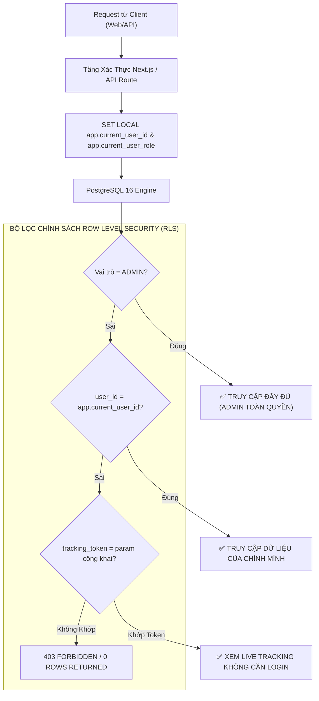

# CHÍNH SÁCH BẢO MẬT CẤP HÀNG & PHÒNG CHỐNG IDOR (ROW LEVEL SECURITY POLICIES)

> **Tên sản phẩm**: Nền Tảng Tích Hợp & So Sánh Giao Hàng Đa Hãng (`FAST-SHIP-HUB`)  
> **Mã tài liệu**: `DOC-DB-005` | **Phiên bản**: `1.0.0` | **Trạng thái**: `APPROVED_FOR_MIGRATION`  
> **Tác giả**: `database-engineer` (Kỹ sư Cơ sở Dữ liệu & Data Modeling)  
> **Người tiếp nhận**: `security-reviewer`, `backend-engineer`, `system-architect`

---

## 1. NGUYÊN TẮC BẢO MẬT DỮ LIỆU & KIẾN TRÚC RLS (ROW LEVEL SECURITY ARCHITECTURE)

Trong mô hình SaaS Aggregator Đa Hãng, nguy cơ lộ lọt dữ liệu lớn nhất là lỗi **IDOR (Insecure Direct Object References)** — khi Merchant A cố tình thay đổi tham số ID trên URL để xem trộm đơn hàng, địa chỉ khách hàng hoặc số dư ví của Merchant B.

Để loại bỏ triệt để rủi ro này từ tận tầng nhân cơ sở dữ liệu (Defense-in-Depth), `FAST-SHIP-HUB` áp dụng **PostgreSQL Row Level Security (RLS)** trên 100% các bảng dữ liệu nhạy cảm:



---

## 2. CƠ CHẾ THIẾT LẬP PHIÊN XÁC THỰC TRONG POSTGRESQL (SESSION CONTEXT)

Hệ thống Next.js 15 Backend trước khi thực thi truy vấn sẽ thiết lập biến Session trong Transaction kết nối:

```sql
-- Thiết lập ngữ cảnh định danh người dùng hiện tại (Lấy từ JWT Cookie)
SET LOCAL app.current_user_id = '0192e2b3-5678-7123-8abc-def012345678';
SET LOCAL app.current_user_role = 'MERCHANT';

-- Hoặc trường hợp người nhận tra cứu Live Tracking công khai:
SET LOCAL app.current_tracking_token = 'fsh_live_89a7df6b02a4b3c1d9e20011';
```

Hai hàm trợ giúp (Helper Functions) trích xuất ngữ cảnh bảo mật:
```sql
CREATE OR REPLACE FUNCTION get_current_user_id() 
RETURNS UUID AS $$
BEGIN
    RETURN NULLIF(current_setting('app.current_user_id', true), '')::UUID;
EXCEPTION
    WHEN OTHERS THEN RETURN NULL;
END;
$$ LANGUAGE plpgsql STABLE SECURITY DEFINER;

CREATE OR REPLACE FUNCTION get_current_user_role() 
RETURNS TEXT AS $$
BEGIN
    RETURN current_setting('app.current_user_role', true);
EXCEPTION
    WHEN OTHERS THEN RETURN 'ANONYMOUS';
END;
$$ LANGUAGE plpgsql STABLE SECURITY DEFINER;

CREATE OR REPLACE FUNCTION get_current_tracking_token() 
RETURNS TEXT AS $$
BEGIN
    RETURN current_setting('app.current_tracking_token', true);
EXCEPTION
    WHEN OTHERS THEN RETURN '';
END;
$$ LANGUAGE plpgsql STABLE SECURITY DEFINER;
```

---

## 3. TOÀN BỘ CHÍNH SÁCH BẢO MẬT RLS CHO CÁC BẢNG (100% PRODUCTION SQL)

### 3.1. Bảng Người dùng (`users`)
```sql
ALTER TABLE users ENABLE ROW LEVEL SECURITY;

-- 1. Admin được toàn quyền xem và quản trị tất cả người dùng
CREATE POLICY p_users_admin_all ON users
    FOR ALL
    TO authenticated, anon
    USING (get_current_user_role() = 'ADMIN')
    WITH CHECK (get_current_user_role() = 'ADMIN');

-- 2. Người dùng chỉ được xem thông tin hồ sơ của chính mình (Chống IDOR profile)
CREATE POLICY p_users_owner_select ON users
    FOR SELECT
    TO authenticated
    USING (id = get_current_user_id());

-- 3. Người dùng chỉ được cập nhật họ tên, avatar của chính mình
CREATE POLICY p_users_owner_update ON users
    FOR UPDATE
    TO authenticated
    USING (id = get_current_user_id())
    WITH CHECK (id = get_current_user_id());

-- 4. Cho phép đăng ký người dùng mới (Guest hoặc Merchant)
CREATE POLICY p_users_insert_register ON users
    FOR INSERT
    TO authenticated, anon
    WITH CHECK (true);
```

---

### 3.2. Bảng Ví Tiền (`wallets`) — Tối Thượng An Toàn Tài Chính
```sql
ALTER TABLE wallets ENABLE ROW LEVEL SECURITY;

-- 1. Admin được quyền xem số dư ví toàn hệ thống
CREATE POLICY p_wallets_admin_all ON wallets
    FOR ALL
    TO authenticated
    USING (get_current_user_role() = 'ADMIN');

-- 2. Chủ shop CHỈ ĐƯỢC XEM số dư ví của chính mình (Chống IDOR xem ví shop khác)
CREATE POLICY p_wallets_owner_select ON wallets
    FOR SELECT
    TO authenticated
    USING (user_id = get_current_user_id());

-- 3. CẤM TUYỆT ĐỐI người dùng UPDATE / INSERT / DELETE trực tiếp vào ví!
-- Thao tác thay đổi số dư chỉ được thực hiện qua Service Role nội bộ (Database Transactions)
CREATE POLICY p_wallets_deny_direct_write ON wallets
    FOR INSERT
    TO authenticated, anon
    WITH CHECK (false);

CREATE POLICY p_wallets_deny_direct_update ON wallets
    FOR UPDATE
    TO authenticated, anon
    USING (false);

CREATE POLICY p_wallets_deny_direct_delete ON wallets
    FOR DELETE
    TO authenticated, anon
    USING (false);
```

---

### 3.3. Bảng Biến Động Số Dư (`wallet_transactions`) — Sổ Cái Kế Toán Bất Biến
```sql
ALTER TABLE wallet_transactions ENABLE ROW LEVEL SECURITY;

-- 1. Admin được tra cứu toàn bộ giao dịch
CREATE POLICY p_wallet_tx_admin_select ON wallet_transactions
    FOR SELECT
    TO authenticated
    USING (get_current_user_role() = 'ADMIN');

-- 2. Người dùng chỉ được xem lịch sử giao dịch phát sinh từ ví của chính mình
CREATE POLICY p_wallet_tx_owner_select ON wallet_transactions
    FOR SELECT
    TO authenticated
    USING (
        wallet_id IN (
            SELECT w.id FROM wallets w WHERE w.user_id = get_current_user_id()
        )
    );

-- 3. Bất biến (IMMUTABLE): CẤM mọi hành vi UPDATE hoặc DELETE trên sổ cái giao dịch
CREATE POLICY p_wallet_tx_deny_update ON wallet_transactions
    FOR UPDATE
    TO authenticated, anon
    USING (false);

CREATE POLICY p_wallet_tx_deny_delete ON wallet_transactions
    FOR DELETE
    TO authenticated, anon
    USING (false);
```

---

### 3.4. Bảng Đơn Hàng (`orders`) — Bảo Mật Đơn & Hỗ Trợ Live Tracking Công Khai
```sql
ALTER TABLE orders ENABLE ROW LEVEL SECURITY;

-- 1. Admin có quyền xem và xử lý toàn bộ đơn hàng
CREATE POLICY p_orders_admin_all ON orders
    FOR ALL
    TO authenticated
    USING (get_current_user_role() = 'ADMIN')
    WITH CHECK (get_current_user_role() = 'ADMIN');

-- 2. Chủ shop CHỈ xem được các đơn hàng do chính mình tạo
CREATE POLICY p_orders_owner_select ON orders
    FOR SELECT
    TO authenticated
    USING (user_id = get_current_user_id());

-- 3. Chủ shop chỉ được tạo đơn hàng gắn với user_id của chính mình
CREATE POLICY p_orders_owner_insert ON orders
    FOR INSERT
    TO authenticated
    WITH CHECK (user_id = get_current_user_id());

-- 4. Chủ shop chỉ được sửa/hủy đơn khi đơn còn ở trạng thái DRAFT, QUOTED, BOOKED
CREATE POLICY p_orders_owner_update ON orders
    FOR UPDATE
    TO authenticated
    USING (
        user_id = get_current_user_id() 
        AND status IN ('DRAFT', 'QUOTED', 'BOOKED')
    )
    WITH CHECK (user_id = get_current_user_id());

-- 5. CHÍNH SÁCH ĐẶC THÙ: Người nhận tra cứu Live Tracking không cần đăng nhập
-- Chỉ cho phép đọc bản ghi nếu cung cấp đúng tracking_token bí mật (32 ký tự URL-safe)
CREATE POLICY p_orders_public_tracking_select ON orders
    FOR SELECT
    TO authenticated, anon
    USING (
        tracking_token = get_current_tracking_token() 
        AND tracking_token <> ''
    );
```

---

### 3.5. Bảng Kiện Hàng (`packages`)
```sql
ALTER TABLE packages ENABLE ROW LEVEL SECURITY;

-- 1. Admin toàn quyền
CREATE POLICY p_packages_admin_all ON packages
    FOR ALL
    TO authenticated
    USING (get_current_user_role() = 'ADMIN');

-- 2. Chủ shop xem kiện hàng của đơn mình sở hữu
CREATE POLICY p_packages_owner_select ON packages
    FOR SELECT
    TO authenticated
    USING (
        order_id IN (
            SELECT o.id FROM orders o WHERE o.user_id = get_current_user_id()
        )
    );

-- 3. Cho phép người tra cứu tracking xem gói hàng (Tên hàng, loại hàng)
CREATE POLICY p_packages_public_tracking_select ON packages
    FOR SELECT
    TO authenticated, anon
    USING (
        order_id IN (
            SELECT o.id FROM orders o 
            WHERE o.tracking_token = get_current_tracking_token() 
            AND o.tracking_token <> ''
        )
    );
```

---

### 3.6. Bảng Báo Giá (`carrier_quotes`)
```sql
ALTER TABLE carrier_quotes ENABLE ROW LEVEL SECURITY;

-- 1. Cho phép bất kỳ ai (Guest hoặc Merchant) tạo báo giá và xem báo giá của phiên mình
CREATE POLICY p_carrier_quotes_select ON carrier_quotes
    FOR SELECT
    TO authenticated, anon
    USING (
        order_id IS NULL 
        OR order_id IN (
            SELECT o.id FROM orders o 
            WHERE o.user_id = get_current_user_id() 
               OR o.tracking_token = get_current_tracking_token()
        )
    );

CREATE POLICY p_carrier_quotes_insert ON carrier_quotes
    FOR INSERT
    TO authenticated, anon
    WITH CHECK (true);
```

---

### 3.7. Bảng Nhật Ký Trạng Thái (`order_status_logs`)
```sql
ALTER TABLE order_status_logs ENABLE ROW LEVEL SECURITY;

-- 1. Admin toàn quyền
CREATE POLICY p_status_logs_admin_all ON order_status_logs
    FOR ALL
    TO authenticated
    USING (get_current_user_role() = 'ADMIN');

-- 2. Chủ shop xem lịch sử trạng thái đơn hàng của mình
CREATE POLICY p_status_logs_owner_select ON order_status_logs
    FOR SELECT
    TO authenticated
    USING (
        order_id IN (
            SELECT o.id FROM orders o WHERE o.user_id = get_current_user_id()
        )
    );

-- 3. Người xem tracking công khai đọc được timeline di chuyển của đơn
CREATE POLICY p_status_logs_public_select ON order_status_logs
    FOR SELECT
    TO authenticated, anon
    USING (
        order_id IN (
            SELECT o.id FROM orders o 
            WHERE o.tracking_token = get_current_tracking_token() 
            AND o.tracking_token <> ''
        )
    );
```

---

### 3.8. Bảng Nhật Ký Webhook (`webhook_logs`) — Cô Lập Tuyệt Đối
```sql
ALTER TABLE webhook_logs ENABLE ROW LEVEL SECURITY;

-- CHỈ DUY NHẤT ADMIN VÀ SERVICE ROLE NỘI BỘ ĐƯỢC PHÉP TRUY CẬP
CREATE POLICY p_webhook_logs_admin_only ON webhook_logs
    FOR ALL
    TO authenticated
    USING (get_current_user_role() = 'ADMIN')
    WITH CHECK (get_current_user_role() = 'ADMIN');

-- CẤM TOÀN BỘ MERCHANT VÀ GUEST TIẾP CẬN DỮ LIỆU NÀY
CREATE POLICY p_webhook_logs_deny_public ON webhook_logs
    FOR ALL
    TO anon
    USING (false);
```

---

## 4. MA TRẬN PHÂN QUYỀN RLS TỔNG THỂ (ACCESS CONTROL MATRIX)

| Tên Bảng (Table) | Khách Vãng Lai (`GUEST / ANON`) | Chủ Shop (`MERCHANT`) | Quản Trị Viên (`ADMIN`) | Hệ Thống / Worker (`SERVICE_ROLE`) |
| :--- | :---: | :---: | :---: | :---: |
| `users` | Chỉ INSERT (Đăng ký) | Đọc / Sửa Profile của mình | Toàn quyền (Full CRUD) | Toàn quyền (Bypass RLS) |
| `wallets` | Không có quyền | Chỉ Đọc ví của mình | Xem tất cả ví | Cập nhật số dư trong Transaction |
| `wallet_transactions` | Không có quyền | Chỉ Đọc lịch sử ví mình | Xem toàn bộ sổ cái | Ghi thêm (Insert-only) |
| `carriers` | Chỉ Đọc danh mục active | Chỉ Đọc danh mục active | Toàn quyền cấu hình | Toàn quyền |
| `carrier_service_tiers`| Chỉ Đọc danh mục active | Chỉ Đọc danh mục active | Toàn quyền | Toàn quyền |
| `orders` | Đọc qua `tracking_token` | Toàn quyền trên đơn của mình | Toàn quyền giám sát | Cập nhật trạng thái qua Webhook |
| `packages` | Đọc qua `tracking_token` | Đọc/Ghi trên đơn của mình | Toàn quyền | Toàn quyền |
| `carrier_quotes` | Đọc/Ghi phiên so sánh giá | Đọc/Ghi phiên so sánh giá | Toàn quyền | Ghi báo giá từ Adapter |
| `order_status_logs` | Đọc timeline qua token | Đọc timeline đơn của mình | Toàn quyền | Ghi nhật ký trạng thái mới |
| `webhook_logs` | ❌ CẤM TRUY CẬP | ❌ CẤM TRUY CẬP | Xem toàn bộ Log | Ghi & Đánh dấu xử lý sự kiện |
