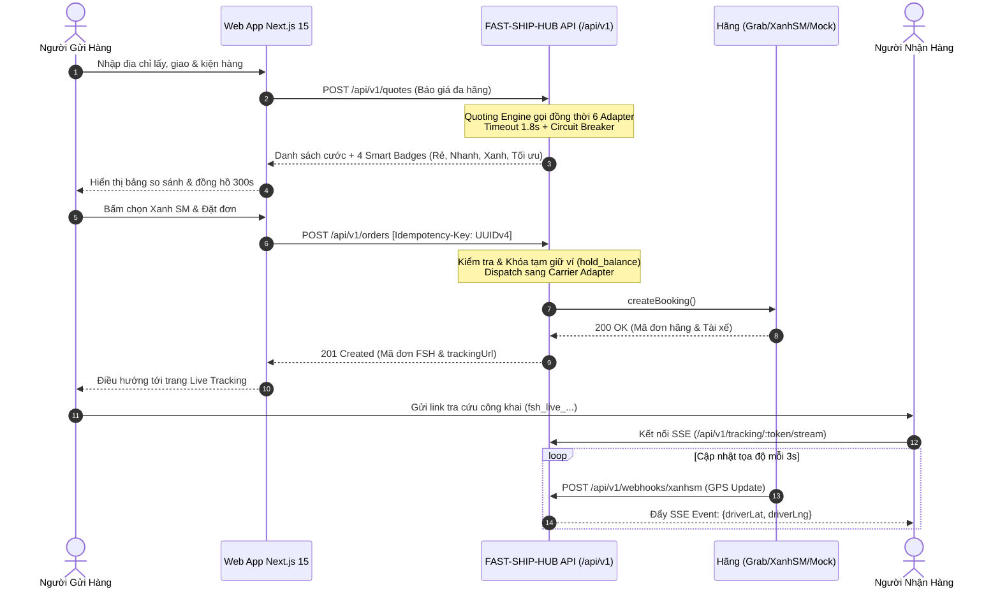

# HƯỚNG DẪN TÍCH HỢP HỆ THỐNG VÀ GỌI API (DEVELOPER INTEGRATION GUIDE)

> **Tên sản phẩm**: Nền Tảng Tích Hợp & So Sánh Giao Hàng Đa Hãng (`FAST-SHIP-HUB`)  
> **Mã tài liệu**: `DOC-BE-003` | **Phiên bản**: `1.0.0` | **Trạng thái**: `APPROVED_FOR_INTEGRATION`  
> **Tác giả**: `backend-engineer` (Kỹ Sư Backend Cấp Cao)  
> **Người tiếp nhận**: `frontend-engineer`, `qa-engineer`, `security-reviewer`, Đối tác Tích Hợp Hãng

---

## 1. TỔNG QUAN LUỒNG TÍCH HỢP HỆ THỐNG

Tài liệu này cung cấp hướng dẫn lập trình thực tế cho các kỹ sư Frontend và đối tác bên ngoài khi tích hợp với `FAST-SHIP-HUB`. Toàn bộ luồng nghiệp vụ được tóm tắt qua sơ đồ dưới đây:



---

## 2. HƯỚNG DẪN XÁC THỰC (AUTHENTICATION GUIDE)

FAST-SHIP-HUB hỗ trợ 3 cơ chế xác thực riêng biệt tùy theo phân hệ:

### 2.1. Xác thực Người dùng Nội bộ (Merchant / Admin):
- **Cơ chế**: JSON Web Token (JWT) mã hóa bằng thuật toán `HS256`.
- **Cách truyền token**:
  - Cách 1 (Mặc định trên Web): Token được tự động lưu trong Cookie an toàn `auth_token` (`HttpOnly: true`, `Secure: true`, `SameSite: Lax`). Frontend không cần can thiệp JavaScript.
  - Cách 2 (Dành cho API Client / Mobile): Truyền qua HTTP Header:
    ```http
    Authorization: Bearer <ACCESS_TOKEN>
    ```

### 2.2. Tra cứu Live Tracking Không Cần Đăng Nhập (Guest Token):
- Người nhận hàng hoàn toàn không cần tạo tài khoản hay đăng nhập.
- Khi tạo đơn thành công, hệ thống tự động sinh một chuỗi ngẫu nhiên bảo mật 32 ký tự URL-safe: `fsh_live_[32_hex_chars]`.
- Token này được gắn trực tiếp trên URL tra cứu: `https://fastshiphub.vn/track/fsh_live_89a7df6b02a4b3c1d9e20011a8b9c0d1`.
- Quyền hạn: **Chỉ đọc (Read-Only)**, ẩn toàn bộ số dư ví, thông tin tài chính và họ tên đầy đủ người gửi.

### 2.3. Xác thực Webhook Đối Tác Hãng (HMAC-SHA256):
- Mọi request từ các hãng vận chuyển gửi tới webhook gateway đều bắt buộc phải mang theo chữ ký số trên Header HTTP tương ứng (`X-Grab-Signature`, `X-Shopee-Signature`, `X-XanhSM-Signature`, hoặc `X-Signature`).
- Đoạn mã mẫu xác thực chữ ký an toàn trong Node.js/TypeScript:

```typescript
import crypto from 'node:crypto';

export function verifyCarrierWebhookSignature(
  rawBody: string,
  signatureHeader: string,
  secretKey: string
): boolean {
  if (!signatureHeader || !secretKey) return false;

  const computedSignature = crypto
    .createHmac('sha256', secretKey)
    .update(rawBody, 'utf8')
    .digest('hex');

  const signatureBuffer = Buffer.from(signatureHeader, 'hex');
  const computedBuffer = Buffer.from(computedSignature, 'hex');

  if (signatureBuffer.length !== computedBuffer.length) {
    return false;
  }

  // Sử dụng timingSafeEqual để chống Timing Attack
  return crypto.timingSafeEqual(signatureBuffer, computedBuffer);
}
```

---

## 3. CƠ CHẾ CHỐNG TRÙNG LẶP IDEMPOTENCY (IDEMPOTENCY SPECIFICATION)

Để ngăn chặn tuyệt đối tình trạng người dùng bấm đúp chuột (Double Click) hoặc lỗi mạng khiến đơn hàng bị tạo 2 lần và trừ 2 lần tiền ví, endpoint tạo đơn (`POST /api/v1/orders`) bắt buộc phải có header:

```http
Idempotency-Key: <UUIDv4>
```

### 3.1. Quy trình xử lý tại Backend:
1. Khi nhận được request, Backend kiểm tra khóa `Idempotency-Key` trong bộ nhớ Redis/In-Memory Cache:
   - **Trường hợp 1 (Khóa mới)**: Backend lưu khóa với trạng thái `PROCESSING` và thời hạn TTL là **120 giây**. Tiến hành xử lý tạo đơn và gọi hãng đối tác. Sau khi hoàn tất, cập nhật trạng thái khóa thành `RESOLVED` kèm toàn bộ dữ liệu phản hồi (Response Body).
   - **Trường hợp 2 (Đang xử lý - Trùng lặp)**: Nếu request thứ hai gửi lên cùng khóa khi trạng thái vẫn đang là `PROCESSING`, Backend lập tức trả về mã lỗi `409 Conflict`:
     ```json
     {
       "success": false,
       "error": {
         "code": "IDEMPOTENCY_CONFLICT",
         "message": "Yêu cầu tạo đơn hàng với Idempotency-Key này đang được xử lý, vui lòng không bấm lặp lại"
       }
     }
     ```
   - **Trường hợp 3 (Đã xử lý xong - Replay Request)**: Nếu request gửi lên cùng khóa khi trạng thái đã là `RESOLVED`, Backend trả lại **nguyên vẹn kết quả của lần tạo đơn trước** kèm HTTP `200 OK` mà không thực hiện gọi lại sang hãng hay trừ thêm tiền ví.

### 3.2. Hướng dẫn lập trình phía Frontend:
```typescript
import { v4 as uuidv4 } from 'uuid';

export async function createOrderSafely(orderPayload: CreateOrderDto) {
  // Sinh Idempotency-Key một lần duy nhất cho mỗi phiên bấm nút đặt
  const idempotencyKey = uuidv4();

  const response = await fetch('/api/v1/orders', {
    method: 'POST',
    headers: {
      'Content-Type': 'application/json',
      'Idempotency-Key': idempotencyKey,
    },
    body: JSON.stringify(orderPayload),
  });

  if (response.status === 409) {
    // Thông báo cho người dùng chờ đợi, không cho bấm tiếp
    console.warn('Đang xử lý đơn hàng, vui lòng không bấm lại!');
  }

  return response.json();
}
```

---

## 4. CƠ CHẾ CHỊU LỖI & BỘ NGẮT MẠCH (CIRCUIT BREAKER)

Khi gọi báo giá đa hãng song song, FAST-SHIP-HUB áp dụng kiến trúc cô lập lỗi:
1. **Ngắt mạch Timeout cứng (1.800ms)**:
   - Mỗi hãng được cấp một bộ đếm thời gian riêng biệt. Nếu quá 1.8s mà hãng chưa phản hồi, request tới hãng đó sẽ bị hủy ngay lập tức (`AbortController.abort()`).
   - Các hãng khác trả lời nhanh hơn vẫn được hiển thị bình thường.
2. **Bộ ngắt mạch Circuit Breaker (3 trạng thái)**:
   - **CLOSED**: Trạng thái bình thường, mọi request đều được chuyển tiếp.
   - **OPEN**: Nếu một hãng bị lỗi hoặc timeout liên tiếp **5 lần**, Circuit Breaker chuyển sang `OPEN`. Mọi request trong vòng **60 giây** tới hãng này sẽ bị từ chối ngay lập tức (0ms) với mã lỗi `CARRIER_CIRCUIT_OPEN` để bảo vệ tài nguyên hệ thống.
   - **HALF-OPEN**: Sau 60 giây, hệ thống cho phép 1 request thử nghiệm đi qua. Nếu thành công, mạch đóng lại (`CLOSED`); nếu thất bại, mạch tiếp tục mở (`OPEN`).

> [!TIP]
> **Khuyến nghị cho Frontend**: Khi trường `failedCarriers` trong response báo giá có dữ liệu, hãy hiển thị một dòng thông báo nhỏ thân thiện: *"Hãng Grab hiện đang phản hồi chậm, bạn có thể tham khảo Xanh SM hoặc ShopeeFood."* Tuyệt đối không làm vỡ hoặc chặn giao diện của người dùng.

---

## 5. HƯỚNG DẪN TÍCH HỢP SERVER-SENT EVENTS (SSE) CHO LIVE TRACKING

Đối với màn hình Live Tracking, trình duyệt nên mở kết nối SSE tới endpoint `/api/v1/tracking/:trackingNumber/stream` để nhận dữ liệu tọa độ GPS tài xế mà không cần liên tục gửi request thăm dò (Polling).

### Đoạn mã React / TypeScript mẫu tích hợp SSE:
```typescript
import { useEffect, useState } from 'react';

interface DriverLocationEvent {
  latitude: number;
  longitude: number;
  updatedAt: string;
}

export function useDriverLiveTracking(trackingToken: string) {
  const [driverLocation, setDriverLocation] = useState<DriverLocationEvent | null>(null);
  const [orderStatus, setOrderStatus] = useState<string>('BOOKED');

  useEffect(() => {
    if (!trackingToken) return;

    const eventSource = new EventSource(`/api/v1/tracking/${trackingToken}/stream`);

    // Lắng nghe sự kiện cập nhật vị trí GPS
    eventSource.addEventListener('location', (event) => {
      const data: DriverLocationEvent = JSON.parse(event.data);
      setDriverLocation(data);
    });

    // Lắng nghe sự kiện đổi trạng thái đơn hàng
    eventSource.addEventListener('status', (event) => {
      const data = JSON.parse(event.data);
      setOrderStatus(data.status);

      // Nếu đã giao thành công hoặc đã hủy, tự động đóng luồng
      if (data.status === 'DELIVERED' || data.status === 'CANCELLED') {
        eventSource.close();
      }
    });

    eventSource.onerror = (err) => {
      console.error('SSE Connection error:', err);
      // EventSource tự động reconnect theo chuẩn W3C
    };

    return () => {
      eventSource.close();
    };
  }, [trackingToken]);

  return { driverLocation, orderStatus };
}
```

---

## 6. MẪU DỮ LIỆU TÍCH HỢP WEBHOOK CHO TỪNG HÃNG

### 6.1. Webhook ShopeeFood:
- **Đường dẫn nhận**: `POST /api/v1/webhooks/shopeefood`
- **Mẫu Payload**:
```json
{
  "event": "ORDER_STATUS_CHANGED",
  "order_id": "SPF-99881122",
  "partner_order_id": "FSH-20261104-0012",
  "status": "DELIVERING",
  "driver": {
    "name": "Lê Văn Tốc",
    "phone": "0912999888",
    "license_plate": "59-X1 123.45"
  },
  "timestamp": 1730679800
}
```

### 6.2. Webhook Xanh SM (EV Fleet):
- **Đường dẫn nhận**: `POST /api/v1/webhooks/xanhsm`
- **Mẫu Payload**:
```json
{
  "eventType": "SHIPPER_GPS_PING",
  "carrierOrderId": "GSM-DELIVERY-99123",
  "fastShipOrderCode": "FSH-20261104-0012",
  "status": "DELIVERING",
  "vehicleType": "ELECTRIC_BIKE",
  "gps": {
    "lat": 21.033500,
    "lng": 105.845000,
    "recordedAt": "2026-11-04T00:22:15.000Z"
  }
}
```
