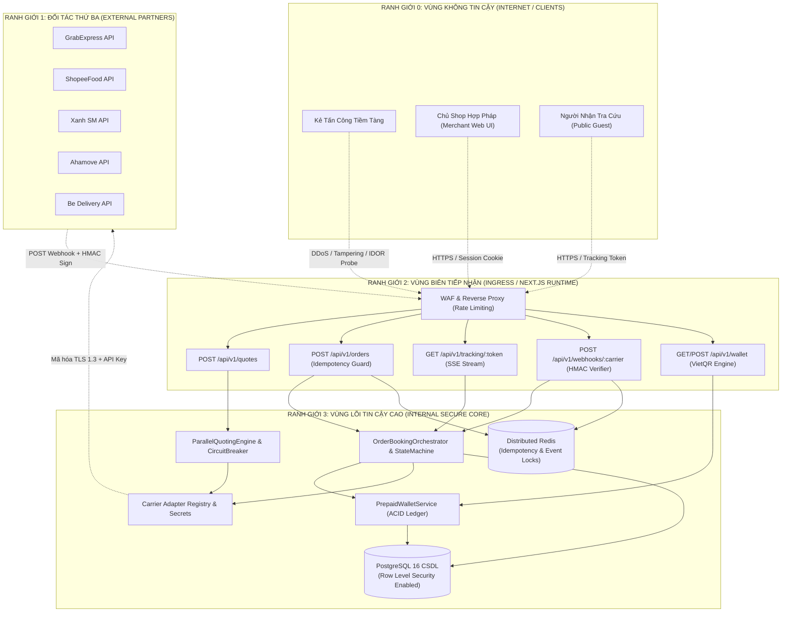
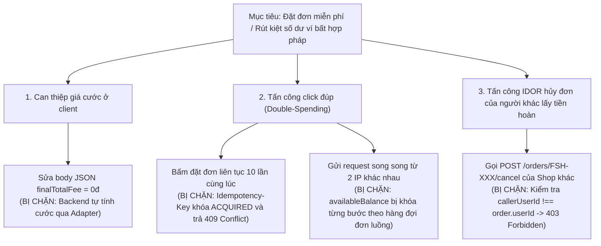

# MÔ HÌNH HÓA MỐI ĐE DỌA AN NINH THEO CHUẨN STRIDE (STRIDE THREAT MODEL SPECIFICATION)

> **Tên sản phẩm**: Nền Tảng Tích Hợp & So Sánh Giao Hàng Đa Hãng (`FAST-SHIP-HUB`)  
> **Mã tài liệu**: `DOC-SEC-002` | **Phiên bản**: `1.0.0` | **Trạng thái**: `APPROVED_BY_SECURITY_REVIEWER`  
> **Tác giả**: `security-reviewer` (Chuyên gia An ninh Ứng dụng & Bảo mật)  
> **Người tiếp nhận**: `system-architect`, `backend-engineer`, `devops-engineer`, `qa-engineer`, `code-reviewer`

---

## 1. PHƯƠNG PHÁP LUẬN VÀ PHẠM VI MÔ HÌNH HÓA (METHODOLOGY & SCOPE)

Tài liệu này áp dụng phương pháp luận **STRIDE (Spoofing, Tampering, Repudiation, Information Disclosure, Denial of Service, Elevation of Privilege)** do Microsoft phát triển kết hợp với thang đo rủi ro **DREAD (Damage, Reproducibility, Exploitability, Affected Users, Discoverability)** để nhận diện, đánh giá và đề xuất phương án giảm thiểu rủi ro cho toàn bộ kiến trúc `FAST-SHIP-HUB`.

### 1.1. Mục tiêu bảo vệ trọng yếu (Core Assets to Protect)
1. **Tài sản Tài chính**: Số dư ví trả trước của Merchant (`availableBalance`, `holdBalance`), giao dịch thanh toán cước và nạp tiền VietQR.
2. **Dữ liệu Định danh & Riêng tư (PII)**: Họ tên, số điện thoại, địa chỉ kho/nhà riêng, thông tin lộ trình di chuyển của người gửi và người nhận.
3. **Tính Toàn vẹn Vận hành**: Trạng thái đơn hàng xuyên suốt chu trình 10 bước (`DRAFT` đến `DELIVERED`/`CANCELLED`), tọa độ GPS di chuyển thời gian thực của tài xế.
4. **Bảo mật Khóa Bí mật Tích hợp**: API Keys, Webhook Secrets, OAuth Client Secrets của 5 hãng đối tác (Grab, ShopeeFood, Xanh SM, Ahamove, Be).

---

## 2. PHÂN RÃ HỆ THỐNG & RANH GIỚI TIN CẬY (SYSTEM DECOMPOSITION & TRUST BOUNDARIES)

Hệ thống được phân định thành 4 vùng ranh giới tin cậy (Trust Boundaries) rõ ràng:

---

## 3. PHÂN TÍCH CHI TIẾT CÁC MỐI ĐE DỌA THEO MÔ HÌNH STRIDE

### 3.1. [S] Spoofing (Mạo danh danh tính)
| Mã Đe Dọa | Kịch Bản Tấn Công | Mục Tiêu Bị Nhắm Đến | Hậu Quả Tiềm Tàng | Biện Pháp Phòng Vệ Hiện Hữu | Đánh Giá Rủi Ro |
| :--- | :--- | :--- | :--- | :--- | :---: |
| **TH-S-01** | Kẻ tấn công giả mạo Webhook của Grab hoặc Xanh SM gửi sự kiện `DELIVERED` giả mạo. | Endpoint `POST /api/v1/webhooks/:carrier` | Đơn hàng bị hoàn tất giả mạo, tự động quyết toán trừ tiền ví trước khi hàng được giao thực tế. | Kiểm tra chữ ký số HMAC-SHA256 bắt buộc; So sánh bằng `crypto.timingSafeEqual`; Ném lỗi 401 nếu sai chữ ký. | **THẤP** (Đã phòng vệ hoàn toàn) |
| **TH-S-02** | Merchant A mạo danh Merchant B bằng cách sửa Header hoặc tham số nhận dạng. | Các Endpoint `/api/v1/orders` và `/api/v1/wallet` | Thao túng đơn hàng và tiền ví của shop khác. | RLS trên PostgreSQL; Kiểm tra Header `x-user-id` và session token; Trả về HTTP 403 Forbidden. | **THẤP** (Đã phòng vệ hoàn toàn) |
| **TH-S-03** | Giả mạo đơn vị vận chuyển phản hồi kết quả báo giá thấp bất thường. | Giao tiếp Adapter Outbound | Người dùng đặt dịch vụ ảo, không có xe thật tới lấy hàng. | Toàn bộ giao tiếp ra ngoài sử dụng HTTPS (TLS 1.3), kiểm tra chứng chỉ x509 đối tác. | **RẤT THẤP** |

---

### 3.2. [T] Tampering (Làm sai lệch / Can thiệp dữ liệu)
| Mã Đe Dọa | Kịch Bản Tấn Công | Mục Tiêu Bị Nhắm Đến | Hậu Quả Tiềm Tàng | Biện Pháp Phòng Vệ Hiện Hữu | Đánh Giá Rủi Ro |
| :--- | :--- | :--- | :--- | :--- | :---: |
| **TH-T-01** | Sửa đổi cước phí đơn hàng trên Request payload (`finalTotalFee` từ 28.000đ thành 1.000đ). | `POST /api/v1/orders` | Thiệt hại doanh thu sàn và tiền ví bị trừ ít hơn chi phí đối tác thực tế. | **Không tin cậy Client**: Cước phí được Backend tính toán lại độc lập qua Adapter dựa trên `quoteReferenceId`. | **RẤT THẤP** (Miễn nhiễm) |
| **TH-T-02** | Thay đổi tọa độ hoặc địa chỉ trong body Webhook khi đang truyền trên đường truyền. | Webhook Gateway | Lệch lạc vị trí hiển thị shipper trên bản đồ Live Tracking. | HMAC-SHA256 bao bọc toàn bộ chuỗi raw body payload. Bất kỳ thay đổi nào dù chỉ 1 byte cũng làm sai lệch chữ ký và bị từ chối 401. | **RẤT THẤP** (Miễn nhiễm) |
| **TH-T-03** | Can thiệp trực tiếp vào số dư ví trong bảng `wallets` của CSDL. | PostgreSQL Database | Gian lận làm giàu số dư ví bất hợp pháp. | Chính sách RLS `p_wallets_deny_direct_write`: Cấm tuyệt đối lệnh `UPDATE` hay `INSERT` trực tiếp từ phía người dùng. | **RẤT THẤP** (Miễn nhiễm) |

---

### 3.3. [R] Repudiation (Chối bỏ trách nhiệm)
| Mã Đe Dọa | Kịch Bản Tấn Công | Mục Tiêu Bị Nhắm Đến | Hậu Quả Tiềm Tàng | Biện Pháp Phòng Vệ Hiện Hữu | Đánh Giá Rủi Ro |
| :--- | :--- | :--- | :--- | :--- | :---: |
| **TH-R-01** | Merchant chối bỏ việc bấm nút đặt đơn, khiếu nại sàn tự động trừ tiền ví. | Luồng Đặt Đơn | Tranh chấp pháp lý và yêu cầu bồi thường tiền ví. | Ghi nhận bắt buộc `Idempotency-Key` (UUIDv4) do client sinh ra kèm `traceId` và thời gian UTC; Sổ cái ví ghi `orderId` và `transactionCode`. | **THẤP** |
| **TH-R-02** | Hãng đối tác chối bỏ việc đã gửi thông báo hủy đơn hoặc giao hàng thất bại. | Webhook Receiver | Bất đồng đối soát giữa sàn FAST-SHIP-HUB và các hãng Grab/XanhSM. | Bảng `WebhookLog` lưu vết toàn bộ `eventId`, raw payload, header signature và thời gian nhận gốc để đối chiếu khi cần. | **THẤP** |

---

### 3.4. [I] Information Disclosure (Lộ lọt thông tin nhạy cảm)
| Mã Đe Dọa | Kịch Bản Tấn Công | Mục Tiêu Bị Nhắm Đến | Hậu Quả Tiềm Tàng | Biện Pháp Phòng Vệ Hiện Hữu | Đánh Giá Rủi Ro |
| :--- | :--- | :--- | :--- | :--- | :---: |
| **TH-I-01** | **IDOR Đơn Hàng**: Kẻ tấn công quét số thứ tự đơn hàng `FSH-20261103-XXXX` trên URL để trộm thông tin khách hàng. | Endpoint `GET /api/v1/orders/[orderCode]` | Lộ lọt hàng loạt số điện thoại, tên, địa chỉ nhà riêng của khách hàng mua sắm. | **ĐÃ VÁ**: Kiểm tra quyền truy cập theo `order.userId === callerUserId`; Nếu không phải chủ sở hữu -> Trả ngay 403 Forbidden. | **THẤP** (Đã kiểm soát) |
| **TH-I-02** | Dò tìm mã tra cứu hành trình công khai để theo dõi người nhận bất kỳ. | Endpoint `GET /api/v1/tracking/[trackingNumber]` | Vi phạm quyền riêng tư di chuyển và địa chỉ giao hàng. | Mã tra cứu `trackingToken` dài 32 ký tự ngẫu nhiên hex (128 bits entropy), bất khả thi để brute force; Dữ liệu công khai bị lược bỏ toàn bộ số dư và thông tin người dùng. | **THẤP** |
| **TH-I-03** | Rò rỉ API Key hoặc Webhook Secret của Grab, Shopee, Xanh SM qua mã nguồn Frontend. | Bundle Next.js Client | Kẻ xấu chiếm quyền gọi API đối tác miễn phí dưới danh nghĩa tài khoản sàn. | Toàn bộ Adapter và API Key đối tác chỉ chạy trên Server-side (`src/services/carrier-adapters`); Không có tiền tố `NEXT_PUBLIC_` trên các biến môi trường nhạy cảm. | **RẤT THẤP** (An toàn) |

---

### 3.5. [D] Denial of Service (Tấn công từ chối dịch vụ)
| Mã Đe Dọa | Kịch Bản Tấn Công | Mục Tiêu Bị Nhắm Đến | Hậu Quả Tiềm Tàng | Biện Pháp Phòng Vệ Hiện Hữu | Đánh Giá Rủi Ro |
| :--- | :--- | :--- | :--- | :--- | :---: |
| **TH-D-01** | Bắn hàng nghìn request tính cước cùng lúc tới `POST /api/v1/quotes`. | Quoting Engine & Adapter Hãng | Vượt hạn mức Rate Limit của hãng Grab/Shopee/XanhSM, kích hoạt Circuit Breaker làm nghẽn toàn sàn. | Áp dụng AbortController ngắt kết nối sau 1800ms; Cơ chế Circuit Breaker tự ngắt hãng bị lỗi để bảo vệ các hãng còn lại. Khuyến nghị cấu hình WAF Rate Limit 60 req/min. | **TRUNG BÌNH** (Đang bảo vệ tốt) |
| **TH-D-02** | Treo hàng nghìn kết nối Server-Sent Events (SSE) `/tracking/:token/stream`. | SSE Connection Engine | Chiếm dụng file descriptors và bộ nhớ máy chủ Next.js. | Lắng nghe tín hiệu `req.signal.addEventListener('abort')` để giải phóng `clearInterval` và đóng luồng stream tức thì khi client ngắt kết nối. | **THẤP** |
| **TH-D-03** | Chiếm dụng bộ nhớ Idempotency Store bằng cách bơm hàng triệu key rác. | In-Memory `IdempotencyStore` | Nguy cơ tràn bộ nhớ (Out-Of-Memory / OOM crash). | Cơ chế `cleanExpired()` tự động dọn dẹp các key hết hạn sau 120 giây; Khuyến nghị chuyển sang Redis cluster khi vận hành quy mô lớn. | **TRUNG BÌNH** |

---

### 3.6. [E] Elevation of Privilege (Leo thang đặc quyền)
| Mã Đe Dọa | Kịch Bản Tấn Công | Mục Tiêu Bị Nhắm Đến | Hậu Quả Tiềm Tàng | Biện Pháp Phòng Vệ Hiện Hữu | Đánh Giá Rủi Ro |
| :--- | :--- | :--- | :--- | :--- | :---: |
| **TH-E-01** | Merchant tự ý thay đổi vai trò `role` từ `MERCHANT` thành `ADMIN` trong JWT hoặc Session. | RBAC Middleware | Merchant truy cập toàn bộ đơn hàng và sổ quỹ ví toàn sàn. | Chữ ký JWT sử dụng thuật toán mã hóa `HS256` với khóa bí mật `JWT_SECRET` (độ dài tối thiểu 32 ký tự); Client không thể tự ký lại token. | **RẤT THẤP** |
| **TH-E-02** | Người dùng gửi lệnh tạo giao dịch cộng tiền ví trực tiếp qua API nạp tiền. | `POST /api/v1/wallet` | Tự động tăng tiền ví mà không thực hiện chuyển khoản ngân hàng Napas 24/7. | API chỉ sinh mã VietQR và ghi nhận giao dịch ở trạng thái `PENDING`; Thao tác chuyển sang `SUCCESS` bắt buộc xác thực qua Webhook Ngân hàng có chữ ký số. | **RẤT THẤP** |

---

## 4. MA TRẬN ĐÁNH GIÁ VÀ XẾP HẠNG RỦI RO THEO DREAD (DREAD RISK SCORING)

Thang điểm từ 1 (Thấp nhất) đến 10 (Cao nhất) cho mỗi tiêu chí:
- **D (Damage)**: Mức độ thiệt hại kinh doanh và tài chính.
- **R (Reproducibility)**: Khả năng lặp lại cuộc tấn công.
- **E (Exploitability)**: Độ dễ dàng trong việc khai thác.
- **A (Affected Users)**: Tỷ lệ người dùng bị ảnh hưởng.
- **D (Discoverability)**: Khả năng kẻ tấn công phát hiện điểm yếu.
- **Điểm Rủi Ro Tổng (Score)**: $\text{Score} = \frac{D + R + E + A + D}{5}$

| Mã Đe Dọa | Phân Loại STRIDE | D | R | E | A | D | Điểm Tổng (DREAD) | Mức Độ | Trạng Thái Giảm Thiểu |
| :--- | :---: | :---: | :---: | :---: | :---: | :---: | :---: | :---: | :--- |
| **TH-I-01** (IDOR Đơn hàng) | Information Disclosure | 8 | 9 | 8 | 9 | 7 | **8.2 / 10** | **CAO** | ✅ **ĐÃ VÁ HOÀN TOÀN** (Kiểm tra quyền sở hữu) |
| **TH-S-01** (Webhook Giả mạo) | Spoofing | 9 | 4 | 3 | 8 | 4 | **5.6 / 10** | **TRUNG BÌNH** | ✅ **ĐÃ BẢO VỆ** (HMAC-SHA256 + TimingSafe) |
| **TH-D-01** (Quoting Flooding) | Denial of Service | 6 | 8 | 7 | 6 | 6 | **6.6 / 10** | **TRUNG BÌNH** | 🔄 **ĐANG BẢO VỆ** (Circuit Breaker, Cần WAF) |
| **TH-T-01** (Thao túng Giá cước)| Tampering | 8 | 3 | 2 | 2 | 3 | **3.6 / 10** | **THẤP** | ✅ **ĐÃ BẢO VỆ** (Server Re-quote) |
| **TH-D-03** (OOM Idempotency) | Denial of Service | 7 | 4 | 5 | 7 | 4 | **5.4 / 10** | **TRUNG BÌNH** | 🔄 **CẦN NÂNG CẤP** (Chuyển sang Redis) |
| **TH-R-01** (Chối bỏ Tạo đơn) | Repudiation | 5 | 3 | 2 | 4 | 3 | **3.4 / 10** | **THẤP** | ✅ **ĐÃ BẢO VỆ** (TraceId + Sổ cái ACID) |

---

## 5. CÂY TẤN CÔNG ĐIỂN HÌNH (ATTACK TREES)

### 5.1. Cây tấn công: Kẻ xấu cố tình chiếm đoạt tiền ví (Wallet Depletion Attack Tree)

---

## 6. KẾT LUẬN & CHỈ ĐẠO BẢO MẬT (SECURITY MANDATES)

1. **Nguyên tắc "Zero-Trust" cho dữ liệu Client**: Mọi thông số giá tiền, khoảng cách, phụ phí hiển thị trên giao diện người dùng chỉ mang tính tham khảo UX. Logic quyết định trừ ví và gửi lệnh hãng bắt buộc tính toán lại 100% tại tầng Server.
2. **Kỷ luật Khóa Bí Mật**: Không bao giờ hardcode API Keys của đối tác vào bất kỳ file nguồn nào. Môi trường Production bắt buộc nạp qua dịch vụ quản lý bí mật (GCP Secret Manager, AWS Secrets Manager hoặc biến môi trường được mã hóa).
3. **Giám sát Phân Tích Bất Thường**: Định kỳ theo dõi tỷ lệ gọi lại của các `Idempotency-Key` và tỷ lệ từ chối chữ ký số Webhook để phát hiện sớm các chiến dịch tấn công thăm dò lỗ hổng.
