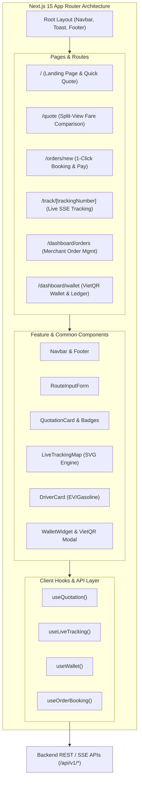

# KIẾN TRÚC GIAO DIỆN FRONTEND (FRONTEND ARCHITECTURE SPECIFICATION)

> **Tên sản phẩm**: Nền Tảng Tích Hợp & So Sánh Giao Hàng Đa Hãng (`FAST-SHIP-HUB`)  
> **Mã tài liệu**: `DOC-FE-001` | **Phiên bản**: `1.0.0` | **Trạng thái**: `APPROVED_AND_IMPLEMENTED`  
> **Tác giả**: `frontend-engineer` (Kỹ sư Frontend Cấp Cao)  
> **Công nghệ áp dụng**: Next.js 15 (App Router), React 19, TypeScript 5.6+, Tailwind CSS v3.4+, Lucide React

---

## 1. TỔNG QUAN KIẾN TRÚC FRONTEND (FRONTEND OVERVIEW)

Kiến trúc Frontend của **FAST-SHIP-HUB** được thiết kế nhằm đáp ứng mục tiêu cốt lõi: **So sánh cước đa hãng siêu tốc (< 1.5s), đặt đơn 1-click không ma sát và theo dõi hành trình trực quan thời gian thực (SSE Live Tracking)**.

### Các Trụ Cột Kỹ Thuật (Architecture Pillars):
1. **Next.js 15 App Router & React 19**: Kết hợp tối ưu giữa Server Components (tối ưu SEO, load nhanh, zero client bundle) và Client Components (tương tác trực quan, xử lý sự kiện, bản đồ động).
2. **Type-Safe Contract Synchronization**: Sử dụng 100% Type-safe schemas đồng bộ với Hợp đồng API Backend (`src/types/carrier.types.ts`, `src/types/api.types.ts`) và Zod validation.
3. **Responsive Split-View Paradigm**: Màn hình so sánh cước và theo dõi đơn tự động chuyển đổi giữa Mobile-First (Single column, sticky bottom summary) và Desktop (Split-view 520px / 100% map).
4. **Resilient Realtime Streaming**: Tích hợp Server-Sent Events (SSE) cho Live Tracking tự động cập nhật GPS shipper mà không cần reload trang hay polling liên tục.



---

## 2. CẤU TRÚC THƯ MỤC CHUẨN HÓA (DIRECTORY STRUCTURE)

Dự án áp dụng mô hình tổ chức module theo tính năng (Feature-based Modular Structure):

```
src/
├── app/                                # Next.js 15 App Router
│   ├── globals.css                     # Tailwind directives, font & keyframe animations
│   ├── layout.tsx                      # Root Layout (Navbar, Footer, ToastProvider)
│   ├── page.tsx                        # Trang chủ (Hero, Quick Quote, Features, Partner Logos)
│   ├── quote/
│   │   └── page.tsx                    # Màn hình So sánh cước đa hãng (Split-View)
│   ├── orders/
│   │   └── new/
│   │       └── page.tsx                # Màn hình Đặt đơn 1-click & Thanh toán ví/VietQR
│   ├── track/
│   │   └── [trackingNumber]/
│   │       └── page.tsx                # Màn hình Live Tracking công khai (SSE Real-time)
│   ├── dashboard/
│   │   ├── orders/
│   │   │   └── page.tsx                # Quản lý danh sách đơn hàng của chủ shop
│   │   └── wallet/
│   │       └── page.tsx                # Quản trị ví tiền, nạp VietQR 24/7 & lịch sử GD
│   └── api/v1/                         # API Endpoints (Next.js Route Handlers)
├── components/
│   ├── common/                         # Các thành phần giao diện dùng chung
│   │   ├── Navbar.tsx                  # Header bar, logo, link điều hướng, số dư ví
│   │   ├── Footer.tsx                  # Chân trang chuyên nghiệp, logo 5 hãng vận chuyển
│   │   ├── SmartBadge.tsx              # 4 Huy hiệu thông minh (Rẻ nhất, Nhanh nhất,...)
│   │   └── Toast.tsx                   # Hệ thống thông báo Pop-up Toast phản hồi nhanh
│   └── features/                       # Các khối chức năng nghiệp vụ trọng yếu
│       ├── RouteInputForm.tsx          # Form nhập điểm lấy/giao, kích thước kiện, COD, mẫu HN/HCM
│       ├── QuotationCard.tsx           # Thẻ cước từng hãng, nhận diện thương hiệu, ETA, chiết khấu
│       ├── LiveTrackingMap.tsx         # Bản đồ lộ trình trực quan, Polyline SVG, shipper GPS di chuyển
│       ├── DriverCard.tsx              # Thẻ tài xế, ảnh đại diện, SĐT, biển số, xe điện VinFast
│       └── WalletWidget.tsx            # Widget số dư ví, modal quét mã VietQR Napas 24/7
├── hooks/                              # Custom React Hooks
│   ├── useQuotation.ts                 # Quản lý phiên báo giá, đếm ngược TTL 5 phút, cache
│   ├── useLiveTracking.ts              # Kết nối SSE stream nhận vị trí GPS tài xế và tiến trình
│   └── useWallet.ts                    # Tra cứu số dư, tạo lệnh nạp VietQR tức thì
├── lib/                                # Các tiện ích dùng chung
│   ├── api-client.ts                   # Fetch wrapper có sẵn Idempotency-Key và error handling
│   ├── formatters.ts                   # Định dạng tiền tệ VND, khoảng cách km, thời gian tiếng Việt
│   └── geo.ts                          # Tính toán cự ly, polyline và vị trí trên bản đồ
└── types/                              # TypeScript Interface định nghĩa hợp đồng
    ├── api.types.ts                    # ApiResponse, ErrorCode, Envelopes
    └── carrier.types.ts                # CarrierCode, CarrierQuoteItem, DriverInfo, etc.
```

---

## 3. MÔ HÌNH PHÂN CHIA SERVER VS CLIENT COMPONENTS

Để đạt hiệu năng cao nhất theo chuẩn Next.js 15:
- **Server Components (RSC)**: Đóng vai trò làm layout nền tảng, nạp dữ liệu ban đầu phía server, giảm dung lượng JavaScript gửi xuống trình duyệt.
- **Client Components (`'use client'`)**: Chỉ dùng tại các điểm cần tương tác người dùng:
  - Form nhập địa chỉ và sự kiện `onChange`, `onSubmit`.
  - Các thẻ cước tương tác chọn `onSelect` và đếm ngược TTL 5 phút.
  - Bản đồ thời gian thực cần vẽ canvas/SVG và nhận tín hiệu GPS.
  - Modal nạp tiền VietQR và đồng hồ kiểm tra trạng thái chuyển khoản.

---

## 4. CHIẾN LƯỢC QUẢN LÝ DỮ LIỆU & BỘ NHỚ ĐỆM (DATA FETCHING & CACHING)

1. **Client-Side SWR / Reactive State**:
   - Sử dụng state phản ứng nhanh không chặn luồng hiển thị (Non-blocking UI).
   - Bộ đếm TTL 300 giây (5 phút) bảo đảm giá cước luôn có hiệu lực. Khi đồng hồ về 0, hiển thị lớp kính mờ (Backdrop Blur) kèm nút "Làm Mới Giá Cước".
2. **Server-Sent Events (SSE) Live Tracking**:
   - Khởi tạo kết nối `EventSource` tới `/api/v1/tracking/:trackingNumber/stream`.
   - Lắng nghe sự kiện `status` để cập nhật trạng thái đơn (BOOKED -> PICKING -> DELIVERING -> DELIVERED).
   - Lắng nghe sự kiện `location` (mỗi 3 giây) để cập nhật tọa độ tài xế, điều hướng icon shipper trên bản đồ mượt mà với CSS transition.
3. **Idempotency Protection trên UI**:
   - Khi bấm "Đặt đơn 1-click", client tự động sinh một mã `idempotency-key` (UUIDv4) gắn vào Header request.
   - Nút đặt đơn được vô hiệu hóa tức thì (`disabled={isSubmitting}`) và chuyển sang trạng thái Loading Spinner để ngăn ngừa hoàn toàn tình trạng người dùng click đúp (double-click).

---

## 5. MÁY TRẠNG THÁI GIAO DIỆN (6 MANDATORY UI STATES)

Mọi màn hình và thành phần giao diện đều tuân thủ máy trạng thái 6 nấc:
1. **Idle / Default**: Trạng thái ban đầu, gợi ý người dùng nhập thông tin.
2. **Loading (Skeleton Shimmer)**: Hiển thị 5 khung xương thẻ cước quét sáng nhịp nhàng khi gọi API `/api/v1/quotes`.
3. **Success (Quoted / Booked)**: Hiển thị kết quả rõ ràng, gắn 4 huy hiệu thông minh.
4. **Empty State**: Tuyến đường vượt quá 50km hoặc ngoài khu vực hỗ trợ; cung cấp nút đổi địa chỉ.
5. **Error / Timeout State**: Phân biệt lỗi toàn cục (Banner thử lại) và lỗi cục bộ 1 hãng (thẻ xám mờ cuối danh sách, không nghẽn các hãng khác).
6. **Disabled / Expired State**: Báo giá quá hạn 5 phút hoặc số dư ví không đủ (kèm CTA nạp VietQR ngay).

---

## 6. QUY TẮC HIỂN THỊ RESPONSIVE (MOBILE-FIRST & DESKTOP SPLIT-VIEW)

| Thiết Bị | Breakpoint | Bố Cục Trang So Sánh Cước (`/quote`) | Bố Cục Màn Hình Tracking (`/track`) |
| :--- | :---: | :--- | :--- |
| **Mobile** | `< 768px` (375px+) | 1 Cột dọc: Form nhập ở trên -> Bảng thẻ cước cuộn dọc -> Sticky Bottom Bar hiển thị hãng được chọn & nút đặt đơn. Nút gạt xem bản đồ (Toggle Map Drawer). | Stepper trạng thái ở trên -> Bản đồ thu nhỏ 240px -> Thẻ tài xế và mốc thời gian chi tiết. |
| **Tablet** | `768px - 1024px` | Bố cục 1 cột linh hoạt có padding rộng, thẻ cước dạng lưới 2 cột. | Bản đồ chiều cao 360px đặt phía trên, bên dưới chia 2 cột: Tài xế và Timeline. |
| **Desktop** | `≥ 1280px` | **Split-View**: Cột trái cố định 520px cuộn độc lập chứa Form & Bảng giá; Cột phải chiếm 100% không gian còn lại hiển thị Bản đồ lộ trình tương tác. | Cột trái 480px chứa Thông tin đơn & Thẻ tài xế; Cột phải hiển thị Bản đồ live tracking toàn màn hình. |

---

## 7. BẢNG MÀU THƯƠNG HIỆU HÃNG VÀ DESIGN TOKENS CHUẨN

Được cấu hình đồng nhất trong `tailwind.config.ts`:
- **GrabExpress**: `#00B14F` (Xanh lá cây Grab)
- **ShopeeFood**: `#EE4D2D` (Cam đỏ Shopee)
- **Xanh SM Delivery**: `#008B8B` (Xanh ngọc xe điện EV VinFast)
- **Ahamove**: `#FF5722` (Cam đậm Ahamove)
- **beDelivery**: `#F59E0B` (Vàng tươi Be)
- **Sandbox Mock**: `#6366F1` (Tím Indigo thử nghiệm)

---
*Tài liệu được phê duyệt và áp dụng trực tiếp cho toàn bộ mã nguồn Frontend của FAST-SHIP-HUB.*
