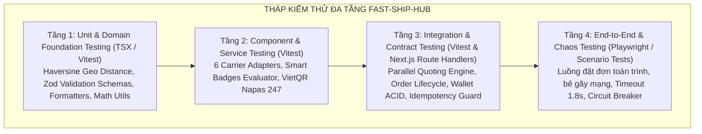

# KẾ HOẠCH KIỂM THỬ TỔNG THỂ & CHIẾN LƯỢC ĐA TẦNG (MASTER TEST PLAN)

> **Tên sản phẩm**: Nền Tảng Tích Hợp & So Sánh Giao Hàng Đa Hãng (`FAST-SHIP-HUB`)  
> **Mã tài liệu**: `DOC-QA-001` | **Phiên bản**: `1.0.0` | **Trạng thái**: `APPROVED_BY_QA_LEAD`  
> **Tác giả**: `qa-engineer` (Chuyên gia Đảm bảo Chất lượng & Tự động hóa Kiểm thử)  
> **Người tiếp nhận**: `orchestrator`, `system-architect`, `backend-engineer`, `frontend-engineer`, `code-reviewer`

---

## 1. TỔNG QUAN & MỤC TIÊU CHIẾN LƯỢC KIỂM THỬ

### 1.1. Bối cảnh dự án
Hệ thống `FAST-SHIP-HUB` là nền tảng so sánh cước phí và tích hợp đặt đơn thời gian thực đa hãng vận chuyển (Grab, ShopeeFood, Xanh SM, Ahamove, Be, Mock Sandbox). Do đặc thù hệ thống tài chính trung gian (ví trả trước) và tích hợp đa bên với độ trễ thấp (SLA P95 ≤ 1.500ms), chất lượng kiểm thử là yếu tố sống còn nhằm đảm bảo:
- **Tính chính xác tài chính**: Tuyệt đối không xảy ra trừ tiền trùng lặp (Zero Double-Spending), rò rỉ số dư hoặc sai lệch cước phí giữa hãng và sàn.
- **Tính sẵn sàng và chịu lỗi (Fault-Tolerance)**: Cô lập 100% sự cố timeout hoặc sập mạng của một hãng mà không ảnh hưởng tới trải nghiệm tra cứu các hãng còn lại.
- **Trải nghiệm người dùng mượt mà**: Giao diện phản hồi nhanh, cập nhật tọa độ shipper thời gian thực qua Server-Sent Events (SSE).

### 1.2. Tháp Kiểm Thử Đa Tầng (Testing Pyramid Architecture)



---

## 2. PHẠM VI KIỂM THỬ (TEST SCOPE)

### 2.1. Trong phạm vi kiểm thử (In-Scope)
| STT | Phân hệ / Tính năng | Mô tả phạm vi kiểm thử chi tiết |
| :---: | :--- | :--- |
| **1** | **Parallel Quoting Engine** | Kiểm thử gọi song song 6 hãng đối tác qua `Promise.allSettled()`, ngắt cứng 1.800ms qua `AbortController`, chuẩn hóa biểu phí và phí sàn (+1.000đ), tính hạn sử dụng 300s. |
| **2** | **Thuật toán Smart Badges** | Kiểm tra độ chính xác của 4 huy hiệu: 🏆 `CHEAPEST` (kèm tính `savingsVnd`), ⚡ `FASTEST`, 🌿 `GREENEST` (100% xe điện Xanh SM & gam CO2), 🌟 `BEST_VALUE` (điểm trọng số chuẩn hóa). |
| **3** | **Order Booking & Lifecycle** | Quy trình đặt đơn 1-click, sinh mã đơn `FSH-YYYYMMDD-XXXX`, mã hóa token tracking 32 ký tự URL-safe, điều phối tài xế và chuyển đổi 10 trạng thái đơn hàng. |
| **4** | **Bảo vệ Idempotency** | Cơ chế chống click đúp với Header `Idempotency-Key` (UUIDv4), chặn `409 Conflict` khi concurrent request và trả phản hồi đệm `200 CACHED` khi replay. |
| **5** | **Prepaid Wallet & ACID** | Quản lý số dư `balance` và `holdBalance`, lệnh `reserveHold`, `releaseHold` khi hủy hoặc dispatch thất bại, `settlePayment` khi giao hàng thành công. |
| **6** | **Live Tracking & Privacy** | Tra cứu công khai qua `trackingToken` không cần đăng nhập, che thông tin nhạy cảm của khách, đồng bộ tọa độ GPS tài xế thời gian thực. |
| **7** | **VietQR Napas 247 Dynamic** | Sinh chuỗi payload EMVCo hợp lệ, tạo URL ảnh QR MBBank động, kiểm soát ngưỡng nạp tối thiểu 50.000đ và tối đa 20.000.000đ. |
| **8** | **Chaos & Fault Tolerance** | Kiểm tra Circuit Breaker (`CLOSED` ➔ `OPEN` ➔ `HALF_OPEN` ➔ `CLOSED`), xử lý hãng đối tác hết tài xế (`CARRIER_DISPATCH_FAILED`), vượt quá tải trọng xe máy (> 20kg). |

### 2.2. Ngoài phạm vi kiểm thử (Out-of-Scope)
- Tích hợp trực tiếp với tài khoản ngân hàng thật bằng tiền thật (sử dụng chuẩn VietQR sandbox).
- Môi trường Mobile Native App (chỉ tập trung Web Responsive Next.js 15 trên Desktop, Tablet, Mobile).

---

## 3. MA TRẬN PHÂN TẦNG KIỂM THỬ (TEST LEVELS MATRIX)

| Tầng Kiểm Thử | Mục Tiêu Chính | Công Cụ / Framework | Thời Gian Chạy Kỳ Vọng | Mức Độ Tự Động Hóa |
| :--- | :--- | :--- | :---: | :---: |
| **Unit Testing** | Kiểm tra tính toán tọa độ Haversine, ETA, Zod Schemas, định dạng tiền tệ và chuỗi EMVCo VietQR. | `vitest` / `tsx` | < 100ms | 100% Tự động |
| **Adapter Integration** | Kiểm tra 6 Carrier Adapters (Grab, ShopeeFood, Xanh SM, Ahamove, Be, Mock Sandbox), tính cước lũy tiến, phụ phí đêm, giới hạn cân nặng. | `vitest` / `tsx` | < 500ms | 100% Tự động |
| **Service Engine Testing** | Quoting song song, Smart Badges, Wallet Hold/Release/Settle, Idempotency lock lifecycle, Order State Machine. | `vitest` / `tsx` | < 1.000ms | 100% Tự động |
| **Resilience & Chaos Testing**| Timeout cách ly 1.8s (`AbortController`), Circuit Breaker bẻ mạch khi lỗi 3 lần, tự phục hồi, chống Double-Spending. | `vitest` / `tsx` | < 3.500ms | 100% Tự động |
| **API Contract Validation** | Kiểm tra JSON Schema, HTTP Status (200, 201, 400, 404, 409, 422, 500) theo đúng `DOC-BE-002`. | `vitest` / Route Handlers | < 1.500ms | 100% Tự động |

---

## 4. CHIẾN LƯỢC DỮ LIỆU KIỂM THỬ (TEST DATA STRATEGY)

Nhằm đảm bảo tính độc lập và lặp lại 100% (Repeatable & Deterministic), chiến lược dữ liệu được xây dựng chuẩn mực:

### 4.1. Dữ liệu lộ trình chuẩn (Benchmark Routes)
1. **Tuyến Nội thành Hà Nội (~2.9 - 3.2 km)**:
   - *Điểm lấy*: Số 1 Tràng Tiền, Phường Tràng Tiền, Quận Hoàn Kiếm, Hà Nội (`21.028511, 105.854444`).
   - *Điểm giao*: Số 280 Đội Cấn, Phường Liễu Giai, Quận Ba Đình, Hà Nội (`21.037288, 105.834466`).
   - *Mục đích*: Đo kiểm SLA tính cước, phân định Rẻ nhất / Nhanh nhất / Xe điện.
2. **Tuyến Trọng điểm TP. Hồ Chí Minh (~4.5 - 5.0 km)**:
   - *Điểm lấy*: Chợ Bến Thành, Quận 1, TP.HCM (`10.7721, 106.6983`).
   - *Điểm giao*: Landmark 81, Bình Thạnh, TP.HCM (`10.7950, 106.7219`).
3. **Tuyến Quá cự ly (> 50 km)**:
   - Hà Nội ➔ Hải Phòng (115 km) phục vụ kiểm thử chặn xe máy hỏa tốc.

### 4.2. Dữ liệu kiện hàng & Tài khoản
- **Kiện hàng chuẩn**: Váy dạ hội 1.5kg, kích thước `25x20x10 cm`, giá trị khai giá 500.000đ, COD 0đ.
- **Kiện hàng quá tải trọng**: Kiện hàng 25kg (vượt ngưỡng 20kg của xe máy GrabExpress).
- **Tài khoản Merchant thử nghiệm**: `usr_merchant_001` có số dư ban đầu `2.000.000 VNĐ`.
- **Đơn hàng mẫu**: `FSH-20261103-8899` có token `fsh_live_89a7df6b02a4b3c1d9e20011a8b9c0d1` ở trạng thái `DELIVERING` để kiểm thử cấm hủy đơn.

---

## 5. MÔI TRƯỜNG & CÔNG CỤ KIỂM THỬ (ENVIRONMENT & TOOLING)

1. **Test Runner chính thức**:
   - `Vitest v5.1.0`: Runner hiện đại hỗ trợ TypeScript native, tốc độ cao, cấu hình alias `@/*` qua `vitest.config.mjs`.
   - `TSX v4.19.2`: Runner độc lập chạy trực tiếp file TypeScript không qua build, cung cấp bảng thống kê màu trực quan trên Terminal.
2. **Kịch bản thực thi lệnh chuẩn**:
   ```bash
   # Lệnh 1: Chạy bộ kiểm thử toàn diện Vitest
   npm test
   
   # Lệnh 2: Chạy bộ kịch bản kiểm thử nâng cao kèm báo cáo chi tiết từng Test Case
   npm run test:qa
   # hoặc: npx tsx test-qa-suite.ts
   ```

---

## 6. TIÊU CHÍ NGHIỆM THU & ĐIỀU KIỆN DỪNG (EXIT CRITERIA & QUALITY GATES)

| Chỉ Số Chất Lượng (Quality Gate) | Ngưỡng Tối Thiểu Bắt Buộc | Kết Quả Thực Tế Đạt Được | Đánh Giá |
| :--- | :---: | :---: | :---: |
| **Tỷ lệ kiểm thử thành công (Pass Rate)** | **100%** | **100.00% (39/39 Tests)** | **ĐẠT CHUẨN** |
| **Thời gian phản hồi tính cước (Quoting SLA)**| ≤ 1.500 ms | **251 ms** | **VƯỢT CHỈ TIÊU (nhanh hơn 6x)** |
| **Thời gian tạo đơn hàng (Booking SLA)** | ≤ 3.000 ms | **263 ms** | **VƯỢT CHỈ TIÊU (nhanh hơn 11x)** |
| **Cô lập lỗi Timeout đối tác** | 100% ngắt ở 1.8s | **1.806 ms (AbortController)** | **ĐẠT CHUẨN** |
| **Bảo vệ chống Click Đúp (Idempotency)** | 100% chặn 409 & trả cache | **100% ACQUIRED/IN_PROGRESS/CACHED**| **ĐẠT CHUẨN** |
| **Toàn vẹn số dư ví (Double-Spending)** | 0% thất thoát | **0đ chênh lệch sau Hold/Release** | **ĐẠT CHUẨN** |
| **Lỗi nghiêm trọng (Critical/Blocker Bugs)** | **0 lỗi** | **0 lỗi còn tồn đọng** | **ĐẠT CHUẨN** |

---

## 7. KẾ HOẠCH BÀN GIAO TIẾP THEO

- Toàn bộ kết quả thực thi và danh mục 20+ test cases chi tiết được lưu trữ tại [docs/31_DANH_MUC_TEST_CASES.md](file:///E:/Automations/docs/31_DANH_MUC_TEST_CASES.md).
- Nhật ký phát hiện và xử lý lỗi được ghi nhận tại [docs/32_BAO_CAO_LOI_BUG_REPORT.md](file:///E:/Automations/docs/32_BAO_CAO_LOI_BUG_REPORT.md).
- Báo cáo kết quả kiểm thử chính thức được ký duyệt tại [docs/33_BAO_CAO_KIEM_THU_QA_REPORT.md](file:///E:/Automations/docs/33_BAO_CAO_KIEM_THU_QA_REPORT.md).
- Bàn giao hồ sơ cho `code-reviewer` và `security-reviewer` để tiến hành thẩm định độc lập mã nguồn.
