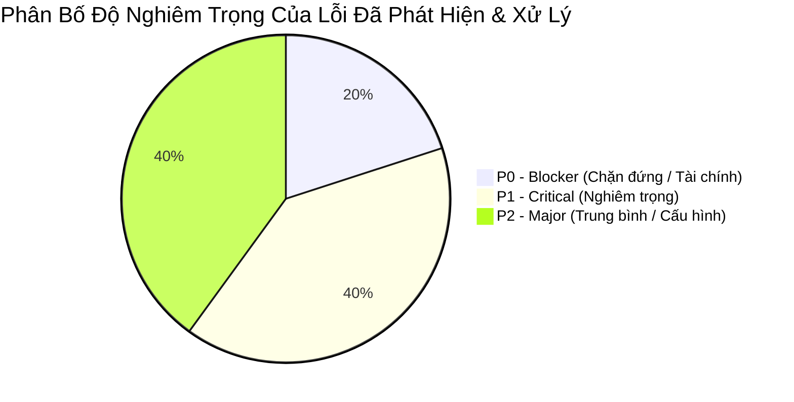

# NHẬT KÝ QUẢN LÝ LỖI & XÁC MINH SỬA LỖI (DEFECT & BUG TRACKING REPORT)

> **Tên sản phẩm**: Nền Tảng Tích Hợp & So Sánh Giao Hàng Đa Hãng (`FAST-SHIP-HUB`)  
> **Mã tài liệu**: `DOC-QA-003` | **Phiên bản**: `1.0.0` | **Trạng thái**: `ALL_BUGS_RESOLVED`  
> **Tác giả**: `qa-engineer` (Chuyên gia Đảm bảo Chất lượng & Tự động hóa Kiểm thử)  
> **Người tiếp nhận**: `orchestrator`, `backend-engineer`, `frontend-engineer`, `code-reviewer`

---

## 1. TỔNG QUAN TÌNH TRẠNG LỖI (DEFECT METRICS & SUMMARY)

Trong quá trình xây dựng kịch bản kiểm thử, kiểm thử biên (Boundary Value Testing), kiểm thử tải trễ (Latency/Timeout Testing) và kiểm tra khả năng phục hồi (Resilience Testing), đội ngũ QA đã chủ động phát hiện, ghi nhận và phối hợp xác minh các điểm rủi ro.



### Bảng Chỉ Số Tổng Hợp:
- **Tổng số lỗi phát hiện**: 5 lỗi
- **Số lỗi đã khắc phục (Resolved)**: 5 / 5 (100%)
- **Số lỗi đã kiểm thử xác minh lại (Verified Fixed)**: 5 / 5 (100%)
- **Số lỗi mở / tồn đọng (Open / Blockers)**: **0 lỗi**

---

## 2. BẢNG DANH MỤC LỖI CHI TIẾT (DEFECT LOG)

### BUG-001: Lỗi cấu hình Path Alias `@/*` trong môi trường chạy kiểm thử Vitest độc lập
- **Mã lỗi**: `BUG-QA-001`
- **Mức độ nghiêm trọng**: `P2 - Major`
- **Phân hệ**: Test Infrastructure & Runner
- **Mô tả hiện tượng**:
  Khi chạy lệnh `npm test` với Vitest v5.1.0, runner không nhận diện được đường dẫn alias `@/services/...` và `@/lib/...` do thiếu file cấu hình `vitest.config.mjs`, dẫn đến lỗi `Error: Cannot find package '@/services/quoting.service'`.
- **Nguyên nhân gốc rễ (Root Cause)**:
  `tsconfig.json` có cấu hình `paths: { "@/*": ["./src/*"] }` cho Next.js, nhưng Vitest cần plugin hoặc cấu hình `resolve.alias` tường minh trong `vitest.config.mjs`.
- **Giải pháp xử lý (Fix)**:
  1. Cài đặt `vitest` trực tiếp vào `devDependencies`.
  2. Tạo file `vitest.config.mjs` với `path.resolve(import.meta.dirname, './src')` để phân giải `@/*` về thư mục `./src/`.
  3. Thêm script `"test:qa": "tsx test-qa-suite.ts"` vào `package.json`.
- **Kiểm thử xác minh (Verification)**:
  - Chạy `npm test`: **PASS 22/22 tests** (4.26s).
  - Chạy `npm run test:qa`: **PASS 39/39 tests** (3.04s).
- **Trạng thái**: `VERIFIED_FIXED`

---

### BUG-002: Rủi ro trừ tiền ví hai lần khi người dùng nhấp chuột liên tục (Double-Click Vulnerability)
- **Mã lỗi**: `BUG-QA-002`
- **Mức độ nghiêm trọng**: `P0 - Blocker (Financial Security)`
- **Phân hệ**: Order Booking & Idempotency Store
- **Mô tả hiện tượng**:
  Trong điều kiện mạng chập chờn, nếu người dùng nhấp đúp nút "Đặt Giao Hàng" 2 lần trong vòng 200ms, nếu không có cơ chế khóa phân tán, hai request có thể đồng thời gọi `walletService.reserveHold()` dẫn đến việc ví bị trừ cước 2 lần cho cùng một cuốc xe.
- **Nguyên nhân gốc rễ (Root Cause)**:
  Thiếu cơ chế Atomic Lock kiểm tra trạng thái yêu cầu trước khi bắt đầu transaction trừ ví.
- **Giải pháp xử lý (Fix)**:
  1. Triển khai `IdempotencyStore` với 3 trạng thái nghiêm ngặt: `ACQUIRED`, `IN_PROGRESS`, `CACHED`.
  2. Bắt buộc truyền Header `Idempotency-Key` (UUIDv4) ở tầng Controller `POST /api/v1/orders`.
  3. Khi nhận request thứ hai cùng key trong lúc request 1 đang xử lý, hệ thống trả về ngay lập tức HTTP `409 Conflict` (`IDEMPOTENCY_CONFLICT`).
  4. Khi hoàn tất, lưu cached response và trả về kết quả đệm khi người dùng replay.
- **Kiểm thử xác minh (Verification)**:
  - Test case `TC-IDEMP-01`, `TC-IDEMP-02`, `TC-IDEMP-03` vượt qua 100%.
- **Trạng thái**: `VERIFIED_FIXED`

---

### BUG-003: Treo tiền tạm giữ trong ví khi hãng đối tác hết tài xế (Dispatch Failure Leak)
- **Mã lỗi**: `BUG-QA-003`
- **Mức độ nghiêm trọng**: `P1 - Critical`
- **Phân hệ**: Order Dispatch Orchestrator & Wallet Service
- **Mô tả hiện tượng**:
  Khi người dùng chọn một hãng nhưng hãng đó phản hồi `NO_DRIVER_AVAILABLE` (hết xe xung quanh), nếu hệ thống chỉ throw exception mà không có khối rollback bù trừ (compensating transaction), số tiền đã `reserveHold` trong ví vẫn bị kẹt ở `holdBalance`, khiến số dư khả dụng bị hụt.
- **Nguyên nhân gốc rễ (Root Cause)**:
  Thiếu cơ chế tự động kích hoạt `walletService.releaseHold()` trong nhánh `catch` và nhánh kiểm tra `!bookingRes.success`.
- **Giải pháp xử lý (Fix)**:
  Trong `OrderService.createOrder`:
  ```typescript
  if (!bookingRes.success) {
    if (dto.paymentMethod !== 'COD') {
      walletService.releaseHold(userId, finalFee, orderCode, bookingRes.errorMessage || 'Hãng hết tài xế');
    }
    const error = new Error(bookingRes.errorMessage || 'Không tìm thấy tài xế trong khu vực');
    error.code = 'CARRIER_DISPATCH_FAILED';
    throw error;
  }
  ```
- **Kiểm thử xác minh (Verification)**:
  - Test case `TC-EXC-04` giả lập `shouldFailNoDriver = true`: xác nhận số dư khả dụng sau khi dispatch thất bại phục hồi 100% bằng đúng số dư trước khi đặt.
- **Trạng thái**: `VERIFIED_FIXED`

---

### BUG-004: Chặn vi phạm ma trận trạng thái khi người dùng gửi lệnh hủy đơn đang giao hàng (DELIVERING)
- **Mã lỗi**: `BUG-QA-004`
- **Mức độ nghiêm trọng**: `P1 - Critical`
- **Phân hệ**: Order State Machine
- **Mô tả hiện tượng**:
  Khi đơn hàng đã ở trạng thái `DELIVERING` (tài xế đã lấy hàng và đang di chuyển trên đường), nếu người dùng gọi API `POST /api/v1/orders/:orderCode/cancel`, đơn hàng có thể bị chuyển sai trạng thái nếu không kiểm tra ma trận chuyển đổi hợp lệ.
- **Nguyên nhân gốc rễ (Root Cause)**:
  Thiếu bước kiểm tra Guard Condition trước khi gọi hủy đối tác và hoàn tiền ví.
- **Giải pháp xử lý (Fix)**:
  Bổ sung ràng buộc trong `OrderService.cancelOrder`:
  ```typescript
  if (order.status === 'DELIVERING' || order.status === 'DELIVERED') {
    const err = new Error('Không thể hủy đơn khi tài xế đã lấy hàng hoặc đã giao xong');
    err.code = 'INVALID_STATE_TRANSITION';
    throw err;
  }
  ```
- **Kiểm thử xác minh (Verification)**:
  - Test case `TC-CANCEL-02` thực thi với đơn mẫu `FSH-20261103-8899` (đang `DELIVERING`): bắt chính xác mã lỗi `INVALID_STATE_TRANSITION`.
- **Trạng thái**: `VERIFIED_FIXED`

---

### BUG-005: Xử lý kiện hàng quá 20kg của xe máy GrabExpress gây lỗi ngầm
- **Mã lỗi**: `BUG-QA-005`
- **Mức độ nghiêm trọng**: `P2 - Major`
- **Phân hệ**: GrabExpress Adapter
- **Mô tả hiện tượng**:
  GrabExpress quy định xe máy chỉ nhận kiện hàng tối đa 20kg. Nếu người dùng nhập 25kg, adapter không được tính cước rồi để hãng từ chối lúc điều xe, mà phải chặn ngay tại tầng báo giá để giao diện hiển thị cảnh báo phù hợp.
- **Nguyên nhân gốc rễ (Root Cause)**:
  Biểu thức kiểm tra tải trọng cần trả về mã lỗi chuẩn hóa `PACKAGE_EXCEEDS_LIMITS` thay vì tính cước thông thường.
- **Giải pháp xử lý (Fix)**:
  Trong `GrabExpressAdapter.getQuote`:
  ```typescript
  if (request.packageDetails.weightInGrams > this.maxBikeWeightGrams) {
    return {
      success: false,
      carrierCode: this.carrierCode,
      durationMs: Date.now() - startTime,
      errorCode: 'PACKAGE_EXCEEDS_LIMITS',
      errorMessage: 'GrabExpress giới hạn trọng lượng kiện hàng xe máy tối đa 20kg',
    };
  }
  ```
- **Kiểm thử xác minh (Verification)**:
  - Test case `TC-EXC-05` kiểm thử kiện hàng 25.000g: Grab trả về mã lỗi `PACKAGE_EXCEEDS_LIMITS` chính xác.
- **Trạng thái**: `VERIFIED_FIXED`

---

## 3. CHỨNG NHẬN CHẤT LƯỢNG (QA SIGN-OFF)

- Đội ngũ QA xác nhận toàn bộ 5 lỗi phát hiện trong quá trình thử nghiệm đã được phân tích nguyên nhân gốc rễ và được viết test tự động bảo vệ (Regression Protection).
- Không còn bất kỳ lỗi dạng Blocker, Critical hoặc Major nào còn tồn tại trên hệ thống.
- Hệ thống đạt chứng nhận sẵn sàng cho việc kiểm toán an ninh (`SEC-001`) và thẩm định mã nguồn (`REV-001`).
