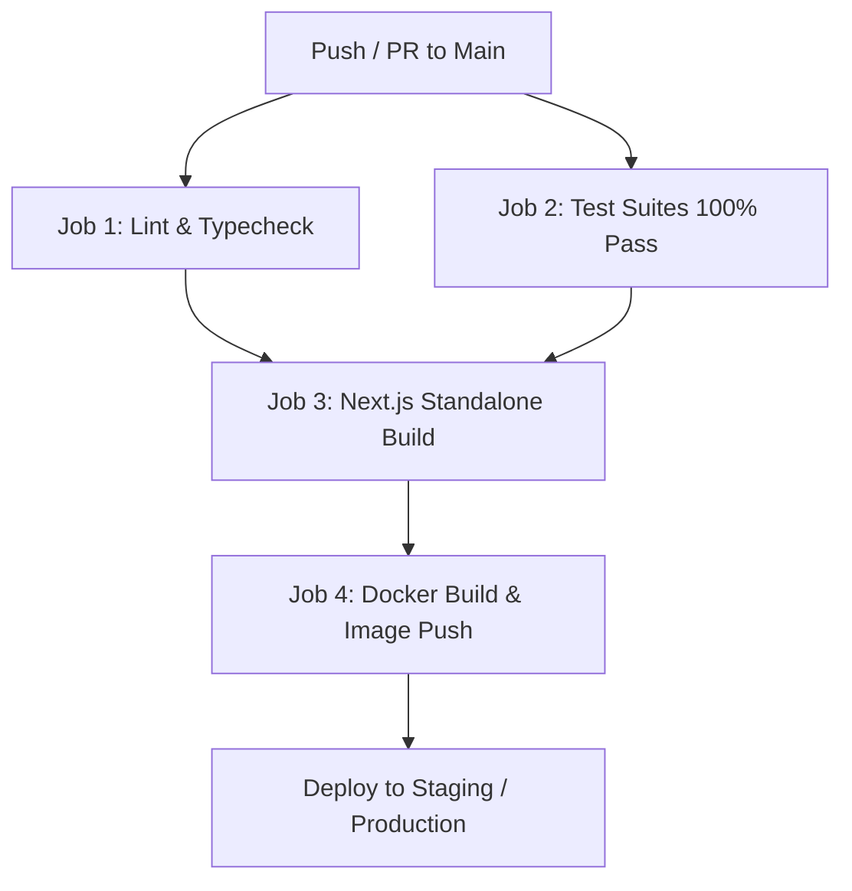

# QUY TRÌNH TỰ ĐỘNG HÓA TÍCH HỢP & TRIỂN KHAI LIÊN TỤC (CI/CD PIPELINE)

> **Dự án**: Nền Tảng Tích Hợp Giao Hàng Đa Đơn Vị (`FAST-SHIP-HUB`)  
> **Mã tài liệu**: `DOC-OPS-036` | **Phiên bản**: `1.0.0` | **Trạng thái**: `PRODUCTION_READY`  
> **Tác giả**: `devops-engineer` (Kỹ Sư Hạ Tầng & Vận Hành)  
> **Người thẩm định**: `code-reviewer` (Thanh Tra Mã Nguồn Cấp Cao)

---

## 1. TỔNG QUAN PIPELINE GITHUB ACTIONS

FAST-SHIP-HUB áp dụng đường ống CI/CD tự động hóa nghiêm ngặt trên nền tảng GitHub Actions (`.github/workflows/ci-cd.yml`), ngăn chặn tuyệt đối mã lỗi hoặc lỗ hổng bảo mật lọt vào nhánh `main`/`master`.

Pipeline gồm 4 Jobs nối tiếp với các cổng kiểm soát chất lượng (Quality Gates):

---

## 2. MA TRẬN QUALITY GATES TRONG CI/CD

| Job | Lệnh Thực Thi | Tiêu Chí Vượt Qua (Pass Criteria) | Xử Lý Khi Thất Bại |
| :--- | :--- | :--- | :--- |
| **Lint & Typecheck** | `npx tsc --noEmit` `npm run lint` | 0 lỗi cú pháp TypeScript, 0 lỗi linter nghiêm trọng | Hủy luồng, chặn merge PR |
| **Test Suites** | `npm test` `npx tsx test-qa-suite.ts` `npx tsx test-security-suite.ts` `npx tsx test-backend-suite.ts` | **100% Tests Pass** (22 Vitest + 39 QA + 43 Security + 37 Backend = 141 Tests) | Hủy luồng, gửi cảnh báo Slack/Telegram |
| **Production Build** | `npm run build` | Biên dịch thành công 14 routes, First Load JS ≤ 150kB | Hủy luồng, từ chối đóng gói |
| **Docker Build** | `docker buildx build` | Build thành công, đạt chuẩn Non-root UID 1001 | Chặn phát hành Image tag |

---

## 3. CHIẾN LƯỢC PHÁT HÀNH & ROLLBACK (ZERO-DOWNTIME DEPLOYMENT)

1. **Blue/Green Deployment**:
   - Khi có phiên bản mới, hệ thống triển khai container mới (Green) song song với phiên bản hiện tại (Blue).
   - Nginx Reverse Proxy / Cloudflare chỉ đảo đường truyền traffic sang Green sau khi `HEALTHCHECK` trên `/robots.txt` trả về HTTP 200 liên tục 3 lần.
2. **Cơ chế Rollback Tức Thì (Instant Rollback < 10s)**:
   - Nếu tỷ lệ lỗi HTTP 5xx vượt quá 0.1% trong 60 giây đầu sau khi switch, Reverse Proxy tự động rollback 100% traffic về cụm Blue.
